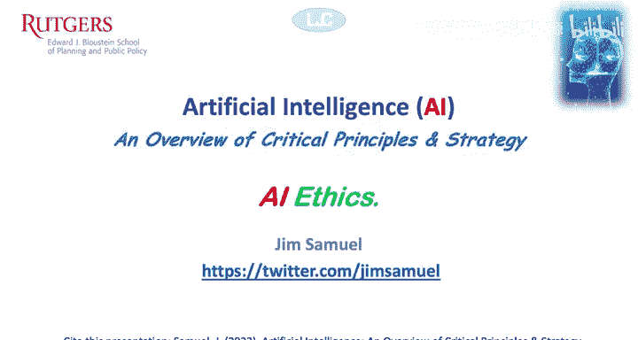
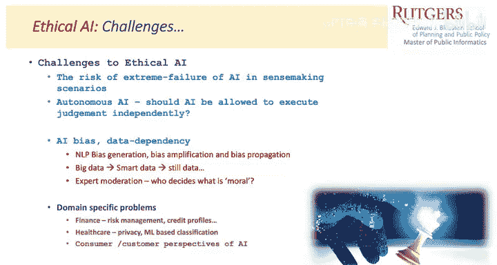

# 18：🤖 AI伦理的三个维度

在本节课中，我们将探讨如何从概念上理解人工智能伦理，并介绍一个三维度的分析框架，以帮助我们应对AI伦理带来的挑战，并制定机制来降低风险、保障个体与集体的福祉。

上一节我们讨论了AI伦理在各领域应用时面临的挑战。本节中，我们来看看如何从概念上构建对AI伦理的理解，以便取得进展、阐明机制并降低风险。

一种有效的方法是采用一个三维度的视角来审视伦理化的人工智能。

以下是AI伦理的三个核心维度：

1.  **人类主导**
    这意味着人工智能在人类建立的伦理框架内运作。人类是伦理框架的制定者，并且在任何伦理决策或场景中，人类实体都是最终的决策和控制实体。其核心是：**人类 > AI**。

2.  **AI增强的人类**
    这个维度与“人类主导”模型非常接近，尤其是在现阶段。其区别在于，我们并非将人类智能与人工智能在伦理问题上完全分离，而是讨论在涉及一个或多个AI执行业务或治理功能的环境中，人类智能可以借助额外的人工智能来增强和支持，以做出伦理决策。这可以看作是一个**人类 + AI辅助 > 其他AI**的协作场景。

3.  **AI主导**
    这是一个高风险模型。它指人工智能在特定场景中被赋予最终决策权，而人类干预被最小化或排除。虽然在某些资源有限、后果轻微的领域（如处理轻微违规行为）可能被考虑使用，但鉴于AI缺乏内在意义感，应尽量避免或最小化此模型的应用。其核心是：**AI > 人类**。

---

上一节我们介绍了AI伦理的三个维度。本节中，我们来看看在应用人工智能时，除了模型选择，还面临哪些具体的伦理挑战。

以下是几个关键的挑战：

*   **极端失败的风险**
    人工智能在确定性场景中能存储和处理更多信息，优化能力更强、更快，在许多方面超越人类。但由于AI缺乏**内在意义感**，当它们失败时，可能是完全、灾难性且难以想象的失败，其程度可能是人类智能永远不会犯的。这意味着我们必须警惕AI做出令人惊讶的极端决策和输出。

*   **自主AI的挑战**
    关键案例是武装无人机。如果无人机是自主的，其人工智能会利用计算机视觉识别目标，并自行评估打击成功的可能性及目标确认度，然后在没有额外人类输入的情况下做出决策。将这种自主权委托给人工智能武器系统是否公平、公正？这是一个伦理难题。在涉及可能剥夺人类生命的武器系统自主权问题上，最好投入必要资源，保留最终的人类控制和决策层。

*   **AI偏见**
    当今的人工智能高度依赖数据，其性能往往取决于输入系统的数据质量。从专家系统到机器学习，从大数据到2022年备受关注的**智能数据**（高质量、小规模的数据），数据依赖性依然存在。这意味着数据中的任何异常、弱点、缺口或质量下降都会对AI性能产生不利影响。随之而来的问题是：谁来决定什么是道德的？谁来决定什么是有偏见的、偏见的程度以及发现偏见后的纠正机制？

*   **领域特定挑战**
    除了技术、政策或哲学层面的一般性挑战，AI伦理还存在领域特定的问题。例如，在金融领域，涉及AI与风险管理、AI与信用评分的伦理问题；在医疗保健领域，存在隐私挑战和基于机器学习的分类挑战。此外，还有消费者如何看待AI的问题。如果他们不了解AI，可能无法获得最佳利益；如果他们（无论合理与否）害怕AI，可能也无法欣赏或使用由AI驱动的产品或服务。

---

本节课中，我们一起学习了理解AI伦理的三维度框架：**人类主导**、**AI增强的人类**和**AI主导**。我们探讨了应用AI时面临的挑战，包括极端失败的风险、自主AI的伦理困境、数据依赖导致的AI偏见，以及各领域特有的伦理问题。理解这些维度和挑战，是朝着构建更负责任、更可信赖的人工智能系统迈出的重要一步。