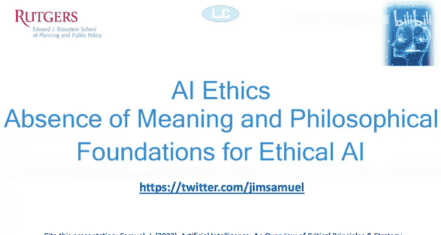
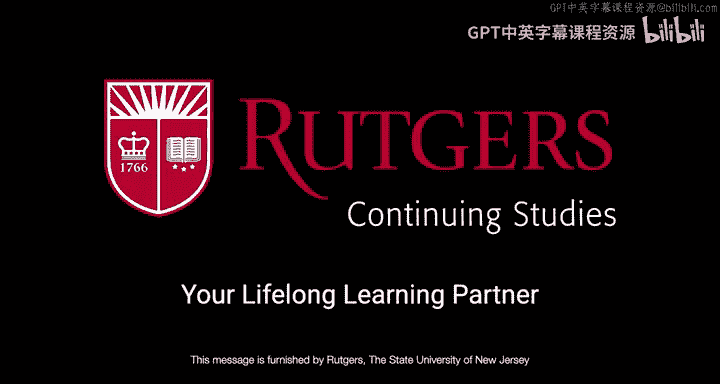

#  19：AI伦理中意义的缺失 👨‍🏫

在本节课中，我们将探讨人工智能伦理领域的一个核心问题：意义的缺失。我们将分析AI缺乏人类意义理解能力的哲学根源，并讨论这对构建伦理AI系统意味着什么。

## 概述

上一节我们介绍了AI伦理的广泛范畴，本节中我们来看看其根源性问题。AI伦理面临的根本挑战之一，在于人工智能本身缺乏哲学基础，尤其是对人类“意义”的理解能力。

## AI伦理的哲学基础缺失

伦理本质上是哲学的一个分支，涉及价值观、道德观以及是非对错的区分。因此，伦理AI需要建立在人工智能自身的哲学基础之上。

然而，我们既未就“伦理”的定义达成一致，也未就“智能”乃至“人工智能”的内涵形成共识。某种程度上，由于机器和电子技术的本质限制，讨论“人工智能”这个短语可能比在哲学上界定“智能”本身更为容易。

但核心观点是：**我们缺失了人工智能的哲学基础，也缺失了伦理AI的哲学基础**。

当前存在过度强调AI应用开发和编码的现象。每个人都想编写下一个伟大的机器学习算法，或开发略微改进的优化数学模型。但我们缺失了本应置于首位的哲学基础，而这些基础本应指导AI应用和科学层面的发展。

## 人工智能：没有穿衣服的皇帝 🫅

以下是AI被视为“皇帝”却无实质的一个根本问题，许多开发者、公司甚至政府领导者都忽略了这一点。

人工智能就像一个没有穿衣服的皇帝。这并非因为AI自封为帝，而是被信息不灵通的人以及所谓自封的、对智能或人工智能缺乏哲学把握的“专家”捧上了帝位，或被视为未来的皇帝。

缺失的组件是**人类意义**。人工智能不具备人类意义。因此，在某种意义上，可以说人工智能是“无意义”的。这并非双关语，不是说AI没有价值，而是指它不具备类人的意义理解能力。

人工智能所能持有的，是一种**合成意义**。

## 合成意义 vs. 人类意义

我重申：以我们当前的技术、算法、优化机制和数据输入，人工智能无法、也不具备类人的意义构建能力。

它所能做的是持有合成意义。所谓“合成意义”，我指的是**数字比特和字节束之间的概率关联**。

无论我们称之为人工智能的是文本到文本、文本到情感、文本到图像、图像到文本，还是任何变体（声音到文本、文本到声音、声音到图像等），对AI而言，最终每个图像、声音、文本片段都被简化为比特和字节束。

我们所做的，是在这些比特和字节束之间建立概率关联。然后，任何新的输入进来，我们将其与存储的模型进行匹配，并基于此提供输出。

基于概率关联的力量，让我举例说明：

如果一组特定的变量配置导致胜利，另一组配置导致失败，人工智能或许能正确分类一支队伍何时会赢。但它不理解“胜利”的意义，也不理解这些变量的意义。它感受不到喜悦，也感受不到悲伤。胜利和失败对它而言是一样的，只是比特和字节束之间机械的概率关联。

因此，人工智能无法像人类智能那样，拥有内在的正义感或公平感。人工智能也没有内在的道德指南针或身份认同感。

## 道德指南针的缺失

过去几分钟我所阐述的内容，是经过多年、甚至数十年研究这些概念才达到能够清晰表述的程度。但如果这些哲学基础缺失，我们就很容易被科学层面的惊人发展所席卷。

例如，生成对抗网络等新技术可以实现从文本到图像的转换。这意味着你输入文本（谷歌等公司已推出相关技术），如果你提供“黄色雨伞”这样的文本，AI就能生成一幅黄色雨伞的图像。

这看起来像是AI理解了你的话，但实则不然。它不具备类人的意义理解能力。它所做的是将文本转换为比特和字节束，并找到与“黄色雨伞”概率关联的比特和字节束。

**因此，人工智能中缺乏道德指南针。它不像人类那样存在道德指南针。** 我再次强调，你仍然可以有合成意义，但我们必须明白，这与人类的感知能力截然不同。

## 一个思考：AI能理解“金规则”吗？

我有个问题：如果下面这句引文适用于人与人之间（或许在有限意义上也适用于AI对人，但可能不适用于人对AI），你如何教导AI什么是公平？

《圣经》中有这样一句话：“**你们愿意人怎样待你们，你们也要怎样待人。**”

当我们阅读它时，这句话内涵丰富、充满意义。它能激发想象、唤起意义、引发理性思考、促发人类智能中的伦理行为，因为我们可以理解文本，能够思考自己和他人。这讲得通，并且我们也认为，我们希望别人如何对待我们，我们就应该如何对待别人，这是公平的。我们也理解人、机器、动物等之间的区别。

那么问题来了：**这样一句话，对人工智能而言，能否产生与对一个或多个人类智能相同的意义？**

当然，有可能将这句话的合成形式灌输或训练给机器人。但其中理解的复杂性和深度将是缺失的。我并不是说，未来某天人工智能不可能拥有如此广泛、密集的合成意义阵列，以至于在感知和推理能力上媲美人类。我没有说那是不可能的。

我要说的是，**其本质是完全不同的**。即使未来某天，在奇点、有感知的AI或自我意识的AI出现时，我们假设性地达到了那个阶段，拥有了那些东西，它仍然与人类对伦理、道德的理解非常不同。

因为从哲学上讲，AI中意义构建的基础是不同的。一个基于比特和字节束之间的概率关联，另一个则基于经验和存在性真理。人类的感知可能因人、社区、国家而异，但它基于经验现实。我们体验痛苦，胜利时感到喜悦，失败时面临悲伤。感知和意义构建参与其中，并且是真实的。

因此，这在哲学上是根本不同的。

## 总结

本节课中我们一起学习了人工智能伦理中“意义缺失”的核心问题。

因此，这里的结论性评论应该是：**我们需要为人类福祉而努力构建AI伦理。我们需要理解AI在伦理方面的局限性。我们需要确保在AI伦理及所有伦理决策场景中，是人类处于主导地位，理想情况下是AI增强的人类处于主导地位。**

希望本次课程有助于澄清和激发大家对AI伦理的进一步思考。我强烈建议大家阅读关于“适应性认知契合”的论文，它能让你了解如何利用人工智能来增强人类智能，以改善复杂信息场景下的表现。

我们下次课再见。谢谢。