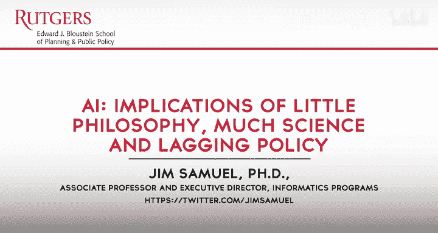
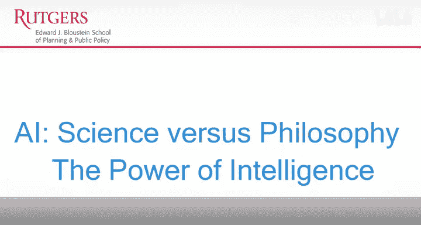

# 20：AI科学vs哲学：智能的力量 🤖🧠

在本节课中，我们将探讨人工智能的现状，分析当前过度强调编码应用、对AI哲学本质理解有限以及政策滞后的局面。我们将审视AI的各种定义，并深入讨论将机器智能与人类智能进行对比时所面临的根本性挑战。

## 概述：AI的现状与挑战

当前人工智能领域呈现出一种不平衡的发展态势。一方面，在编码和应用开发上投入了巨大精力，甚至可以说是过度强调。另一方面，包括一些主要AI公司在内的许多创造者，对人工智能的哲学和本体论本质理解相对有限。与此同时，相关政策制定严重滞后，仍在沿用过去应对技术创新的速度和方式，试图追赶AI的发展步伐。这种模式很可能无法应对AI带来的全新挑战。

## AI的定义演变 📜

上一节我们概述了当前AI领域的整体挑战，本节中我们来看看人工智能这一概念本身是如何被定义的。

自20世纪50年代麦卡锡提出“人工智能”这一术语以来，其定义就如丛林般多样。最初的基础概念是计算机执行某些任务并展现出类人智能输出或成果的能力。然而，麦卡锡后来也澄清，人工智能并不预期是对人类智能的模拟。

近年来，定义变得更加具体。一些定义本质上是技术性的，完全聚焦于我们所称的人工智能在计算上的能力，以产生人类认知的结果或功能，例如人类听和解读音频、看并解读图像、视频和现实场景的能力。

以下是几个值得关注的定义：

*   **信息系统领域的定义**：由Arry等人提出，认为人工智能指的是机器执行我们通常与人类智能相关联的认知功能的能力，这些功能包括感知、推理、学习、与环境互动、解决问题。
*   **综合技术视角的定义**：在一篇即将发表的论文中，我们将人工智能描述为**一系列技术、数学和统计模型以及海量多样化数据的集合**。从这个视角看，人工智能在某种意义上，是人类对与一个包含多种技术的系统相关联的智能的感知。

第二个定义部分还提到了其目的，即**寻求模仿或超越人类智能功能或能力**。这意味着为特定目的设计的人工智能，在特定参数内，可能比人类表现得更好。例如，在高速股票交易中，算法凭借速度和一致性，其能力完全超越了人类手动操作的极限。

## 核心挑战：何为“智能”？❓

我们了解了AI的各种定义，但一个根本问题依然存在：我们比较的基准——“人类智能”——本身是什么？

这让我们陷入一个困境：我们仍在试图定义人工智能，同时意识到一些经典问题尚未解决。例如，S在其著名论文中提出的关于智能极限的问题指出，我们尚未清晰地描述智能的本质、特性和构成。尽管定义众多，但我们缺乏具有说服力且能跨场景应用的结论性定义。

当我们使用“超越人类智能功能”这样的表述时，问题变得更加复杂。人类智能功能本身就是一个尚未有定论的研究领域。因此，我们谈论的是开发性能优于一个抽象标准的人工智能。我们开发的AI非常具体，可以测量其时间、所需计算资源、涉及的计算程度。然而，与之比较的基准——人类智能——却是一个抽象概念。

目前的人工智能以孤立的方式工作，这意味着我们距离通用人工智能（AGI）甚至超级人工智能仍然非常遥远。我们拥有的是狭义人工智能。虽然某个AI可能在围棋上胜过人类，另一个AI在另一项功能上优于人类，但与人类智能相比，人类侧的处理是抽象的，因为它能同时处理多种信息，并以远超当前AI技术水平的方式进行整合。

## 概念差异：感知、推理与学习的本质 🔄

上一节我们讨论了定义“智能”的抽象挑战，本节中我们来看看这种差异在具体认知功能上的体现。

当我们审视“感知、推理、学习、与环境互动”这类定义时，会遇到类似问题。

*   **感知**：人类的感知，甚至动物的感知，与我们赋予人工智能的“感知”有着天壤之别。
*   **推理**：以国际象棋或围棋为例。人类下棋时结合了推理和直觉，有时甚至靠运气尝试，这都是人类智能的一部分。而机器下棋，并非抽象意义上的“推理”，而是**计算**。早期的程序本质上是机械的，它列出每个阶段的所有排列组合，并选择导致最佳结果的走法。如今的程序基于**机器学习方法**，AI可以通过概率模型学习下棋。但这仍然是第二部分“机械”的，它使用了不同的方法（概率逻辑而非确定性逻辑），但基础仍是数学化的。这与人类实体的推理方式截然不同。

对于人类实体，胜利或失败伴随着情感（喜悦或沮丧）。对计算机而言，胜败没有意义，它只是被编程去实现的一个数字过程。

因此，当我们谈论推理、学习、感知时，人工智能确实在做这些事，但其意义与人类智能的方式大相径庭。在部署人工智能的早期阶段，这些差异或许不是大问题，但当我们探讨AI如何与人类智能互动、在AI密集型环境中人类智能应处于何种位置时，这些根本差异就成为了亟待应对的重大挑战。

## 总结

本节课我们一起探讨了人工智能领域当前科学、哲学与政策之间的脱节。我们回顾了AI定义的演变，并深入分析了将机器智能与人类智能进行比较时面临的核心困境：即“智能”本身尚无统一定义，且AI的“感知”、“推理”、“学习”在本质上与人类体验这些功能的方式存在根本差异。这些差异在AI与人类深度互动的未来场景中，将成为必须认真思考和解决的关键挑战。