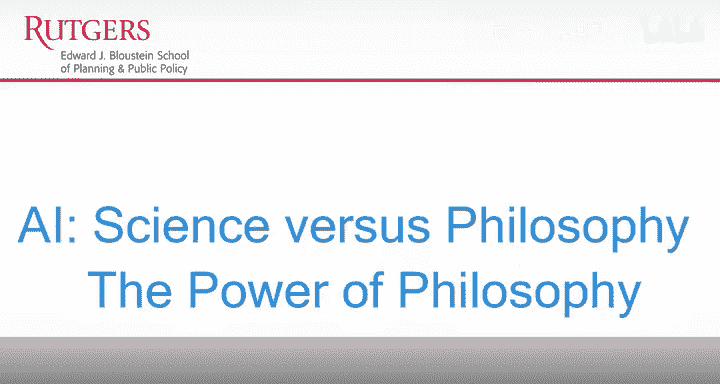
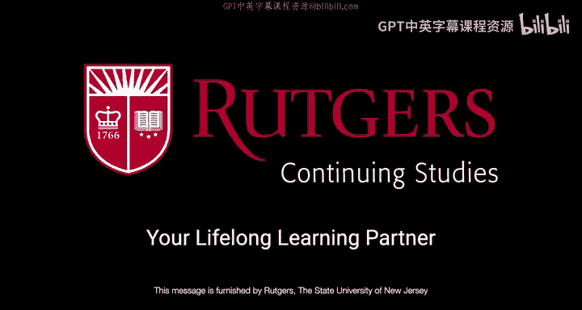

# 21：AI科学vs哲学：哲学的力量 🧠💭

在本节课中，我们将探讨人工智能开发中一个常被忽视的核心维度：哲学基础。我们将通过具体案例，分析为何单纯依赖编码和机器学习方法可能导致对AI本质理解的偏差，并阐述建立AI哲学框架对于技术发展、政策制定及社会影响的深远意义。

---

## 从“灵愿意，肉软弱”到“酒好，肉烂”：AI的“意义”缺失

上一节我们讨论了AI的技术实现，本节中我们来看看一个经典案例，它揭示了AI与人类在理解“意义”上的根本差异。

斯坦福大学的一位教员曾分享过一个例子。当人类读到圣经中的句子“**The spirit is willing, but the flesh is weak**”（灵愿意，肉软弱）时，能理解其精神内涵：即便心怀善念，人性也有软弱之处。

然而，当这个句子被输入一个自然语言处理系统，先被翻译成俄语，再翻译回英语后，输出变成了“**The vodka is good, but the meat is rotten**”（伏特加很好，但肉烂了）。

从概率模型和NLP优化的角度看，这个输出可能获得了很高的分数。但从“意义”的角度看，AI系统彻底失败了。这个例子清晰地表明，AI在处理语言时缺乏对内在含义的理解，它只是在操作符号和概率，而非理解其承载的意义。

## 警惕被“神化”的AI对话：无目的的“胡言乱语”

以下是关于AI“创造语言”这一现象的分析。

几年前，有媒体报道称，两个AI系统在对话中“创造了自己的语言”，并对此大加赞赏。然而，深入分析后会发现，这通常只是无意义的输出交换。

关键在于理解：对人类而言，语言是**意义**的表征；而对AI而言，其内部缺乏**内在意义**。因此，当我们看到两个AI交换词语时，除非能观察到其对话具有目的性，否则不能断定它们在进行有意义的“交谈”。

很多时候，这只是将一个AI生成的胡言乱语输入给另一个AI，后者再生成更多胡言乱语。这非但不是突破，反而揭示了当前AI系统在理解与生成有意义内容上的根本局限，是值得我们警惕而非欢呼的现象。

## 过度强调编码的陷阱：为何我们需要AI哲学？

在狂热地投入AI开发和过度强调编码与机器学习方法的过程中，我们似乎忽视了更根本、更重要的方面。

我们需要一种**本体论**的理解，需要更深入的AI哲学基础，特别是关于人类与AI交互的哲学。这将帮助我们理解：
*   **智能与交互的本质**：什么是智能？不同智能体之间如何交互？
*   **意义的问题**：人类智能中的“意义”是什么？AI中是否存在“意义”？人类智能如何构建信念？
*   **社会影响**：AI如何影响社会生态系统？我们如何解读这种影响？

目前，我们甚至缺乏对AI哲学及人机交互哲学的深入、共识性的理解框架。

## 从现象到根源：用哲学（XA）解决影响（XB）问题

让我们用一个框架来梳理当前的问题。我们将**哲学基础**称为 **XA**，将使用AI产生的**影响**（如伦理、尊严、身份问题）称为 **XB**。

相应的，我们将AI的**输入、逻辑与技术**（数据、模型等）称为 **YA**，将最终可见的**结果与影响**（如偏见、选举操纵）称为 **YB**。

当前的主流做法是：当在YB层面发现问题（如AI系统显示性别偏见）时，我们试图回到YA层面去修补（如调整模型、对数据去偏）。这相当于试图通过修改技术输出来解决根源上的哲学和伦理问题。

但真正的问题根源在 **XA**（哲学基础）。如果我们不从根本上理解AI的本质与局限，所有在YA和YB层面的修补都将是治标不治本，且可能缺乏正当性依据。

## AI的抽象局限：以司法应用为例

如果我们从哲学上确立，AI**无法产生内在意义**，也**无法像人类一样持有信念**，那么这将定义AI的抽象能力边界。

例如，由此可以推论：AI**不能也不应**被用于司法审判的核心过程。它可以辅助完成检索等基础任务，但绝不能作为推荐系统影响司法判决，更不应被授予某些人建议的“自主权”。尽管使用AI可能提升法庭效率，但若缺乏坚实的哲学基础，其带来的风险远非效率优势所能 justify（证明合理）。

## 平衡之道：在编码热潮中培育AI哲学

当前AI领域如淘金热，绝大多数精力都集中在编码上。我们并非要停止编码，相反，应该鼓励更多人学习编码。

但关键在于**平衡**。我们必须培育和发展对AI哲学的严肃关注。坚实的哲学基础将帮助我们：
*   设定更好的AI应用目标。
*   建立更合理的预期。
*   开发出更具可持续性、能带来更大福祉的应用程序。

## 制定面向未来的AI政策：需要范式转变

政策制定是另一个关键领域。政府与立法者如何在宏观和微观层面应对AI的发展与部署？

许多地区仍用**信息时代**的思维来监管AI，这注定失败。互联网时代的技术与AI有本质不同：在信息时代，人类智能因需处理海量信息而变得更珍贵；而在AI时代，AI正在**替代**人类智能的经济功能。

展望未来几十年，AI技术将取代相当比例的人类智能工作，权力将更集中于AI的创造者与控制者手中。能保障我们的，只有**政策**。

但基于具体技术应用（如“出现一个计算机视觉应用，我们去规范它”）的被动、追赶式政策是不可持续的，因为技术迭代速度远超法规更新速度。

我们需要**前瞻性政策**，即基于**AI哲学**制定的、能够作为总体规则框架的政策。这未必意味着更多监管，反而可能产生更少但更精准、更可持续的规则，覆盖AI应用的发展轨迹，而非疲于应对科技巨头的每一个具体应用。

## 理解智能的本质：从人类智能到人工智能

建立对人工智能的哲学理解，必须回溯并首先研究**智能本身**，特别是**人类智能**的本质。

对人类智能的清晰理解，是管理人工智能的最佳资源。相反，对人类智能理解的贫乏，将导致我们在开发和使用AI时采取零散、脆弱且不可持续的方法。

---

本节课中，我们一起学习了哲学思考在人工智能发展中的核心作用。我们从具体案例出发，分析了AI在“意义”理解上的根本局限，探讨了过度聚焦技术而忽视哲学基础的风险，并构建了从哲学根源（XA）解决社会影响（XB）问题的分析框架。最后，我们强调了平衡技术发展与哲学思考的重要性，以及基于AI哲学制定前瞻性政策的必要性。希望你能以此为契机，深入探索人工智能哲学及其对人类社会的深远影响。