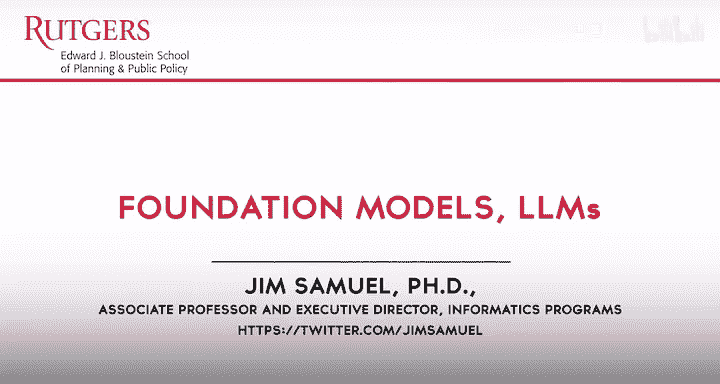

# 22：基础模型与大型语言模型 🧠

在本节课中，我们将学习人工智能领域当前最热门的话题之一：**基础模型**与**大型语言模型**。我们将探讨它们的核心概念、工作原理、当前发展状况以及未来展望。

---

## 什么是基础模型？🏗️

上一节我们介绍了课程主题，本节中我们来看看什么是基础模型。基础模型是一种通用技术，请不要与ChatGPT中的“GPT”混淆。

基础模型可以被理解为：**对世界上某部分数字化知识的大规模、人工智能驱动的概率性表示**。这个定义包含几个关键部分：

*   **大规模**：模型体量巨大。
*   **人工智能驱动**：模型具备智能。
*   **概率性表示**：模型以概率形式关联信息。
*   **世界的数字化知识**：模型的训练数据来源于所有可数字化的信息，如研究论文、维基百科文本等。

任何可以数字化的数据，无论是文本、视频、图像还是声音，都可以作为基础模型的输入训练数据。我们称之为**数字领域数据**。

模型的效能很大程度上取决于输入数据的质量。如果原始数据包含偏见，模型不仅会反映，甚至可能放大这些偏见。

---

## 基础模型是如何构建的？⚙️

理解了基础模型的定义后，我们来看看它的构建流程。这个过程的核心是一个数学和统计过程。

以下是构建和应用基础模型的主要步骤：

1.  **数据输入与分词**：原始数字领域数据（如文本）被输入系统。文本不会以文字形式被处理，而是被转换成称为**令牌**的数值表示。每个独特的词都有一个独特的数字标识。
2.  **Transformer处理**：这些数值令牌通过**Transformer机制**进行处理。该机制的核心是“注意力”机制，它能出色地捕捉一个词与周围词语之间的**概率关联**。正如自然语言处理中的一句老话：“观其伴，知其词”。
3.  **生成基础模型**：经过Transformer处理，输出原始的、基线化的基础模型。这是一个在大量通用数字信息上训练出来的大型复杂模型。
4.  **微调与对齐**：原始基础模型需要进一步加工才能成为用户可用的应用。这通常通过额外的AI技术模块实现，例如**基于人类反馈的强化学习**。这个过程用于过滤输出、设定条件，使其更安全、更可用、更符合设计者的预期。
5.  **应用层**：经过微调后，模型可以支撑像Bard、Claude等各种应用程序，这就是最终用户交互的界面。

**核心公式/代码概念**：
*   **分词**：`文本 -> 数值令牌序列`
*   **注意力机制**：计算词与词之间的关联权重。

---

## 基础模型的两个核心概念 🔑

在了解了构建流程后，我们需要掌握基础模型的两个关键特性：同质化与涌现。

*   **同质化**：基础模型作为一个通用的智能基础。一旦投入巨大资源训练出一个稳健的基础模型，它就可以作为广泛的、特定目的的智能基础来使用。例如，一个用于编程的基础模型可以成为增强人类编码能力的智能空间。
*   **涌现**：这是常被神秘化的概念。**涌现**是指基础模型随着规模扩大，常常会表现出新的、意想不到的能力。这是因为我们输入的数据量巨大、范围极广，在创建模型时无法预测所有可能的信息连接和逻辑组合。因此，发现新能力是预期之中的。企业应将“投资于涌现”作为AI竞争战略的一部分，积极探索模型未被预见的创新用途。

---

## 当前发展现状与未来展望 🌊

现在我们已经理解了基础模型的核心概念，本节我们来看看它们如何塑造了AI的当前图景与未来。

2022年11月OpenAI发布ChatGPT是一个转折点，它极大地提升了公众认知和实用价值。当前，整个AI领域都围绕着基础模型和大型语言模型处于兴奋、增长和巨额投资的状态。

展望未来，虽然带有推测性，但这是一个基于信息的、有根据的视角：基础模型和LLMs将继续是AI发展的核心驱动力。随之而来的是一系列需要深思的主观议题，例如：
*   人工智能的伦理
*   基础模型的伦理
*   模型的开发权与所有权归属
*   可接受的开源程度应该是多少

这些问题没有标准答案，本课程的目的之一是激发概念性思考。希望学习者能在此基础上形成自己的观点。

---

## 总结与结语 📝

本节课中，我们一起学习了基础模型与大型语言模型的核心知识。

我们首先定义了**基础模型**——一种对数字化知识的大规模概率性智能表示。然后，我们剖析了其构建流程：从**数据分词**，到通过**Transformer机制**处理，生成原始模型，再经过**微调对齐**，最终形成用户应用。我们重点探讨了基础模型的**两个核心概念**：作为通用智能基础的**同质化**，以及随着规模扩大产生新能力的**涌现**现象。最后，我们回顾了它们引发的当前AI浪潮，并展望了其未来发展及伴随的伦理与治理挑战。

掌握这些**概念性基础**至关重要，因为相较于快速迭代的代码和具体技术，这些核心概念具有更长的“保质期”，能帮助你在未来十年更好地理解、抽象和应用不断演进的AI技术。