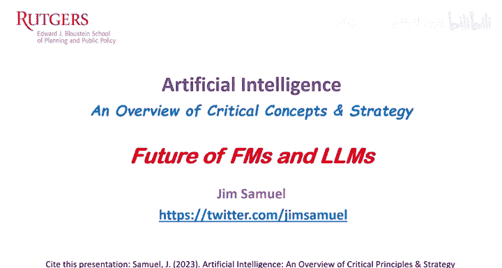
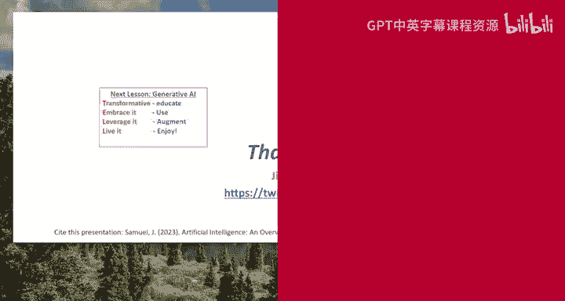
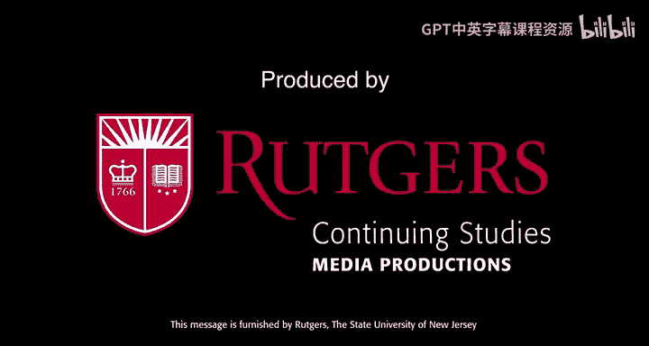

# 24：基础模型与大语言模型的未来 🚀

在本节课中，我们将探讨基础模型和大语言模型的当前发展格局与未来路径。我们将分析激烈的行业竞争、技术发展的挑战与机遇，并讨论监管、开源以及人工智能对社会的影响等核心议题。

## 当前发展格局：激烈的竞争与“淘金热”

上一节我们介绍了人工智能的基本概念，本节中我们来看看其当前的发展态势。基础模型和大语言模型开发领域正面临极端竞争。

一个值得注意的现象是，一些备受尊敬且极具智慧的人士曾呼吁暂停人工智能模型的开发，例如埃隆·马斯克。然而，就在签署并公开“暂停开发”倡议后的几个月内，他新成立的公司XAI就发布了自家的基础模型。这揭示了竞争压力的本质：即使那些公开呼吁暂停的人，也难以抗拒参与开发的冲动。

在终端用户层面的AI应用领域，则出现了一场“超活跃的淘金热”。

以下是当前格局的几个特点：
*   **基础模型层面**：开发成本高昂，需要巨大的计算和资源投入。尽管有许多公司投资，但由于资源限制，参与者的数量相对较少。
*   **应用层面**：建立在大型语言模型之上的终端AI应用数量激增，发展极为迅猛，如同“淘金热”一般。
*   **市场效应**：这种环境将导致“丛林效应”，遵循适者生存法则。许多不好的公司和产品会被淘汰，但有时好的想法也可能因为时机、投资或曝光度不足而夭折。

当前的场景既引人入胜又充满参与感。但如果你身处其中，需要学会在必要时“脱离接触”，保持专注。在追求人工智能竞争优势时，**关键战略是明确你希望AI为你做什么，并培养排除一切无关干扰的艺术**。

## 面临的挑战：质量、风险与监管

随着技术飞速发展，我们不可避免地会面临一系列挑战。

我们正处于第四次工业革命的开端。在任何工业革命或技术革命的早期阶段，都会出现质量问题，也会涌现新的风险，这是可以预见的。

监管是必要的。但问题在于：**由谁来制定这些监管规则？监管的最终目标是什么？**

我们需要的是支持开源、将人工智能的控制权赋予人民的监管，而不是那些帮助权力集中于大公司或特定政府机构、让小企业和个人难以生存的监管。不幸的是，传统的技术监管方式往往导致后者。如果AI监管重蹈覆辙，将是一场巨大的悲剧。

## 未来展望：专业化、人机协作与权力归属

展望未来，我认为竞争会随着时间的推移而逐渐缓和。部分原因在于，公司将专注于开发专业化的基础模型和LLM。维护和更新宽泛的通用模型成本，将远高于开发针对特定领域或功能的模型和应用。

在人机协作方面，我的预测是：
1.  **替代**：基础模型和大型语言模型应用将替代从初级到中级水平的普通人类工作者。我们需要接受这个事实。
2.  **增强**：对于中级水平的工作者，这些技术将起到增强作用。
3.  **辅助**：对于专家级工作者，在处理高度专业化、复杂的任务时，这些模型主要扮演辅助支持的角色。

关于监管，我认为监管将会增加。**如果监管的方向是将权力赋予人民，让人们能够控制GPTs这类通用人工智能技术和应用，那么更多的监管就是有益的**。公司可以营利，但需要在开源和专有之间取得平衡，且这个平衡不应由从技术中资本化的公司决定，而应由人民及其真正的代表来决定。

## 驳斥谬误：AI本身不会毁灭人类

关于人工智能的一个普遍但错误的说法是：**人工智能将导致人类灭绝**。这种叙事在逻辑上不成立。

人工智能本身，无论是基础模型还是大语言模型，都不会毁灭人类。它就像计算机、木材、金属或任何其他通用技术一样。**真正造成区别的是你如何使用它**。确实存在可能性，即控制AI的强大决策者可能利用它做坏事。如果任由一小群强大的富人不受约束地控制AI，他们造成巨大破坏的潜力就很高。

因此，关键在于权力的归属。在人工智能时代，“知识就是力量”这句格言依然成立。为了平衡权力，大多数通用AI技术必须是开源的。

## 解决方案：开源、数据所有权与教育

因此，人工智能（尤其是未来几年由基础模型、大语言模型及相关技术驱动的发展）的解决方案在于：

1.  **开源AI**：包括数据和方法，大约80-90%应开源，其余10-20%可作为专有层叠加其上。
2.  **个人数据所有权**：用于训练人工智能的数据必须被声明。个人应拥有其数据的所有权，明确知晓其智力成果是否及如何被用于AI开发。
3.  **广泛的AI教育**：需要从学校到职场，对公众进行全面的AI教育，包括其哲学、原理，并消除其神秘性，让人们学会如何利用AI增强自身。

未来监管必须有一个主导理念：**权力归于人民**。人工智能监管的试金石应该是：这项监管是否赋予人民权力？是否保护人民？是否确保透明度？是否让人民了解技术？我们必须最大化透明度。

## 总结与下节预告

本节课中，我们一起探讨了基础模型与大语言模型的竞争现状、面临的挑战与风险，以及开源、监管和权力归属等核心议题对于塑造AI未来的重要性。

下一节课将是本课程的最后一讲，我们将讨论生成式AI。我们将探讨生成式AI的概念，以及它将如何塑造我们的未来。敬请期待。