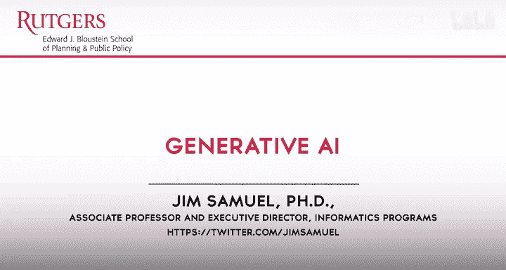

# 25：生成式AI简介 🤖

在本节课中，我们将要学习生成式人工智能（Generative AI）的核心概念、工作原理、模型类型、应用场景及其必要性。生成式AI是当前AI领域最引人注目的发展之一，它能够创造文本、图像、代码等多种形式的新内容。理解它对于把握当下及未来十年的AI战略至关重要。

在上一节关于基础模型和大语言模型的课程中，我们探讨了AI的底层架构。本节中，我们将聚焦于这些模型如何演变为能够“创造”的生成式AI。

## 什么是生成式AI？ 💡

生成式AI是一类能够产出文本、图像、视频、代码、语音、决策与行动或其组合的人工智能。

过去，我们习惯的人工智能输出通常是数据点或特定动作（如下棋）。然而，近几年来，出现了一类新的人工智能，它能够生成海量的文本、逼真的图像和视频，甚至编写可运行的代码。其输出在人类看来，大部分情况下是连贯且有意义的。

人工智能自20世纪40年代起就开始产生输出。图灵测试的核心就是判断AI的输出能否被人类识别为非人类产物。**生成式AI的突破在于，它在输出的数量、复杂性和连续性上跨越了一个关键阈值**。正是这一跨越，催生了当前的生成式AI浪潮及其广泛的应用与创新。

为了更直观地理解，请看下图，它是对生成式AI工作流程的简化表示：

## 生成式AI如何工作？ ⚙️

上图清晰地展示了生成式AI的构成与工作流程。接下来，我们详细拆解这个过程。

首先，我们有**基础模型**，这是我们在上一课中讨论过的核心。基于这些基础模型，我们开发出各种**AI应用**。

这些AI应用接收**人类（或其他智能体）的输入**，这通常被称为“提示”（prompt）。提示作为输入，通过应用程序被传递到某个经过微调的基础模型版本中。

模型内部进行处理，最终生成一系列**数字令牌（tokens）** 作为输出。这些令牌随后被解码，以文本、图像等形式呈现给我们，成为最终的**AI输出**。

关于输入和输出，有几点需要说明：
*   **输入**：最常见的是文本和语音。你也可以输入图像、代码或视频。从概念上讲，输入形式没有限制。
*   **输出**：同样可以是文本、图像、代码、视频等多种形式。
*   **输入源**：图中标注为“人/其他”，是因为未来不仅人类会与AI交互，人类设置的**其他智能体（AI Agent）** 也可能在特定条件下自动向生成式AI提供输入。

## 生成式AI模型类型与应用 🛠️

生成式AI模型主要根据其处理的数据类型进行分类。以下是主要的模型类型及其典型应用：

**文本到文本模型**
这类模型接收文本提示，生成新的文本。例如，用于撰写邮件、创作故事、翻译语言或总结长文档。

**文本到图像模型**
这类模型根据文本描述生成图像。一个著名的例子是OpenAI的DALL-E。用户输入一段文字（如“一只穿着宇航服的柴犬在月球上”），模型便能生成符合描述的原创图像。

**文本到代码模型**
这类模型能够将自然语言描述转化为可执行的代码片段，极大提升了开发者的工作效率。

**多模态模型**
这是更先进的模型，能够理解和生成多种类型的数据（如同时处理文本和图像）。例如，它可以分析一张图片并回答关于图片内容的问题，或者根据图文混合提示生成新的内容。

## 我们为什么需要生成式AI？ ❓

考虑到创建、维护和运行生成式AI需要高昂的资源，这是一个合理的问题。答案取决于具体的商业场景。

在某些场景下，我们可能**并不需要**生成式AI作为竞争策略的一部分。我们可能在A、B、C领域需要它，但在P、Q、R领域则不需要。完全有可能，我们使用其他形式的AI来处理P、Q、R领域的任务，而无需动用生成式AI。

生成式AI的核心价值在于其**创造性和内容生成能力**。当任务涉及创造新内容、设计、辅助创意工作、自动化内容生产或需要理解并生成复杂自然语言时，生成式AI就显示出其必要性。然而，对于传统的预测、分类或优化任务，其他更高效、更经济的AI模型可能仍是更佳选择。

## 总结 📚

本节课中，我们一起学习了生成式AI的基础知识。我们首先定义了生成式AI，即一类能够创造新内容的人工智能。接着，我们通过一个简化的图示，剖析了其基于基础模型的工作流程：从接收提示（输入），到模型处理生成令牌，最后解码为人类可读的输出。

我们探讨了不同类型的生成式模型，如文本到文本、文本到图像、文本到代码以及多模态模型，并了解了它们各自的应用场景。最后，我们理性分析了生成式AI的必要性，指出其并非万能，其价值主要体现在需要创造力和内容生成的领域，企业应根据自身需求审慎选择技术方案。

生成式AI标志着人工智能发展的一个关键里程碑，它正在重塑我们创造、工作和与信息交互的方式。理解其原理与边界，是制定有效AI战略的第一步。