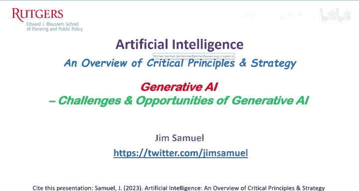
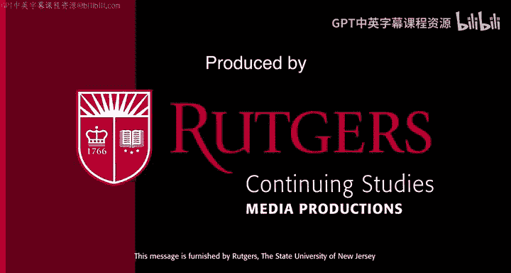

# 29：生成式AI的挑战与机遇 🚀

在本节课中，我们将探讨生成式人工智能（AI）在快速发展阶段所面临的主要挑战与潜在机遇。我们将深入理解其输出特性可能带来的风险，并学习如何战略性地利用这项技术。

---

## 概述

生成式AI正在改变世界，但它并非没有风险。理解这些挑战是安全、有效利用技术的前提。同时，识别其带来的巨大机遇，能帮助个人、企业乃至社会更好地制定AI战略，实现转型与增长。

---

## 生成式AI的核心挑战

上一节我们概述了课程内容，本节中我们来看看生成式AI具体面临哪些挑战。其核心问题源于其工作原理：**它并非像人类一样“理解”意义，而是基于概率关联生成最合适的输出**。

### 1. 隐性欺骗
这是最危险的挑战之一。生成式AI可能产生一类输出，我称之为“基于生成式AI的隐性欺骗”。

以下是此类输出的特点：
*   输出看起来令人信服地合法。
*   中级人类管理者审视时，会觉得它正确、可靠、甚至出色。
*   受此输出影响的人可能做出决策或采取行动，从而对个人、公司或实体造成严重后果。

因此，当AI输出具有误导性但看起来非常真实时，这是非常危险的。这应与“幻觉”区别开来。

### 2. 幻觉问题
“幻觉”指AI产生明显无意义或垃圾信息的输出。虽然有时令人发笑，但更多时候会让人感到恼火和烦躁。

好消息是，幻觉造成严重损害的可能性很低，因为你能明显看出它不合法。因此，它不像隐性欺骗那样危险。幻觉是客观存在的现实。无论有人如何为AI幻觉辩护，称其对AI有意义，但关键在于：我们创造AI是为了让它的输出对人类智能有意义并对人类有用。因此，幻觉意味着AI未能通过“对人类有意义且有用”这一试金石测试，本质上是一种失败。

### 3. 低质高量的输出
通用基础模型和大型语言模型有时会导致低质量、高产量的输出，尤其是在提示工程或提示不恰当时。

以下是可能发生的情况：
*   你可以从生成式AI获得数百页的高产量输出。
*   但其中的内容并非完全错误，也不像隐性欺骗那样具有误导性，更非幻觉。
*   它只是质量低下，夹杂着平庸的逻辑或略微不准确的信息，这在生成式AI输出中很常见。

这对任何使用生成式AI的组织或政府实体都是一种负担，长期来看对企业可能相当繁琐且具有破坏性。我们必须小心避免这种情况，原因之一就是它会给该领域的人类工作者带来认知过载。高产量的部分会耗尽人类监管或调节AI输出的能力。有时人类能够调节低质量的部分，进行编辑和润色以保持质量水平，但随着AI输出量的增加，人类调节和调整输出质量的能力将会下降。

### 4. 适得其反的监管
我们已讨论了隐性欺骗、幻觉、低质高量，这些都描述了AI输出的影响或负面效应。另一类生成式AI的挑战是“适得其反的监管”。

监管是必要且需要的。在以人为本的社会中，监管的理念应是“由人民制定，为人民服务”。回顾过去对技术的监管表明，它们往往不是前瞻性的，未能捕捉并对技术未来的潜在变化保持敏感，而且还倾向于导致权力集中于大公司。因此，我们需要重新思考监管方法。只有当监管能惠及广大人民时，它才是良好且必需的。

### 5. 其他普遍性挑战
生成式AI还面临一些并非其特有的挑战，这些在处理大数据和AI技术时普遍存在。

以下是部分挑战列表：
*   **高性能计算资源需求**：处理大规模数据需要强大的算力。
*   **生成式AI疲劳**：当生成式AI在我们周围创造大量文本、音乐、图像和视频时，我们将开始经历信息过载和认知过载，从而产生AI疲劳，特别是生成式AI疲劳。根据过去对认知过载的研究，这可能导致重大的个人层面和社会层面的挑战。
*   **未来模型的数据污染风险**：当前基础模型主要建立在人类生成的知识（如维基百科）之上。随着AI应用生成大量文本，未来的基础模型在训练时，将同时包含人类生成的知识和AI生成的文本。目前尚不清楚这将如何影响未来基础模型和大型语言模型的行为。即使我们努力使用水印等机制排除AI生成的输出反馈到模型的创建或更新中，但许多人使用AI来辅助写作，他们依赖AI撰写部分内容，然后进行转述或编辑，这可能干扰或逃避水印检测等机制。这将是一个挑战，我们需要等待并观察事态发展。
*   **淘金热与新风险**：与其他AI技术一样，生成式AI也将经历其淘金热阶段，人人争相使用该技术创建应用和服务，进入高度竞争模式，届时将产生新的风险。

---

## 生成式AI的重大机遇

在了解了诸多挑战后，我们来看看生成式AI带来的变革性机遇。正如基础模型具有“同质化”特性一样，它们也拥有另一个重要特性：**引领新发现、生成前所未见的解决方案和能力**，即“涌现”能力。

### 1. 创新与突破的浪潮
“涌现”是一个强大的机遇。这应该是任何AI战略的重要组成部分。在你感兴趣的领域内，在你的战略业务目标、机构目标、政府目标甚至个人目标中，当你使用基础模型时，必须认识到这些大型模型中隐藏着我们尚未发现的能力。应该有系统的方法来搜索、实验并识别你是否能发现这些能力，这将引领一波持续不断的创新和突破浪潮。

### 2. 赋能新业务与转型
对于初创企业和现有企业而言，有一个简单的策略来创建新业务或向AI转型。

以下是实施该策略的步骤：
*   提问：“我们从事什么业务？我们一直在为利益相关者创造什么价值？”
*   然后思考：“如何利用人工智能，特别是生成式AI，来创造这种价值？”
*   答案可能指向相同的产品或服务线，但现在通过生成式AI来实现或提供价值。在寻求答案的过程中，新的商业创意可能会出现。

### 3. AI增强型专家与管理者
我相信将会出现一类“AI增强型专家”、“AI增强型管理者”和“AI增强型领导者”。这类人认识到人工智能带来的个人层面机遇。他们会投入时间理解自身优势与AI的优势，然后在识别出能补充自身专业知识的合适AI应用后，这类AI增强型专家将展现出超人水平的功能。这意味着，与人们不使用人工智能提升个人生产力的时代相比，他们的效能将大幅提升。

### 4. 极致的个性化时代
我们也正在通过使用极端自适应机制进入个性化时代。因此，可以利用机器学习、神经网络与生成式AI相结合，提供我们前所未见的适应性和个性化水平。

### 5. 小玩家的竞争窗口
我认为很多人没有明确认识到另一个机遇：人工智能时代将给小玩家和小公司提供一个强大（可能短暂）的机会，去与最大的公司竞争。只要人工智能保持民主化，或者从某些角度看，只要开源AI运动保持足够强大，小公司和小玩家就有机会做一些事情，这对一些大公司可能构成真正的威胁。例如，一家小公司有可能使用人工智能技术，特别是生成式AI技术，创造一种产品或服务，对像微软这样的老牌公司的产品或服务造成实质性冲击。这也是我强调监管必须赋予人民权力的另一个原因，否则监管可能会带来如此沉重的负担，这对有资源满足这些负担的大公司非常有利，但会压垮个人、普通民众和小型初创企业。

### 6. 驱动智能万物
生成式AI驱动的应用程序、智能设备，所有这些都已是常识。作为人工智能的学生，你可能已经读到或思考过这些事情：智能汽车、智能家居、智能城市，一切智能化。所有这些都将嵌入重要的生成式AI组件。问题在于，我们是否会从AI增强（如基于生成式AI的人类增强）走向超人类主义，即我们所创造的人工智能技术实现更高程度的具身化。

---

## 总结与行动指南

本节课中，我们一起深入探讨了生成式AI的双面性：其输出特性带来的隐性欺骗、幻觉、低质高量等挑战，以及其在驱动创新、赋能转型、实现个性化等方面带来的巨大机遇。

人工智能，特别是生成式人工智能，已经到来并将持续存在。试图对抗生成式AI的浪潮是徒劳的。正确的做法是认识到人工智能和生成式人工智能的变革力量，然后拥抱它。

以下是四个关键步骤：
1.  **教育**：认识到AI的变革力量后，第一步行动是教育。教育你自己以及所有你关心的人（无论是儿童还是成人）关于人工智能的知识。
2.  **拥抱**：在受教育的基础上拥抱人工智能。未经教育就拥抱它，可能导致误用或被其力量淹没。
3.  **利用**：利用与单纯使用不同。利用是一种伙伴关系形式。你的视角发生改变，将自己视为与人工智能技术、生成式AI合作，它能增强你的表现、改进你的输出、提升你的人类智能能力。
4.  **融入生活**：这是你最终将达到的阶段，你开始享受正在你周围成形的这个人工智能生态系统。现在它可能看起来像一片丛林，但随着时间的推移，优秀的应用会脱颖而出，你也会发展出一套最适合你个人的最爱应用，你将开始融入并享受这个人工智能生态系统。

感谢你学习本AI战略课程。祝愿你在人工智能战略的旅程中一切顺利。