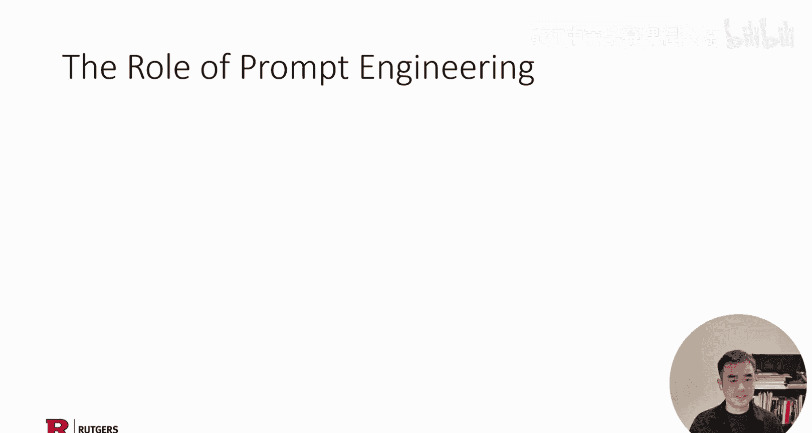
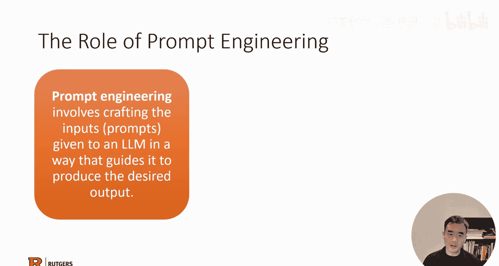
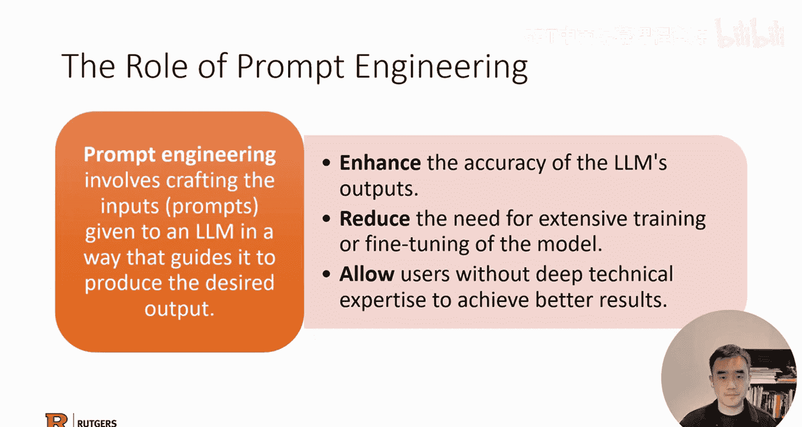
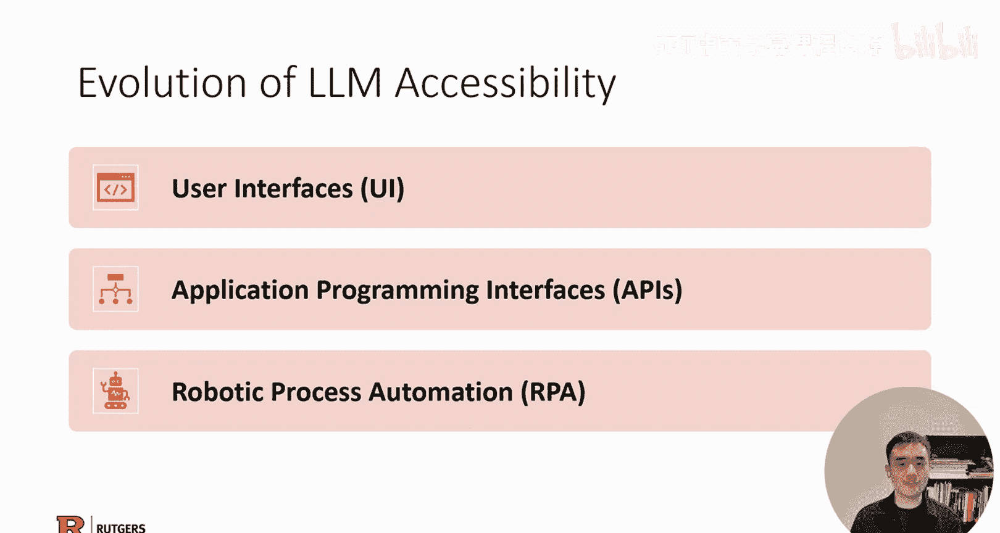
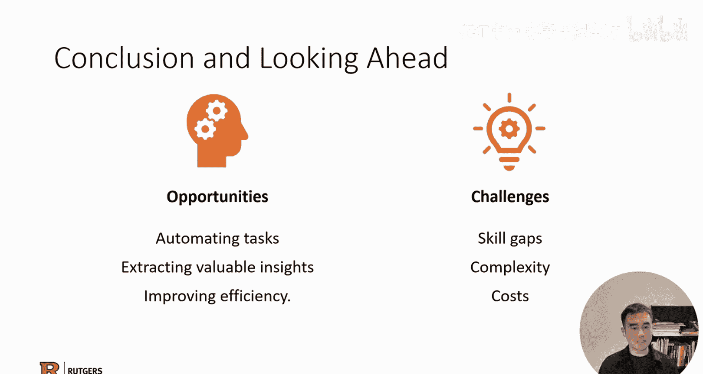

# 4：技能差距、提示工程与演进

在本节课中，我们将学习如何应对采用大语言模型（LLMs）所面临的挑战，理解提示工程的核心概念，并了解大语言模型可访问性的演进过程。

## 应对挑战：缩小技能差距与降低复杂性

上一节我们讨论了采用大语言模型的主要挑战。本节中，我们来看看如何通过缩小技能差距和降低感知复杂性来克服这些挑战。

以下是三种关键策略：

*   **教育与培训**：投资于培训项目，提升会计师在人工智能和数据分析领域的技能。
*   **用户友好工具**：开发和采用具有直观用户界面的人工智能工具，这些工具无需深厚的专业知识即可使用。
*   **跨领域协作**：鼓励会计专业人士与信息技术专家合作，以弥合技术鸿沟。

通过为会计师配备必要的技能和工具，我们可以促进人工智能技术更顺畅地被采纳。

## 核心赋能：理解提示工程

在使大语言模型变得易于访问且高效的过程中，一个关键概念是**提示工程**。

提示工程指的是精心设计输入给大语言模型的指令或提示，以引导其产生期望的输出。这一点至关重要，因为大语言模型响应的质量和相关性，很大程度上取决于提示的措辞方式。

有效的提示工程可以提升大语言模型输出的准确性，减少对模型进行大量训练或微调的需求，并让不具备深厚技术专长的用户也能获得更好的结果。我们将在后续模块中更详细地探讨提示工程。

## 技术演进：大语言模型的可访问性提升

过去，部署先进的语言模型需要大量的编程知识和基础设施搭建。用户必须管理软件依赖、硬件配置，并理解复杂的参数。

然而，近期的技术进步已使大语言模型变得更加易于访问。以下是三个主要的发展方向：

*   **用户界面**：像ChatGPT这样的平台提供了简单的界面，用户无需任何编码即可输入文本提示并接收响应。
*   **应用程序编程接口**：API允许将大语言模型更高级地集成到应用程序中，并支持自定义参数，同时仍比以往的方法更加用户友好。
*   **机器人流程自动化**：将大语言模型与RPA工具集成，可以在无需大量编程的情况下自动化复杂的工作流程。

这些发展降低了使用门槛，使得会计专业人士在工作中利用大语言模型成为可能。

## 课程总结

本节课中，我们一起学习了如何应对大语言模型应用中的挑战。

大语言模型有潜力通过自动化任务、提取有价值的见解和提高效率来革新会计行业。然而，要实现这一潜力，我们必须解决技能差距、复杂性和成本等挑战。理解人工智能、大语言模型和提示工程的基础知识，是将这些技术整合到会计实践中的第一步。

在下一个模块中，我们将探讨在会计工作中实施大语言模型的各种方法，包括每种方法的实际考量。