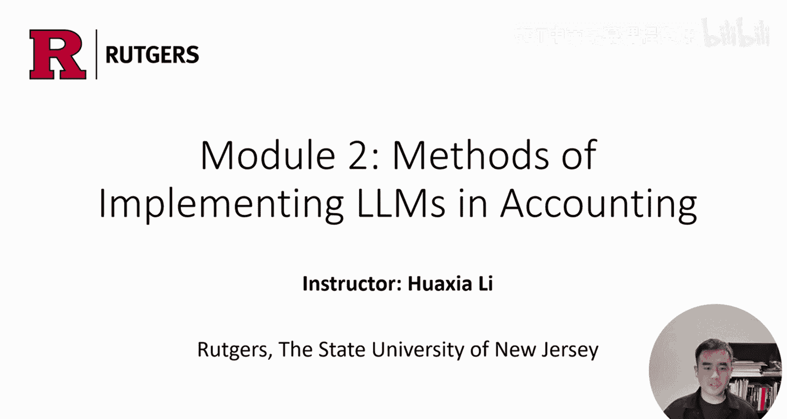
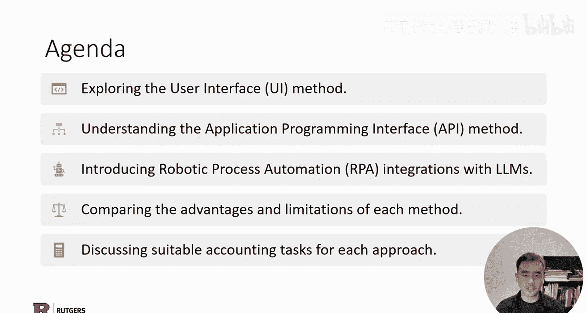
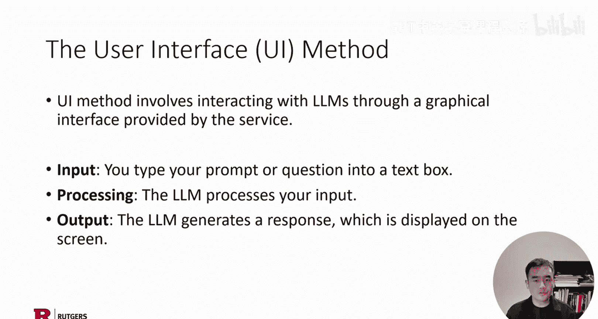
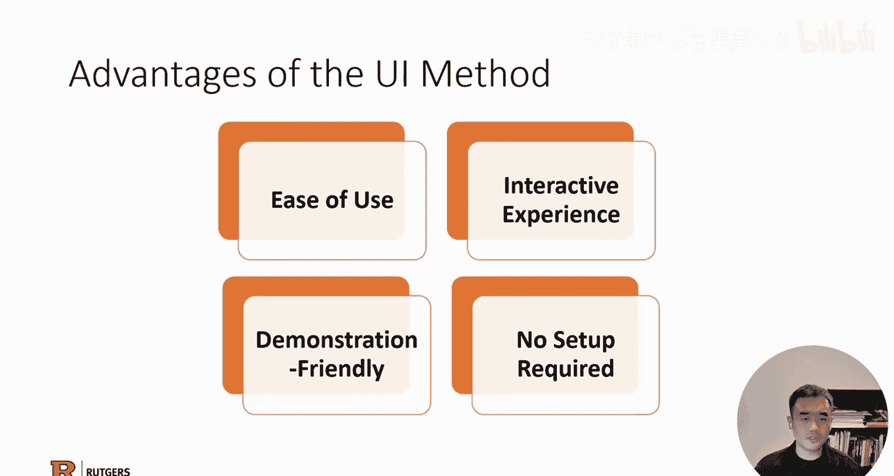
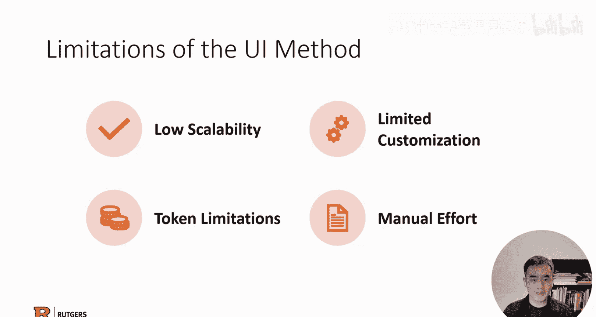
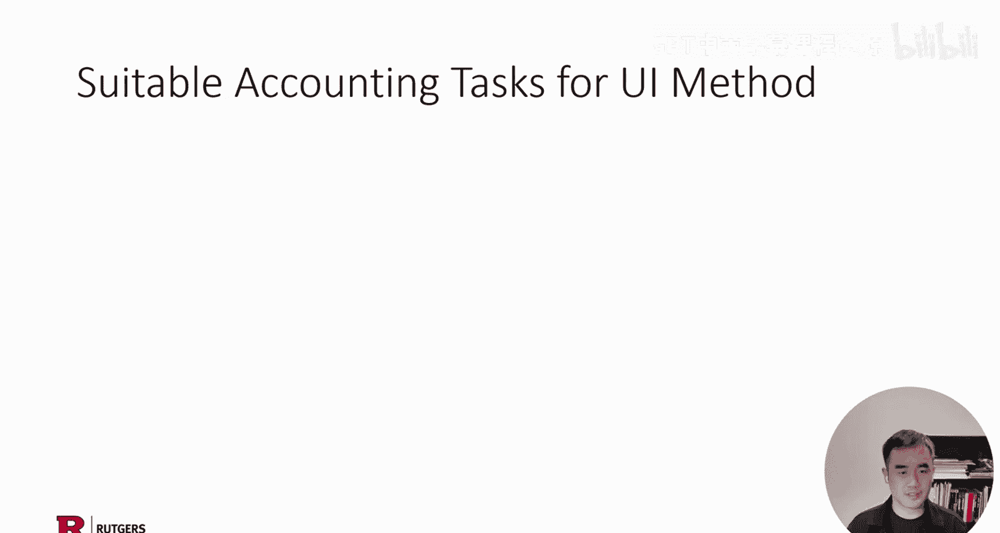
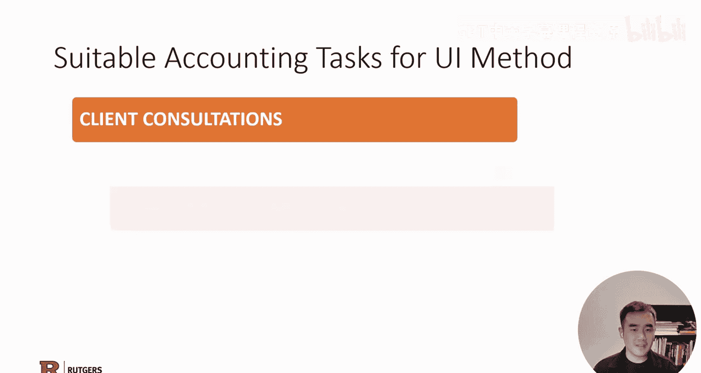
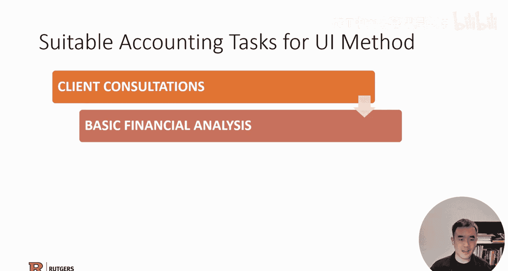
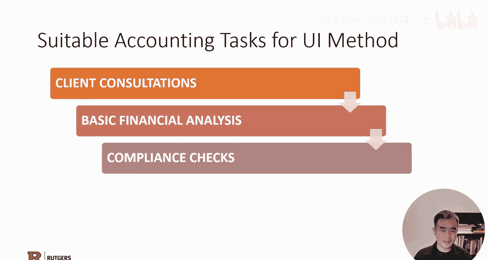
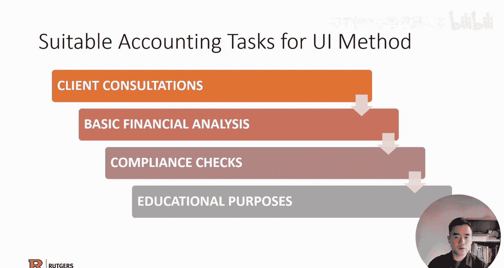

生成式人工智能与政府财务报告：模块2：用户界面方法 🖥️

欢迎回到我们的生成式人工智能在政府报告与会计中的应用课程。在模块2中，我们将讨论在会计工作中实施大语言模型或其他LLM的各种方法。理解这些方法至关重要，因为它能让你根据自身需求、技术能力和预算选择最合适的方案。现在，让我们开始学习。

本节课的议程包括：首先，探索用户界面方法。其次，理解应用程序编程接口方法。第三，介绍大语言模型与机器人流程自动化的集成。接下来，我将比较每种方法的优势与局限。最后，我将讨论每种方法适用的会计任务。

首先，我们来谈谈最简单的方法——使用用户界面。

用户界面方法涉及通过服务提供商提供的图形界面与大语言模型进行交互。一个常见的例子是使用ChatGPT的网页界面。其工作原理如下：对于输入，你在文本框中键入提示、指令或问题。对于处理，大语言模型会处理你的输入。对于输出，大语言模型会生成响应，并显示在屏幕上。这种方法无需编程知识，任何有网络连接的人都可以使用。

以下是用户界面方法的一些关键优势：
*   **易于使用**：操作直接，无需技术专长。
*   **交互体验**：你可以与大语言模型进行来回对话，并根据需要提出后续问题。
*   **便于演示**：这种方法非常适合在现场向客户或团队成员展示模型能力。
*   **无需设置**：你无需安装软件或配置系统即可使用。

然而，用户界面方法也存在一些局限：
*   **可扩展性低**：对于处理大量数据或自动化重复性任务，用户界面方法并不实用。
*   **定制性有限**：用户界面提供的选项较少，难以调整模型参数，如温度或最大输出标记数等。
*   **标记限制**：例如，输入和输出的长度存在一些限制，这对于处理冗长文档可能是个问题。
*   **手动操作**：用户界面方法需要手动输入并将结果复制到输出中，对于批量任务而言非常耗时。

因此，用户界面方法最适合以下几种类型的任务：
*   **客户咨询**：最适合用于交互式回答客户查询。
*   **基础财务分析**：可用于进行快速计算或解释。
*   **合规性检查**：可用于验证文档中的特定信息。
*   **教育目的**：可用于向客户进行演示和培训。

总的来说，当任务量不大且需要人工判断和交互时，用户界面方法是理想的选择。

今天的课程就到这里。在下一讲中，我们将详细介绍API方法。感谢观看。