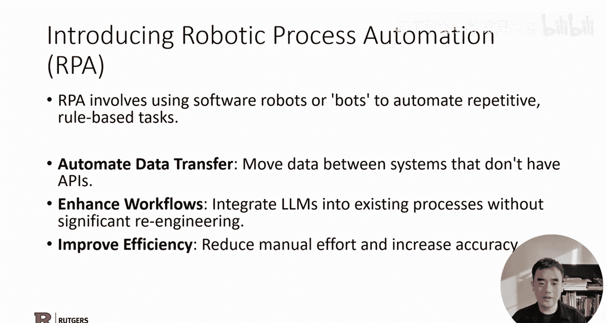
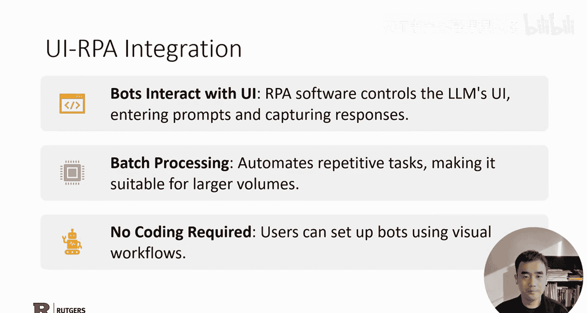
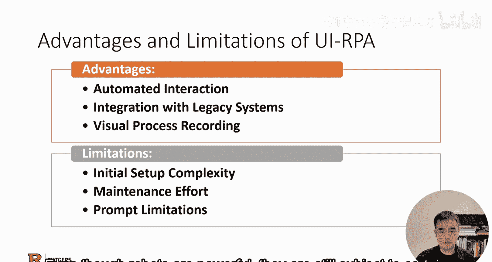
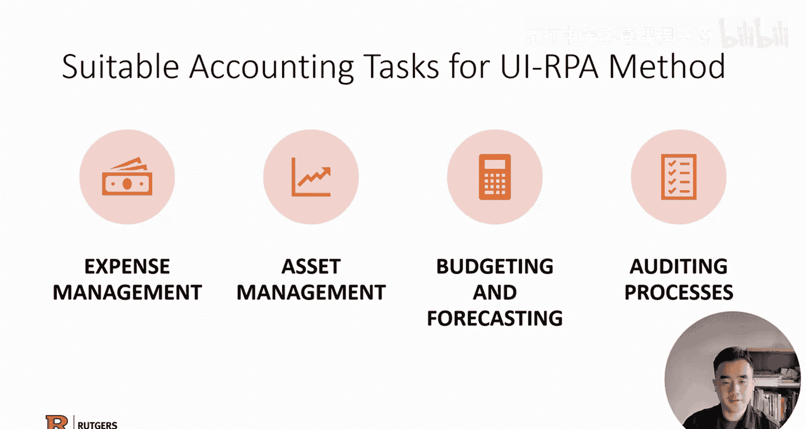

# 7：机器人流程自动化（RPA）🤖

在本节课中，我们将介绍机器人流程自动化（RPA）及其如何与用户界面（UI）方法相结合。

上一节我们介绍了用户界面方法，本节中我们来看看如何通过RPA技术实现自动化，以提升效率和可扩展性。

### 什么是机器人流程自动化（RPA）？

机器人流程自动化（RPA）涉及使用软件机器人或“机器人”来自动化重复且规则明确的任务。这些机器人能够模拟人类与数字系统的交互。当与大型语言模型（LLM）结合时，RPA具有多项独特优势。

以下是RPA与LLM结合的主要优势：
*   **自动化数据迁移**：RPA可以在没有API连接的系统之间移动数据。
*   **增强工作流程**：RPA可以将LLM集成到现有流程中，而无需进行重大的重新设计。
*   **提高效率**：RPA可以减少人工操作，并提高准确性。

### UI-RPA方法：结合UI的简易性与RPA的自动化能力

在对RPA有了基本了解后，现在介绍一种名为UI-RPA的方法，它结合了UI方法的简易性和RPA的自动化能力。

以下是UI-RPA的工作原理：
1.  **机器人可与UI交互**：RPA软件根据设计控制用户界面，输入提示词并捕获来自UI的响应。
2.  **批量处理**：整个UI-RPA流程可以自动化重复性任务，使其适合处理更大规模的数据。
3.  **无需编码**：得益于RPA软件，UI-RPA方法适合那些能够使用可视化工作流设置机器人、而无需编码技能的用户。

总而言之，这种方法在易用性和可扩展性之间架起了桥梁。

### UI-RPA方法的优势与局限

使用UI-RPA方法有若干优势和局限。让我们先看看其优势。

以下是UI-RPA方法的主要优势：
*   **自动交互**：显著减少了人工输入的需求，从而最大限度地降低了错误风险。
*   **与遗留系统交互**：即使在无法使用API的环境中，机器人也能够与那些较旧的系统交互，使技术更具通用性。
*   **可视化流程记录**：允许用户记录整个UI-RPA流程，这可以增强可验证性，并为审查和合规性创建强有力的审计追踪。

现在，我们来看看其局限性。

以下是UI-RPA方法的主要局限：
*   **初始设置复杂**：设计和正确配置机器人需要投入大量精力。
*   **维护需求高**：由于机器人严重依赖用户界面，UI的任何更改都可能导致机器人失效，需要持续更新。
*   **平台限制**：尽管机器人功能强大，但它们仍受某些限制，例如令牌限制和其他UI层面的限制，这可能会在某些情况下限制其有效性。

### UI-RPA的应用场景

现在，让我们讨论一些UI-RPA特别适用的领域。

以下是UI-RPA的几个典型应用场景：
*   **费用管理**：利用RPA，可以自动化来自收据和发票的数据录入，减少手动输入所需的时间和精力。
*   **资产管理**：机器人可以帮助跟踪资产、更新流程，这些通常需要大量的人工监督。
*   **预算与预测**：该流程可以从各种来源收集数据，使决策的编制和分析变得更加容易。
*   **审计流程**：UI-RPA通过自动化重复性审计任务，在审计过程中发挥重要作用，帮助团队节省时间并减少人为错误。

总的来说，UI-RPA方法在任务涉及LLM与没有API连接的系统之间交互的场景中非常理想。当直接交互不可能实现，但仍需要高效的自动化工作流时，这种结合是一个强大的解决方案。

本节课中我们一起学习了机器人流程自动化（RPA）的概念，特别是UI-RPA方法如何结合用户界面的简易性和RPA的自动化能力。我们探讨了其工作原理、优势与局限，以及在政府财务报告等领域的实际应用场景。在下一讲中，我们将介绍如何将RPA与API集成。感谢观看。