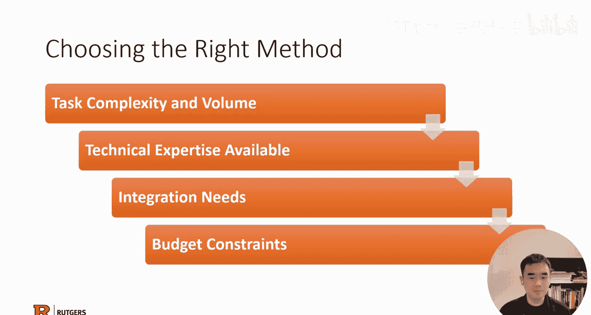
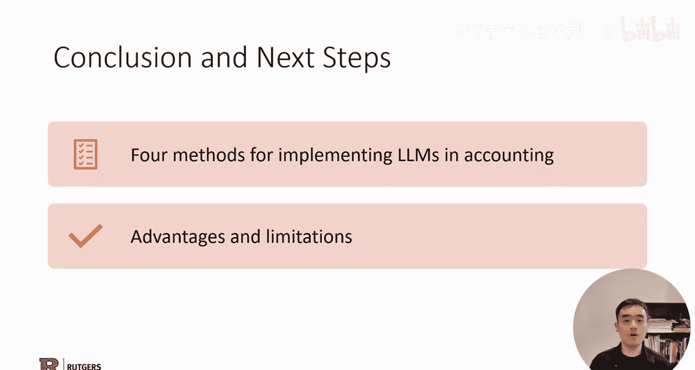

9：选择正确的方法 🎯

在本节课中，我们将学习如何为政府财务报告中的生成式人工智能应用选择最合适的实施方法，并总结本模块的核心内容。

上一节我们介绍了多种实施方法，本节中我们来看看如何根据具体情况进行选择。

选择实施方法时，需要考虑几个关键因素。以下是评估时需要关注的核心方面：

*   **任务类型、复杂性与数据量**：处理的数据量越大或流程越复杂，通常需要更强大、更全面的自动化解决方案。
*   **团队技术专长**：所选方法应与团队实施和维护该方案的技术能力相匹配。
*   **系统集成需求**：确保自动化方法能与现有系统（无论是否使用API）顺利集成。
*   **预算限制**：一些方案可能需要较高的初始投资，但从长期效率和成本节约来看，可能带来显著收益。

总而言之，您应仔细评估组织在上述各方面的独特需求，以选择最适合实施生成式人工智能的方法。

在本模块中，我们探讨了在政府财务报告中实施生成式人工智能的四种主要方法，每种方法都有其优势和局限性。理解这些方法有助于您做出明智的决策，并将人工智能有效地整合到会计实践中。

在下一个模块中，我们将深入探讨生成式人工智能在政府财务领域更实际的应用。

感谢您的关注，期待与您继续共同探索。😊

在课程结束前，关于我们讨论的内容，您有任何问题或评论吗？请随时分享您的想法或提出需要澄清的地方。

**本节课总结**
本节课我们一起学习了如何根据任务复杂性、团队能力、集成需求和预算等因素，为政府财务报告中的生成式人工智能应用选择正确的实施方法，并对本模块的知识进行了回顾。