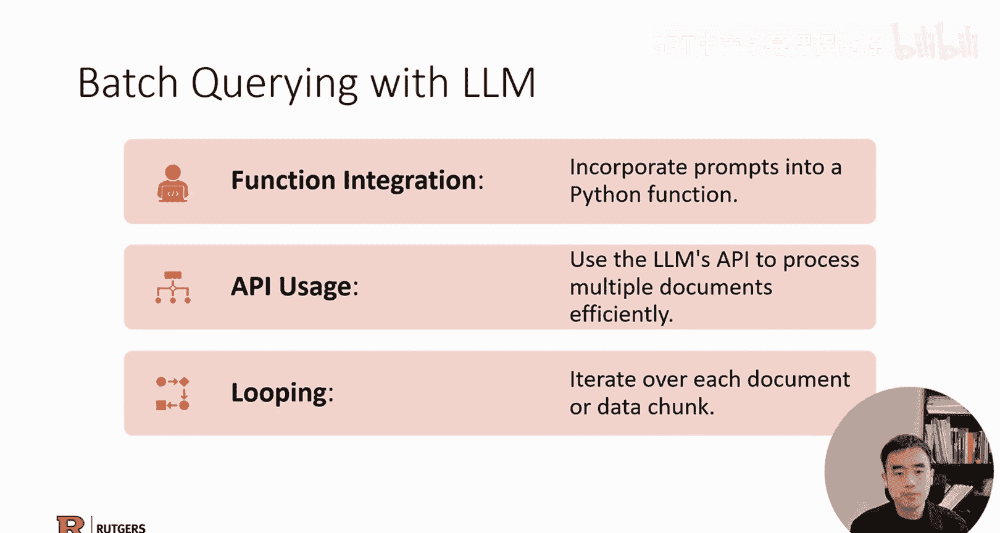
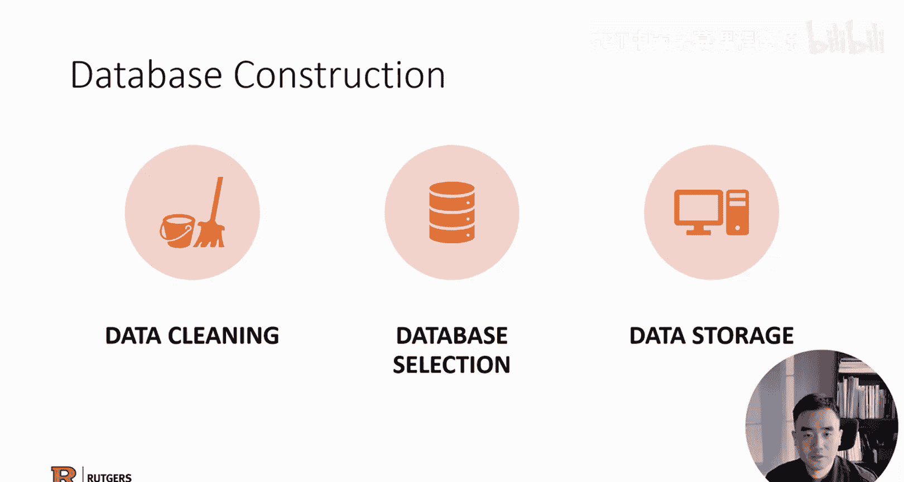

# 13：批量查询与数据库构建 📊

在本节课中，我们将学习如何将精心设计的提示词（prompts）应用于批量文档处理，并构建一个结构化的数据库来存储提取出的数据。我们将介绍自动化查询流程的关键步骤，以及如何整理和存储数据以供后续分析使用。

## 批量查询自动化 🔄

上一节我们介绍了如何设计提示词。本节中我们来看看如何将这些提示词集成到一个自动化流程中，以高效处理大量文档。

一旦我们的提示词设计完成，下一步就是自动化查询过程。具体做法如下：

以下是实现批量查询自动化的三个核心步骤：

1.  **函数集成**：首先，我们将提示词集成到一个Python函数中。这允许我们复用相同的指令，并将其应用于多个文档。
2.  **API调用**：利用大语言模型（LLM）的API，我们可以一次性高效处理多个文档。这大大加快了数据提取的速度，尤其是在处理大型数据集时。
3.  **循环处理**：我们设置一个循环来遍历每一个文档。这确保了数据集中的每个文档都能以一致且自动化的方式得到处理。

通过自动化这个过程，我们显著减少了人工工作量，并确保了在整个数据集中提取数据的一致性。

## 数据库构建与数据整理 🗃️

在数据被提取出来后，下一个关键步骤是为后续分析（如数据清洗）整理数据。这涉及将提取出的值转换为适当的数据类型，并处理任何缺失或不完整的值，以确保数据的完整性。

以下是构建数据库的三个主要环节：

1.  **数据库选择**：我们选择一个最适合需求的数据库系统。对于结构化数据，可以是SQL数据库；对于更灵活的存储，可以选择NoSQL数据库。数据库的选择取决于数据的类型及其使用方式。
2.  **数据清洗**：数据清洗包括将提取的值转换为适当的数据类型（例如数字或日期），并处理任何缺失或不完整的值，以确保数据的完整性。
3.  **数据存储**：数据清洗完成后，被加载到选定的数据库中。在此过程中，建立适当的键（keys）和索引（indexes）非常重要，这将有助于高效查询和检索数据。

通过以结构化的方式存储提取的数据，我们使后续的分析和报告生成变得更加容易，从而支持更明智的决策制定。

本节课中我们一起学习了批量查询自动化的实现步骤，以及如何构建一个结构化的数据库来存储和整理提取出的数据。在下一讲中，我们将介绍如何在一个真实案例——地方政府年度综合财务报告中应用这个框架。