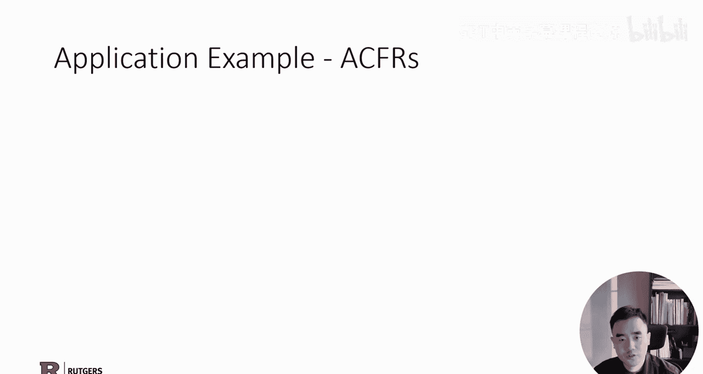
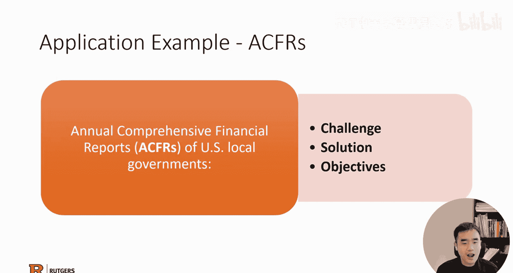
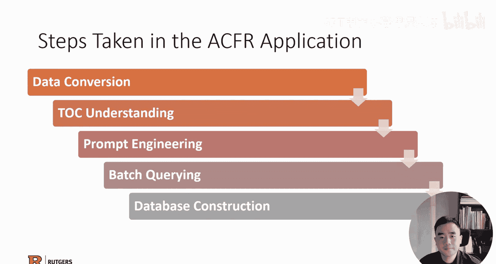

14：示例：提取年度综合财务报告 📊

在本节课中，我们将学习如何将之前介绍的框架应用于一个真实场景：从美国地方政府发布的年度综合财务报告中提取关键财务数据。我们将看到，面对格式不统一的长篇PDF文档，该框架如何实现高效、自动化的数据提取。

---

上一节我们介绍了生成式AI在财务报告中的通用框架，本节中我们来看看一个具体的应用实例。

年度综合财务报告通常是冗长的PDF文档，其格式高度不一致。这使得手动或使用传统方法提取数据变得非常困难。

我们的解决方案是应用基于大语言模型的框架，以一致且自动化的方式提取关键财务变量，例如收入、支出和基金余额。我们的目标是以高准确性和高效率提取这些数据，克服格式不一致带来的问题。这个例子清晰地展示了该框架在处理现实世界中复杂非结构化文档方面的有效性，突显了其在自动化财务数据提取中的价值。

---

以下是提取年度综合财务报告数据所遵循的具体步骤：

首先，进行数据转换。我们使用软件将PDF文档转换为机器可读的文本。对于扫描页面，我们应用光学字符识别技术来准确捕获文本。

其次，进行内容类型理解。利用大语言模型来解释每个文档中的内容类型，帮助我们精确定位包含所需财务数据的章节。

第三，进行提示词工程。我们运用指令学习来精心设计提示词，并包含少量示例，以指导大语言模型准确地提取所需信息。

第四，进行批量处理。为了高效处理多份报告，我们使用大语言模型的API进行批量处理，从而自动化整个提取流程。

最后，进行数据库构建。我们将提取出的数据存储在一个关系型数据库中，以便于访问和分析。

整个过程是迭代式的，这意味着我们会根据初始查询的结果来优化提示词和方法，从而在每一轮中提高准确性和效率。

---

本节课中，我们一起学习了如何将生成式AI框架应用于从格式复杂的年度综合财务报告中自动化提取财务数据。我们了解了从文档转换、内容理解到提示工程和批量处理的完整步骤。这个实例证明了该框架在处理现实世界非结构化文档挑战时的强大能力。在下一讲中，我们将探讨该框架在ESG报告分析中的另一个应用示例。