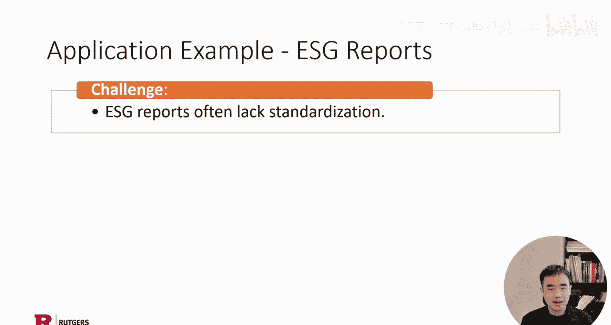
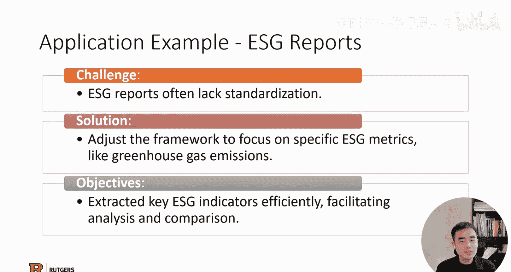
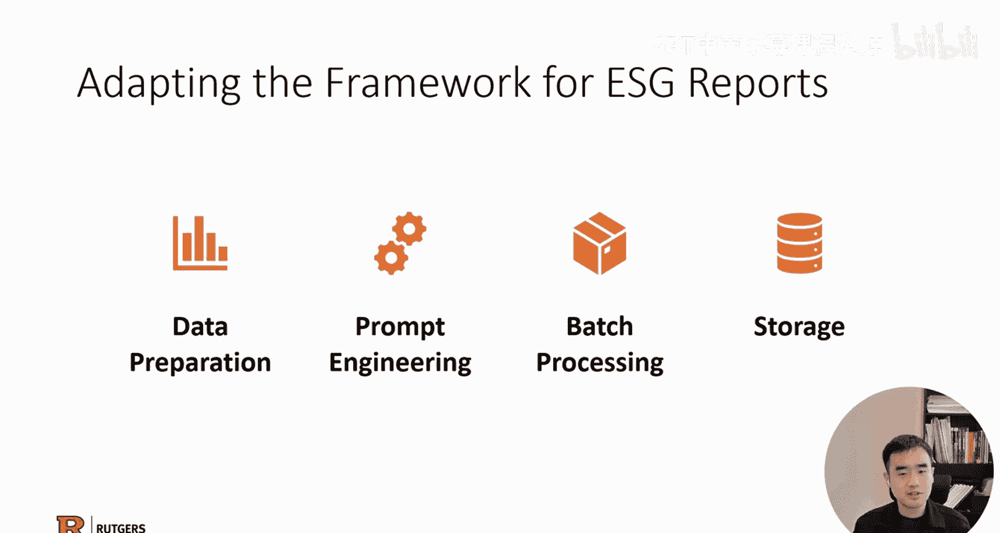
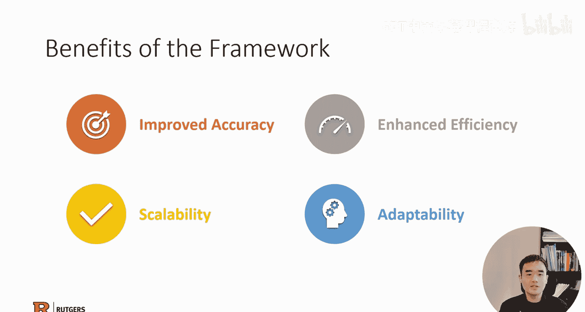
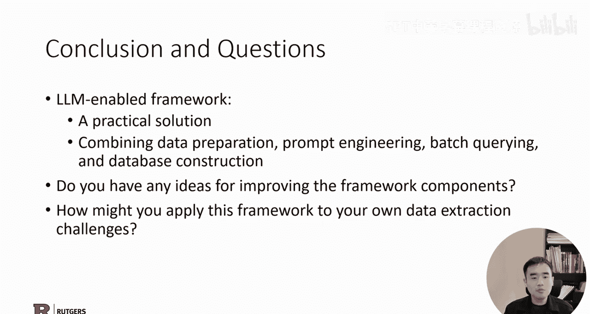

15：示例：提取ESG报告数据 📊

在本节课中，我们将学习如何应用之前介绍的框架来提取环境、社会和治理数据。我们将通过一个具体示例，展示该框架在处理非标准化ESG报告时的强大适应性和有效性。

---

上一节我们介绍了框架的基本构成，本节中我们来看看如何将其应用于一个具体的场景：从ESG报告中提取关键数据。

ESG报告通常缺乏统一标准，各公司以不同的格式和结构呈现信息，这给数据提取带来了挑战。

解决方案是调整框架，使其专注于特定的ESG指标。

通过定制提示词来锁定温室气体排放、员工多样性或治理实践等关键指标，我们能够高效地提取相关数据。

目标是准确、快速地提取这些ESG指标，以便于对不同实体进行更轻松的分析和比较。

这个例子凸显了框架的适应性，它不仅对财务数据有效，对于像ESG数据这类对决策者日益重要的不同类型数据也同样有效。

---

为了将框架适配于ESG数据提取，我们从上一次应用中进行了一些有针对性的调整。

以下是具体的调整步骤：

首先，在数据准备阶段。我们调整了正则表达式模式和关键词，以更好地捕获ESG特定术语，例如“温室气体排放”、“可持续性指标”和“社会影响指标”。

接下来，在提示词工程阶段。我们修改了提示词，专注于提取相关的ESG数据点，确保语言模型被引导至每份报告中的正确信息。

随后，在批处理阶段。我们应用了与之前用例相同的自动化技术，使我们能够一次性高效处理多份文档。

最后，在存储阶段。我们确保数据库能够处理ESG报告中常用的特定数据类型和单位，例如“二氧化碳吨数”或“员工多样性百分比”。

在整个适配过程中，核心框架保持不变，这证明了它在处理不同类型非结构化数据和用例方面的多功能性。

---

使用该框架的主要优势包括以下几点：

第一，**提高准确性**。通过利用语言模型的理解能力，我们可以减少传统提取方法中常见的错误。

第二，**提升效率**。自动化极大地缩短了处理时间，使我们能够比手动处理更快地处理大量数据。

第三，**可扩展性**。该框架设计为可扩展，意味着它可以轻松处理大型数据集，适用于小型和大型项目。

第四，**适应性**。这或许是它最大的优势之一。它可以应用于各种非结构化数据源，从财务报告到ESG数据及其他领域。

总体而言，该框架有效地解决了与数据提取任务相关的常见挑战，为处理非结构化文档提供了一个可靠、可扩展的解决方案。

---

本节课中我们一起学习了如何将通用数据提取框架应用于ESG报告这一特定领域。我们看到了通过调整数据准备、提示词工程等步骤，该框架能够高效、准确地从非标准化的报告中提取关键指标，展现了其强大的适应性和实用性。

在下一个模块，我们将评估该框架的性能，并讨论进一步改进的方法。

现在，欢迎大家提问。
您对这些框架组件有任何疑问吗？
您将如何将此框架应用于您自己的数据提取挑战？
请随时分享您的想法。

