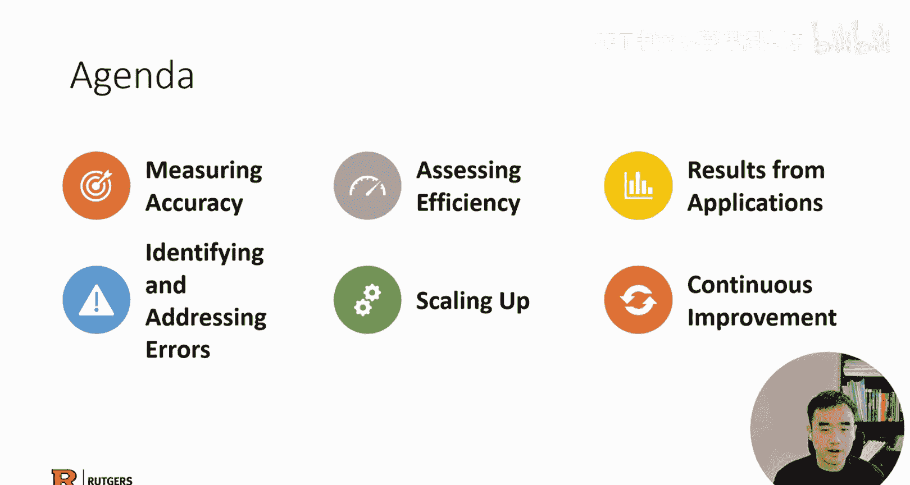
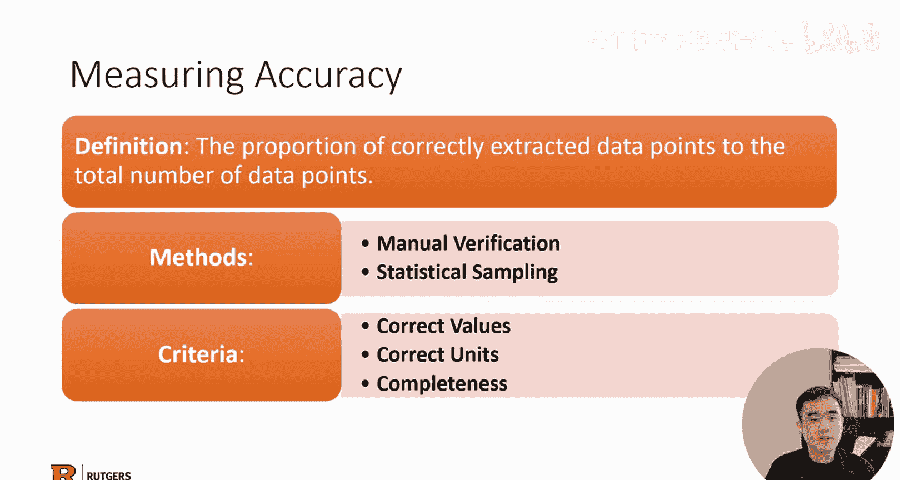
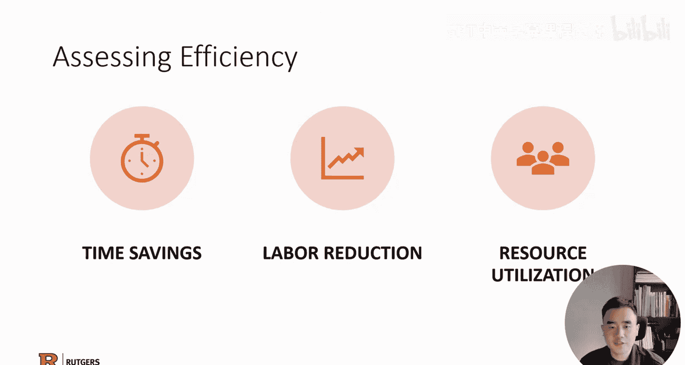

# 16：评估框架在政府与ESG报告中的性能

在本节课中，我们将评估上一模块介绍的Lala学习框架在政府与ESG报告数据提取任务中的表现。我们将学习如何衡量其准确性与效率，并探讨如何进一步提升性能。

---

### **📊 衡量准确性**

上一节我们介绍了评估框架性能的重要性，本节中我们来看看如何具体衡量数据提取的准确性。准确性是衡量提取出的数据点中正确部分所占比例的关键指标。

以下是衡量准确性的主要方法：

*   **人工验证**：将每个提取出的数据点与源文档进行直接比对。此方法精度最高，但对于大型数据集非常耗时。
*   **统计抽样**：对于大型数据，抽取一个数据点子集进行检查，从而估算整体准确性，能在一定程度上节省时间。

准确的数据需满足以下标准：

*   **数值正确**：提取的数据（数字或文本）必须与源文档完全一致。
*   **单位正确**：数据必须使用正确的单位（如千、百万），以防误读。
*   **完整性**：所有必需的数据点都应被提取，无遗漏。

准确的数据是进行可靠分析和决策的基础，在政府与ESG报告这类错误可能带来严重后果的领域尤为重要。

---

### **⚡ 衡量效率**

在了解了准确性之后，我们还需要评估框架的效率。效率不仅关乎速度，还包括完成任务所需的所有资源。

效率可以从以下几个维度衡量：

*   **时间节省**：衡量框架相比人工提取快了多少，这直接体现了整体时间的节约。
*   **人力减少**：衡量所需人工劳动的减少程度，这有助于理解人力成本的节约以及释放员工从事其他任务的可能性。
*   **资源利用**：评估所使用的计算资源，例如API调用次数或处理能力。这有助于判断是否能在保持准确性的前提下进一步优化。

效率的提升不仅能加快流程，更能转化为实际的成本节约。通过减少时间和人力投入，我们可以将人力资源重新分配到更高价值的任务上，从而提升整体生产力和效益。

---

### **📈 实际应用结果与改进**

接下来，我们将审视框架在真实政府与ESG报告应用中的结果。任何框架都有改进空间，我们将讨论如何识别常见错误以及解决这些错误的最佳策略。

随着处理数据量的增长，可扩展性变得至关重要。我们将探讨当数据集在体量和复杂性上扩张时，所面临的挑战和必要的调整。

最后，框架应能随时间演进。我们将介绍如何基于用户反馈、错误分析以及报告要求的变化来持续优化我们的方法。

---

### **🎯 总结**

本节课中，我们一起学习了如何评估生成式AI框架在政府与ESG报告数据提取任务中的性能。我们重点探讨了衡量**准确性**（通过人工验证或统计抽样，确保数据值、单位和完整性正确）和**效率**（从时间节省、人力减少和资源利用多角度评估）的方法。准确高效的数据提取是生成可靠报告、支持有效决策的基石。