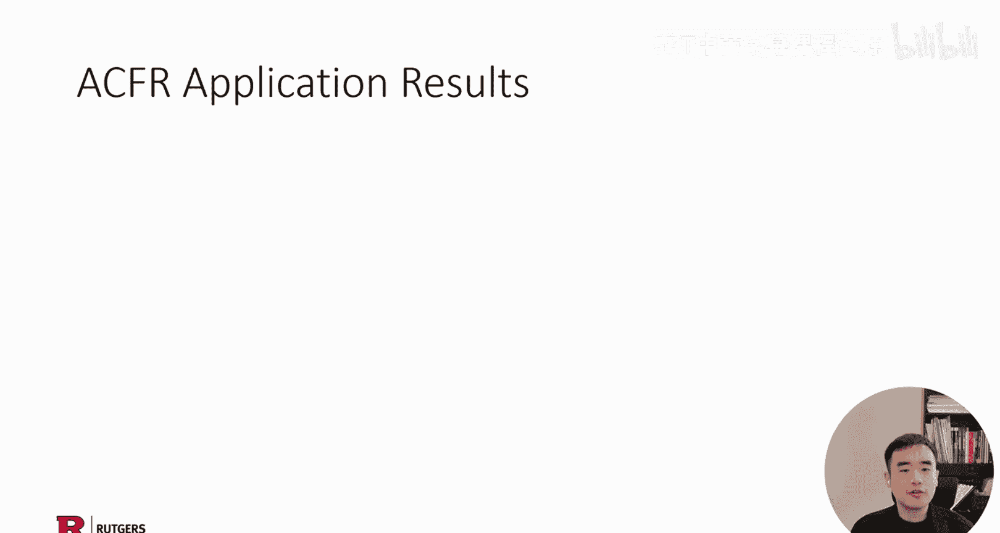
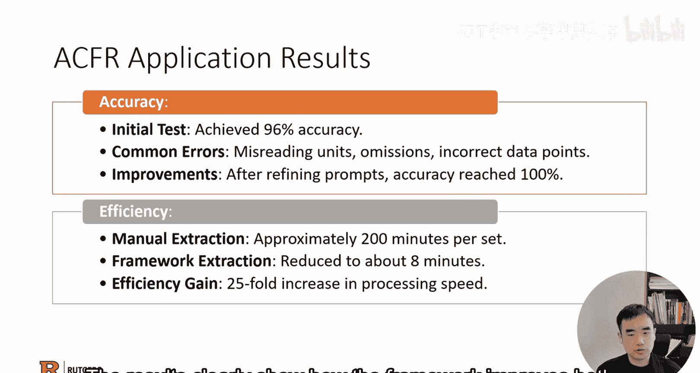
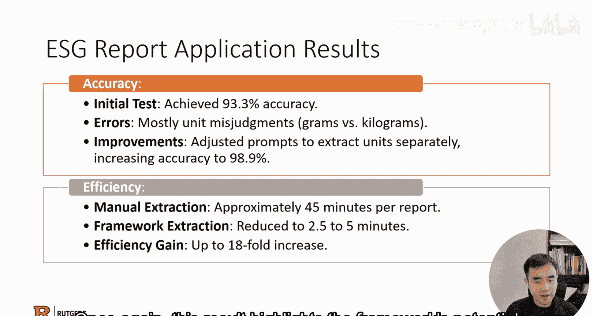
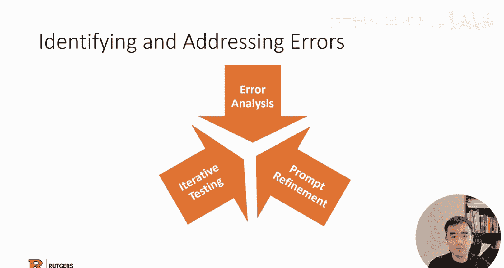
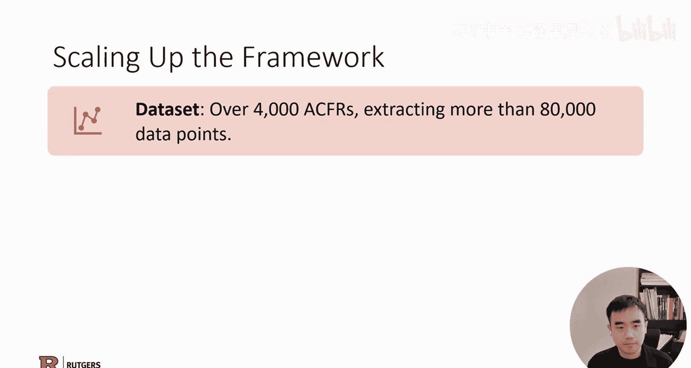
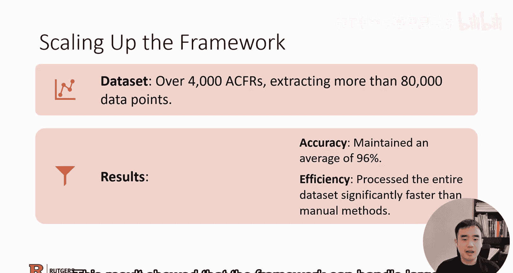
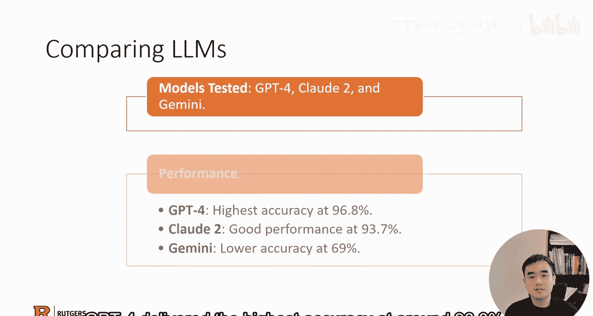
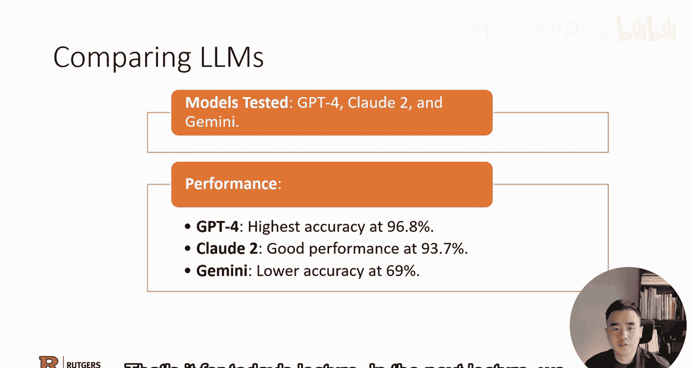

# 17：示例与错误识别

在本节课中，我们将评估框架在EFFORT和ESG报告上的应用结果，分析其准确性与效率，并探讨提升准确性的策略、框架的可扩展性以及不同大语言模型的表现差异。

## 框架在EFFORT报告上的表现

上一节我们介绍了评估框架，本节中我们来看看它在处理EFFORT报告时的具体表现。

**准确性结果：**
*   初始测试中，框架的准确率达到 **96.1%**。
*   识别出的常见错误包括：单位误读、数据遗漏和数据点错误。
*   通过优化提示词来针对性解决这些错误后，在第二次测试中准确率提升至 **100%**，这证明了迭代调整的有效性。

**效率结果：**
*   传统手动提取数据，每份报告约需 **200分钟**。
*   使用框架后，提取整组报告数据的时间降至仅 **8分钟**。
*   这意味着速度提升了 **25倍**，相较于传统方法有显著改进。

这些结果清晰地展示了框架如何同时提升数据提取的准确性和效率，突显了其在处理EFFORT这类复杂报告时的潜力。

## 框架在ESG报告上的表现

了解了EFFORT报告的结果后，我们再来看看框架在ESG报告上的表现。

**准确性结果：**
*   初始测试的准确率为 **93.3%**。
*   大部分错误源于单位判断失误，例如混淆了克与千克。
*   通过调整提示词，将单位处理单独区分后，准确率显著提升至 **98.9%**。

**效率结果：**
*   传统手动提取每份报告约需 **45分钟**。
*   使用框架后，每份报告的提取时间缩短至 **2.5到5分钟**。
*   这相当于速度最高提升了 **18倍**。

这一结果再次强调了框架在节省时间和提高准确性方面的巨大潜力，使其成为处理复杂ESG数据的宝贵工具。

## 提升准确性的策略

在看到了准确率提升的效果后，我们来系统地学习提升框架准确性的迭代方法。

以下是提升准确性的具体步骤：
1.  **错误分析**：进行彻底分析，识别常见错误并理解其成因，这有助于明确需要调整的方向。
2.  **提示词优化**：基于分析结果，优化提示词以针对特定问题。这可能包括：增加示例以支持小样本学习、明确指定单位和格式以避免混淆、或澄清规则部分的指令以确保一致性。
3.  **重新测试**：完成优化后，重新测试框架以验证改进效果。

这种测试与优化的循环有助于实现准确性的逐步提升。迭代方法对于优化性能至关重要，每一次改进都使我们更接近一个更可靠、更高效的提取流程。

## 框架的可扩展性测试

除了单份报告的表现，我们还测试了框架处理大规模数据的能力。

在可扩展性测试中，我们使用了包含 **4000多份EFFORT报告** 的数据集，提取了 **超过80,000个数据点**。
*   框架保持了高准确率，平均达到 **96%**。
*   即使数据量巨大，处理整个数据集的速度也显著快于手动提取，证明了框架在大规模应用下的效率。

这些结果表明，随着数据量的增长，框架能够有效处理大规模提取任务，同时保持速度和准确性。

## 不同大语言模型的性能比较

最后，我们比较了不同大语言模型对框架性能的影响。

我们测试了三种模型：GPT-4、Claude 2和Gemini。
*   **GPT-4** 提供了最高的准确性，约为 **96.8%**。
*   **Claude 2** 表现良好，准确性为 **93.7%**。
*   **Gemini** 的准确性较低，约为 **69%**。

这些结果突出表明，大语言模型的选择显著影响准确性。像GPT-4这样更先进的模型能提供更好的结果。因此，为数据提取任务选择合适的模型对于实现最佳性能至关重要。

## 总结

本节课中我们一起学习了生成式AI框架在EFFORT和ESG报告数据提取中的应用评估。我们看到，通过系统性的错误分析和提示词迭代，框架的准确性可以得到显著提升，同时处理效率也远超传统手动方法。测试还证明该框架具有良好的可扩展性，并且模型选择对最终性能有决定性影响。在下一讲中，我们将总结本模块，讨论一些局限性和实用技巧。