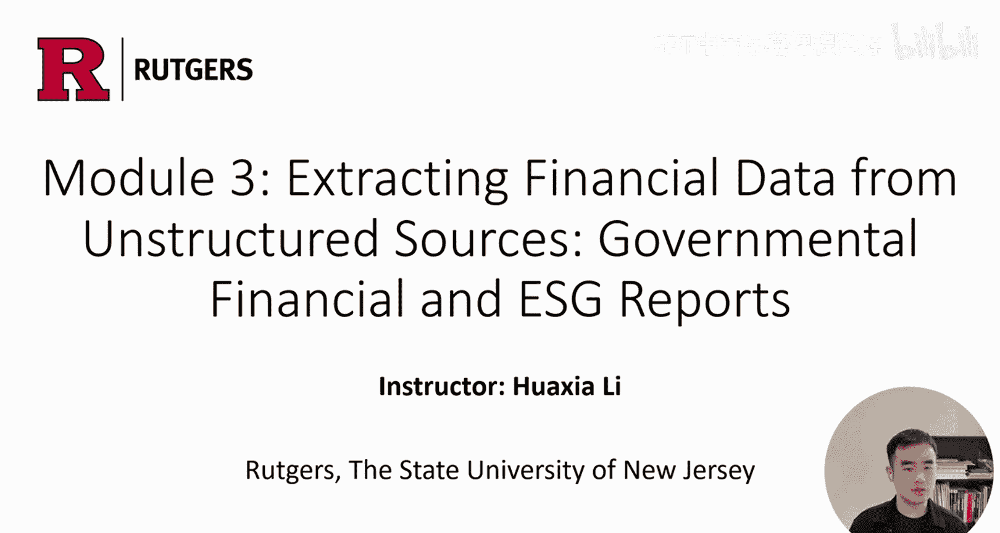
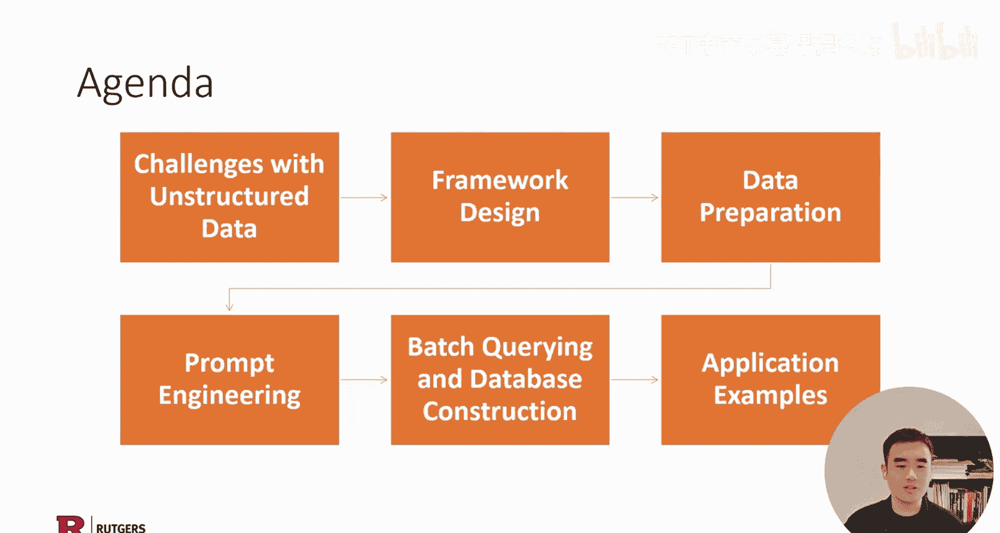
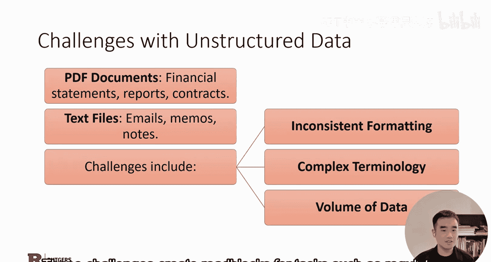
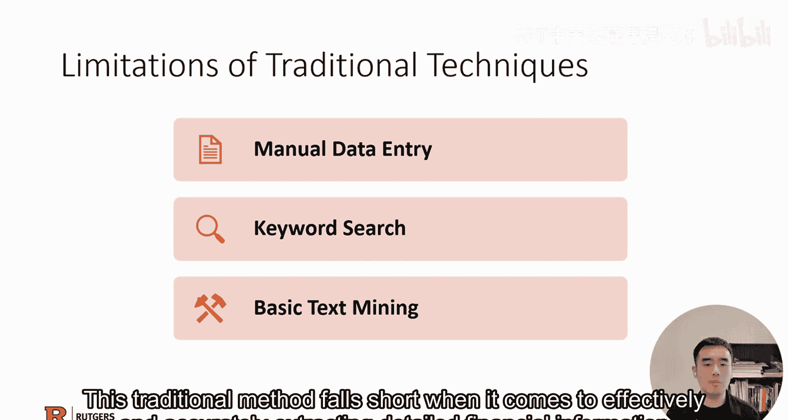
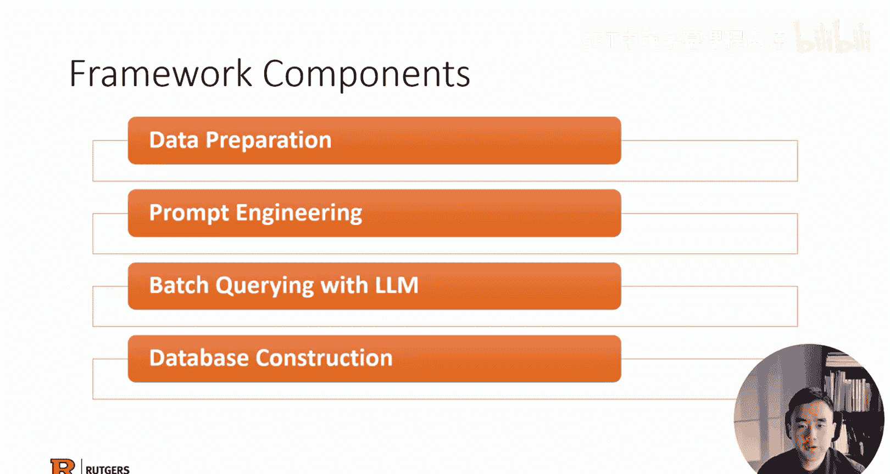

# 生成式人工智能与政府财务报告：P10：非结构化数据介绍

在本节课中，我们将学习如何从非结构化数据源（如PDF文档）中提取财务数据。这是一个在会计和金融领域常见的挑战。课程结束时，你将理解如何利用大语言模型（LLM）有效地从非结构化源中提取有价值的数据。

## 议程概述

今天的议程将涵盖几个重要主题。以下是主要内容：

*   **非结构化数据的挑战**：了解处理PDF等文档的困难。
*   **框架设计**：介绍一个基于LLM的高效数据提取框架。
*   **数据准备**：详细说明转换和准备非结构化数据以供处理的步骤。
*   **提示词工程**：讨论如何设计有效的提示词以进行准确可靠的数据提取。
*   **批量处理与数据库构建**：自动化处理过程，并组织结果以便于访问和分析。
*   **应用示例**：使用真实案例演示该框架的实际运作。

现在，让我们从讨论非结构化数据面临的挑战开始。

## 非结构化数据的挑战 🧩

非结构化数据是指不遵循预定义数据模型或组织形式的信息。一些常见的例子包括：
*   **PDF文档**：如财务报表、报告和合同。
*   **文本文件**：如电子邮件、备忘录和笔记。

现在，让我们看看非结构化数据带来的一些挑战：

*   **不一致的格式**：每个文档可能有独特的布局，这使得自动化工具难以准确提取数据。
*   **复杂的专业术语**：财务和政府文件经常使用专业语言和行话，这可能会让未针对此级别特异性设计的标准化提取工具感到困惑。
*   **数据量巨大**：手动处理大量非结构化数据不仅耗时，而且在大多数情况下也不切实际。

这些挑战为监管合规、研究和决策制定等任务设置了障碍，使得开发更有效的方法来处理此类数据变得至关重要。

## 传统方法的局限性 ⚙️

从非结构化源提取数据的传统方法有其自身的局限性。例如：

*   **手动数据录入**：仍被许多组织使用，但非常耗时且容易出错。
*   **关键词搜索**：这种方法通常效果不佳，因为它难以处理不同文档间变化的术语。
*   **基础文本挖掘工具**：可以提取一些信息，但它们往往会遗漏细节，并且难以理解数据的更广泛背景。

这些传统方法在从复杂的非结构化文档中有效且准确地提取详细的财务信息方面存在不足，这使得采用更先进的方法变得必要。

## 基于LLM的提取框架 🏗️

我们将要使用的框架包含四个主要组成部分：

*   **数据准备**：这涉及将非结构化文档转换为机器可读的文本，这是使数据可供提取的第一步。
*   **提示词工程**：在这里，我们专注于设计特定的提示词，以指导大语言模型提取我们所需的精确信息。
*   **基于LLM的批量处理**：一旦提示词设置好，我们就可以自动化处理过程，以高效处理多个文档。
*   **数据库构建**：数据提取后，我们将其组织成结构化格式，以便于分析和用于决策。

现在，让我们更详细地探讨每个组成部分。

## 总结

本节课中，我们一起学习了从非结构化数据中提取财务信息所面临的挑战、传统方法的局限性，并介绍了一个基于大语言模型（LLM）的四步提取框架。该框架包括**数据准备**、**提示词工程**、**批量处理**和**数据库构建**。在下一讲中，我们将详细介绍**数据准备**部分。