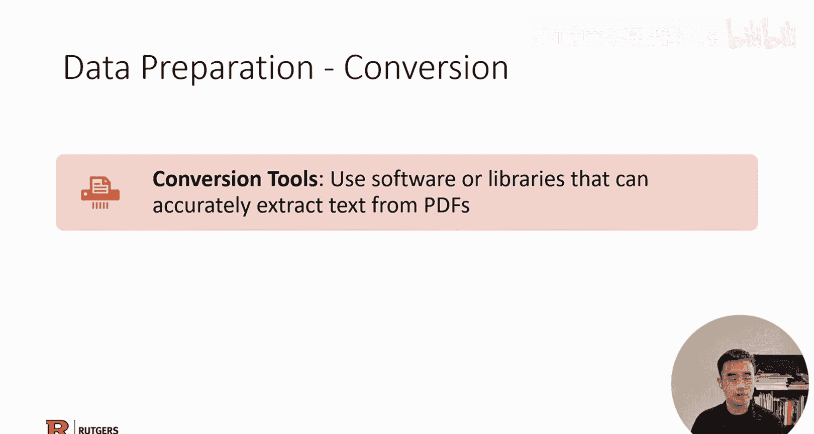
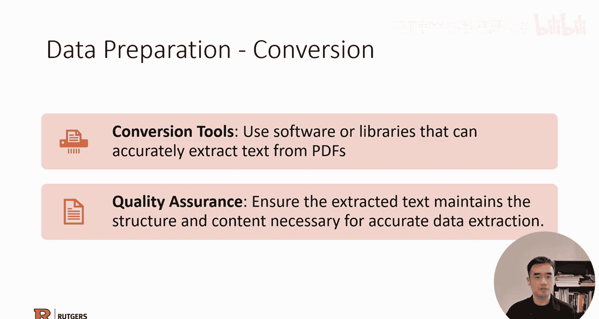
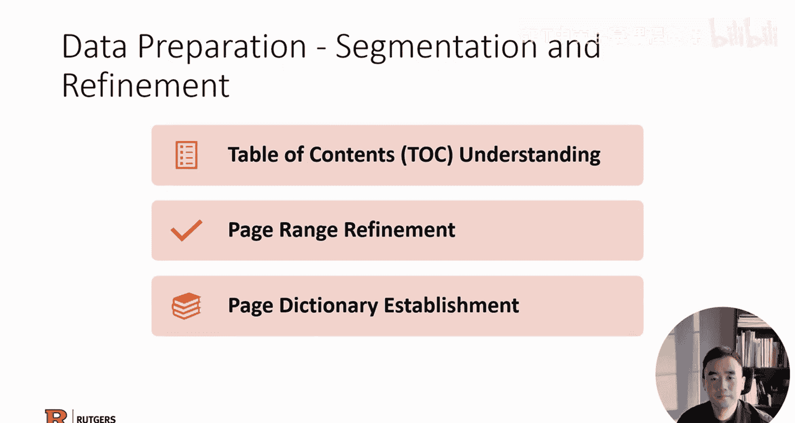

# 生成式人工智能与政府财务报告：P11：数据准备 📄

在本节课中，我们将学习数据处理流程中的第一步：数据准备。我们将了解如何将原始文档转换为可供机器学习模型处理的文本，以及如何对文本进行分段和精炼，以提高后续信息提取的准确性和效率。

---

上一节我们介绍了整体框架，本节中我们来看看数据准备的具体步骤。

数据准备的第一步是将文档转换为机器可读的文本。这一步至关重要，因为如果不将非结构化的数据（如PDF文档）进行转换，我们就无法开始后续的信息提取过程。



为了实现这一转换，我们需要依赖专门的转换工具。这包括能够从PDF文件中准确提取文本的专用软件或程序库。如果你处理的是扫描件文档，那么**OCR（光学字符识别）** 技术就变得必不可少，它能将图像中的文字转换为可编辑和可搜索的数据。

```python
# 示例：使用Python的pdfplumber库提取PDF文本
import pdfplumber

with pdfplumber.open('document.pdf') as pdf:
    text = ''
    for page in pdf.pages:
        text += page.extract_text()
    print(text)
```



在此步骤中，质量保证同样至关重要。提取出的文本需要保持其原始的结构和内容，以确保后续数据提取过程的准确性。如果文本没有经过妥善准备，可能会导致后续阶段出现错误。简而言之，恰当的数据准备是后续所有环节成功的基础。

---

在完成初步的文本转换之后，我们接下来进入文本的分段与精炼阶段。这一步能帮助我们聚焦于文档中最相关的部分，以便进行信息提取。

我们首先从**目录理解**开始。在这里，我们可以利用大语言模型来解读目录，并识别出可能包含我们所需数据的特定章节。这一步对于将我们的注意力集中在文档最相关的部分至关重要。

以下是目录理解与精炼的几个关键步骤：

*   **目录理解**：利用模型识别文档结构，定位目标章节。
*   **页码范围精炼**：在已识别的章节内，进一步缩小页码范围，确保只处理最可能包含目标数据的页面，减少不必要的处理。
*   **创建页面字典**：建立一个将页码映射到特定内容的字典。

```python
# 示例：创建一个简单的页面内容字典
page_dictionary = {
    10: "财务报表 - 资产负债表",
    11: "资产负债表（续表）",
    12: "财务报表 - 利润表",
    # ... 更多映射
}
```

创建页面字典本质上是对页码和特定内容进行映射。这使得在提取过程中能够快速、轻松地检索相关信息。通过这样做，我们显著减少了模型需要处理的无关数据量，从而提高了提取过程的准确性和效率。

---



本节课中我们一起学习了数据准备的两个核心环节：**文档到文本的转换**与**文本的分段精炼**。我们了解到，使用合适的工具（如OCR）进行高质量的文本转换是基础，而通过目录理解和创建页面字典来聚焦相关文本，则是提升后续AI处理效能的关键。下一节课，我们将介绍不同的提示词工程技巧。