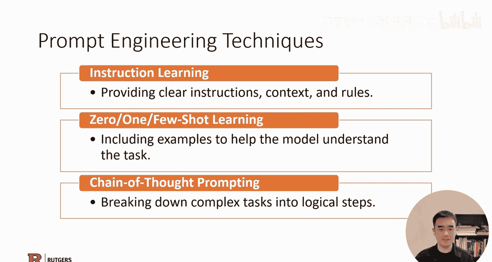
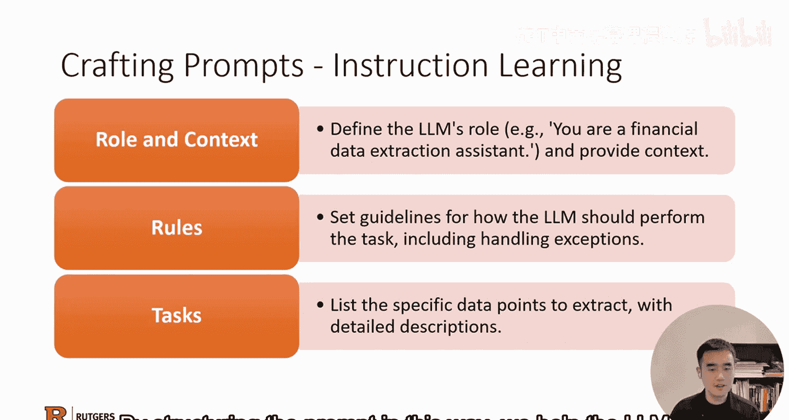
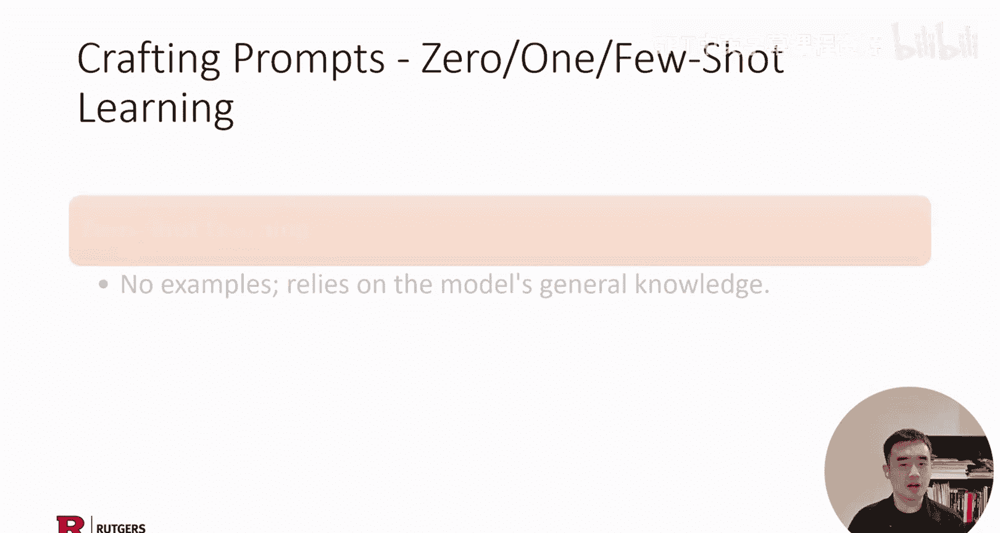
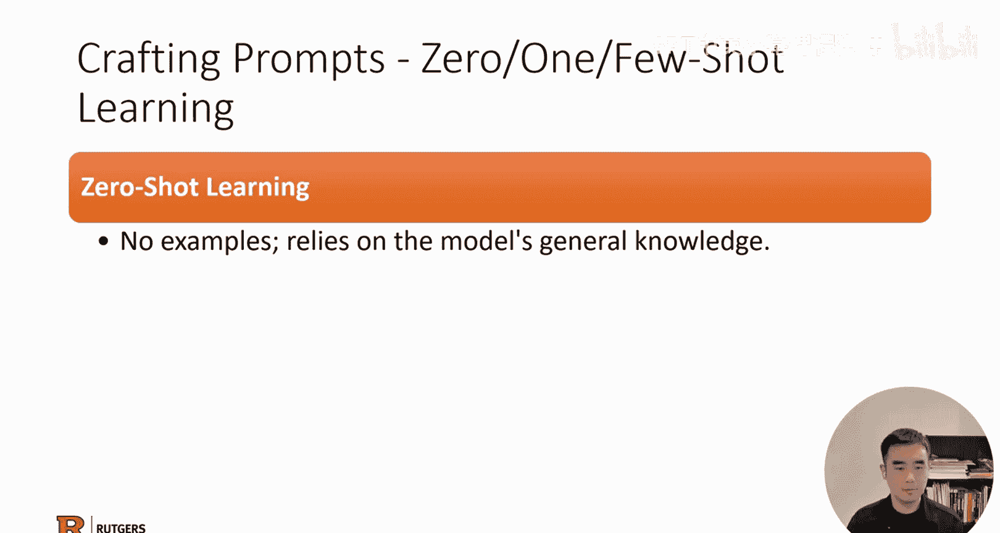
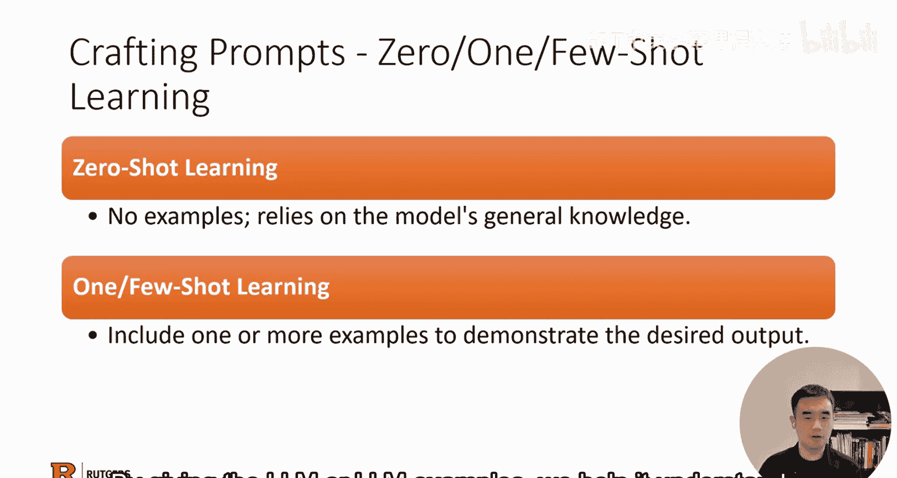
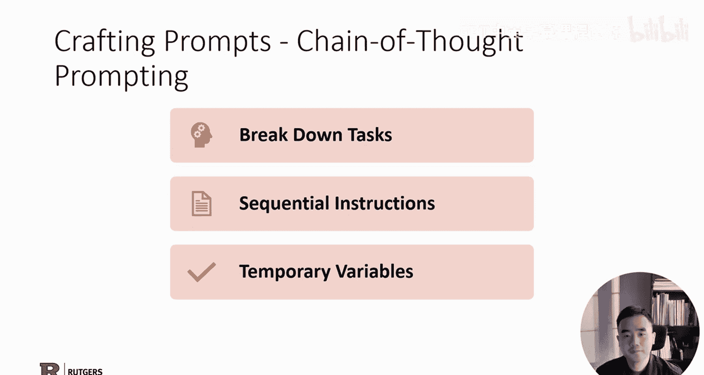

# 生成式人工智能与政府财务报告：P12：提示工程技术 🧠

在本节课中，我们将学习几种关键的提示工程技术。这些技术对于引导大型语言模型准确提取所需信息至关重要。

上一节我们介绍了生成式人工智能的基础概念，本节中我们来看看如何通过精心设计的提示来优化模型的表现。

## 概述：什么是提示工程技术？ 🤔

提示工程技术是一系列用于设计和优化输入给大型语言模型的指令的方法。通过使用这些技术，我们可以显著提升模型在信息提取任务中的精确度和效率。

## 有效的提示工程技术 ✨

以下是几种核心的提示工程技术，它们能帮助我们更好地引导模型。

### 1. 指令学习

指令学习涉及向模型提供清晰的指令、上下文和规则，使其明确知道需要寻找什么信息以及如何提取。

在指令学习中，我们通常将提示结构化为三个关键部分来有效引导模型：
*   **角色与上下文**：首先定义模型的角色并提供必要的背景。例如，我们可以说“你是一个财务数据提取助手”。这为模型设定了任务场景。
*   **规则**：设定模型执行任务的具体指导方针。这可以包括如何处理缺失数据或模糊信息等例外情况的指令，以确保输出的一致性和准确性。
*   **任务**：详细列出我们需要模型提取的具体数据点。例如，我们可以指定“从财务摘要中提取总收入数字”。

通过这种方式构建提示，我们帮助模型准确理解预期目标，从而提高提取的准确性和效率。

### 2. 零样本与少样本学习

这种技术通过提供一个或多个示例，向模型展示我们所寻找的目标，从而帮助模型更好地理解任务并提高其准确性。

对于更复杂的提取任务，我们可以通过提供示例来增强模型的性能。主要有两种方法：
*   **零样本学习**：在这种情况下，完全不提供示例，依靠模型的通用知识来处理任务。这对于简单的任务或当没有可用示例时很有用。
*   **少样本学习**：当任务更复杂时，我们提供一个或多个示例来演示期望的输出。这些示例展示了输入的格式以及期望的输出应该是什么样子。通过给模型提供示例，我们帮助它更清晰地理解任务，并将其推广到新的类似任务中，从而实现更准确可靠的提取。

### 3. 思维链提示

思维链提示是一种引导模型进行逐步推理过程的技术，对于更复杂的提取任务尤其有帮助。

以下是思维链提示的关键步骤：
*   **分解任务**：首先将提取任务分解为更小的逻辑步骤。这使得模型可以一次专注于任务的一部分，而不是试图一次性提取所有内容。
*   **顺序指令**：我们提供逐步指导，引导模型按顺序完成过程的每个部分。这确保了模型在提取过程中遵循清晰、逻辑的路径。
*   **使用临时变量**：在此过程中，我们可以使用占位符或临时变量来存储中间结果。这使得模型在逐步执行时能够记住关键信息。

通过使用思维链提示，我们提高了模型处理更复杂提取任务的能力，特别是那些需要一定程度的推理和逻辑才能得出正确答案的任务。

## 总结 📝

本节课我们一起学习了三种核心的提示工程技术：**指令学习**、**零样本/少样本学习**和**思维链提示**。每种技术都通过不同的方式（如结构化指令、提供示例或分解推理步骤）来引导大型语言模型，从而在信息提取任务中实现更高的精确度和效率。掌握这些技术是有效利用生成式人工智能的关键。