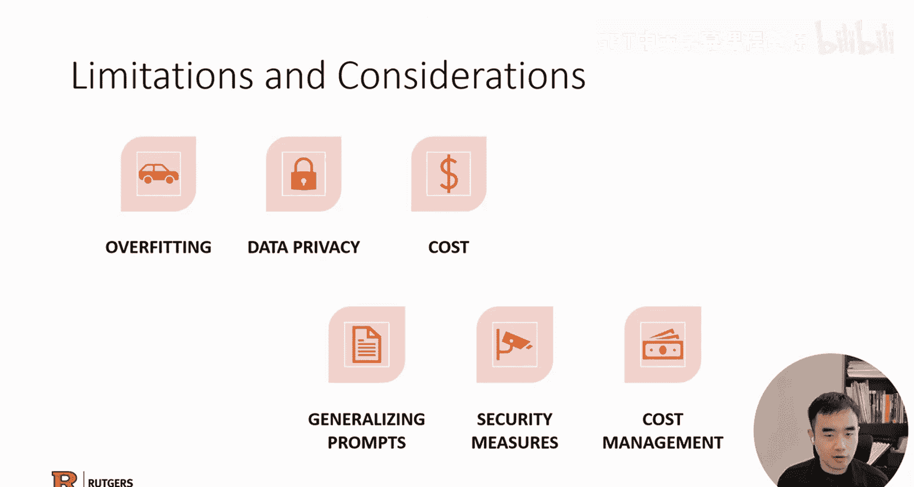
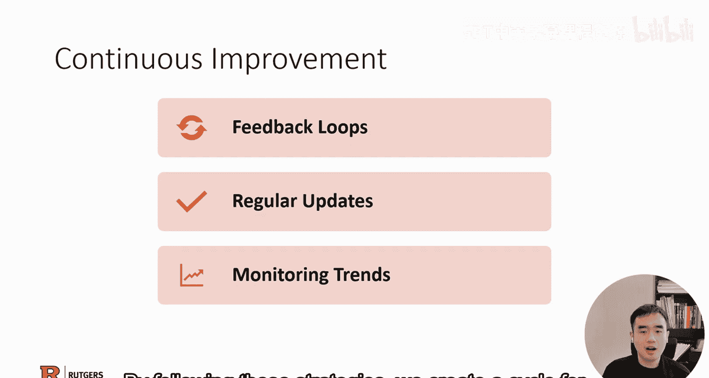
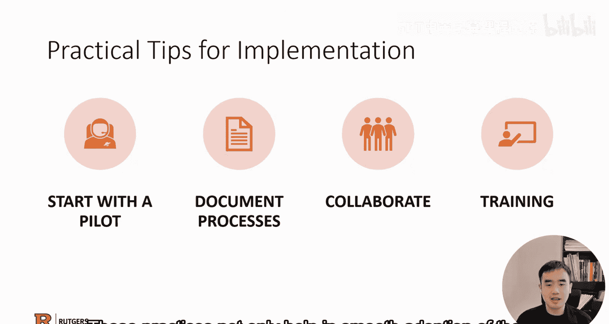
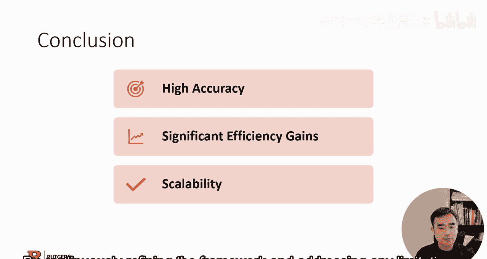
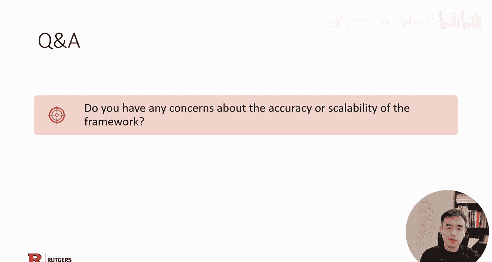
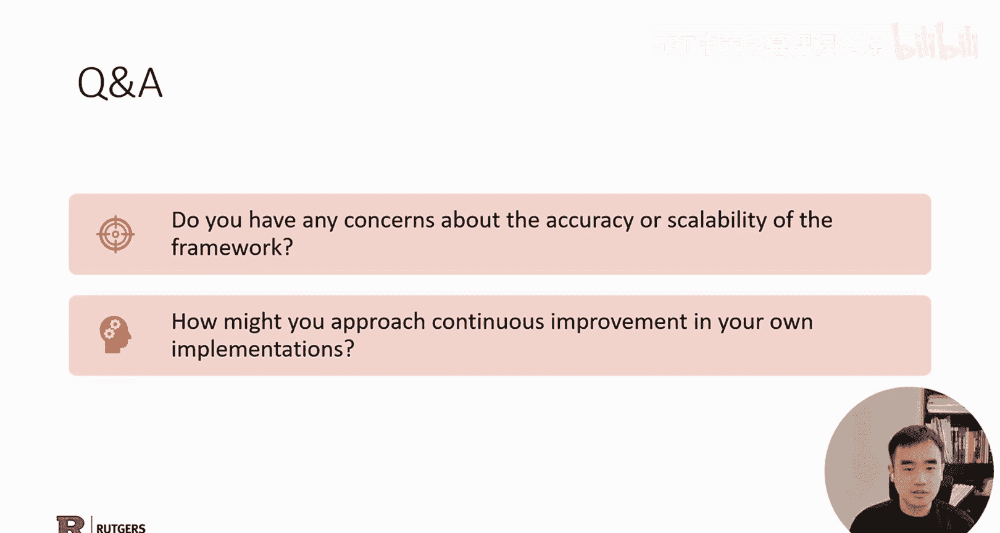

# 生成式人工智能与政府财务报告：P18：限制考虑与总结 🎯

在本节课中，我们将讨论在使用生成式AI框架处理政府财务报告时，需要注意的一些限制、考量因素以及实用的建议。我们将确保框架不仅有效，而且安全、经济且可持续。

---

上一节我们介绍了框架的性能评估，本节中我们来看看在应用过程中可能遇到的一些限制和挑战。

尽管我们的框架表现出色，但仍有一些重要的限制需要考虑。

以下是三个主要的限制因素：

1.  **过拟合**：当提示词过于针对特定数据集时，在其他文档上的表现可能不佳。
2.  **隐私问题**：由于我们处理的是敏感的财务数据，采用安全的方法至关重要。
3.  **成本**：像GPT-4这样的高级模型虽然准确率更高，但使用成本可能较高。

为了应对这些问题，我们可以采取以下措施：

*   **泛化提示词**：设计能够适用于多种文档类型的提示词，以防止过拟合。
*   **实施安全措施**：例如，使用加密连接并遵守数据保护法规，以确保数据隐私。
*   **管理成本**：优化提示词以减少令牌使用量，并在可行时考虑替代模型。

通过解决这些问题，我们可以使框架更具通用性、更安全且更具成本效益。

---

为了确保我们的框架能够长期保持有效，持续改进非常重要。

以下是保持框架性能的几个关键策略：

1.  **反馈循环**：纳入用户反馈和错误报告，以优化框架的准确性和可用性。
2.  **定期更新**：每当新版本的AI模型发布时，调整提示词和方法以保持与时俱进。
3.  **关注趋势**：密切关注人工智能和数据提取领域的发展，以采用新的、更有效的技术。

遵循这些策略，我们可以建立一个持续改进的循环，帮助框架在技术发展中保持高性能。

---

为了成功采用并利用这个框架，以下是一些需要牢记的实用技巧。

以下是四个关键的实施建议：

1.  **从试点开始**：首先在较小、易管理的数据集上测试框架。这有助于及早发现问题，在受控环境中评估性能，并在全面推广前做出必要调整。
2.  **记录流程**：详细记录所有提示词、设置和结果。这便于复制成功的配置，并在出现问题时进行故障排除。文档对于保持一致性、可重复性至关重要，尤其是在团队成员协作或时间跨度较长的情况下。
3.  **与IT和数据专家协作**：与IT和数据专家合作对于解决技术挑战（如将框架集成到现有系统或确保数据安全）非常有价值。他们的专业知识有助于优化性能和更有效地解决问题。
4.  **培训团队成员**：为将使用该框架的团队成员提供针对性培训。这能确保他们理解使用框架的最佳实践，能够准确解读结果，并准备好根据需要做出调整。

这些实践不仅有助于框架的顺利采用，还能通过确保团队准备就绪、流程一致和技术支持到位，最大限度地发挥其效力。

---

在本节课中，我们一起学习了如何评估和改进生成式AI框架。总结来说，评估我们的LLM框架性能需要仔细审视准确性和效率。

首先，**高准确性**。我们通过细致的提示词工程和持续优化来实现这一点，以确保可靠的数据提取。

其次，**显著的效率提升**。自动化使得处理时间大幅减少，框架比手动方法快得多。

最后，**可扩展性**。该框架在大型数据集上表现有效，随着数据量的增加，能保持一致的准确性和速度。

通过不断优化框架并解决其局限性，组织可以显著增强其数据提取能力，从而获得更可靠、更高效的流程。

---

现在，本模块的内容已经结束，欢迎大家提问和讨论。

您对框架的准确性或可扩展性有任何疑问吗？在您自己的数据中应用它时，预见到哪些具体的挑战？

您在自己的实施过程中会如何着手进行持续改进？您考虑过哪些技术来确保持续的准确性和效率？

请随时分享您的想法、见解或任何其他问题。