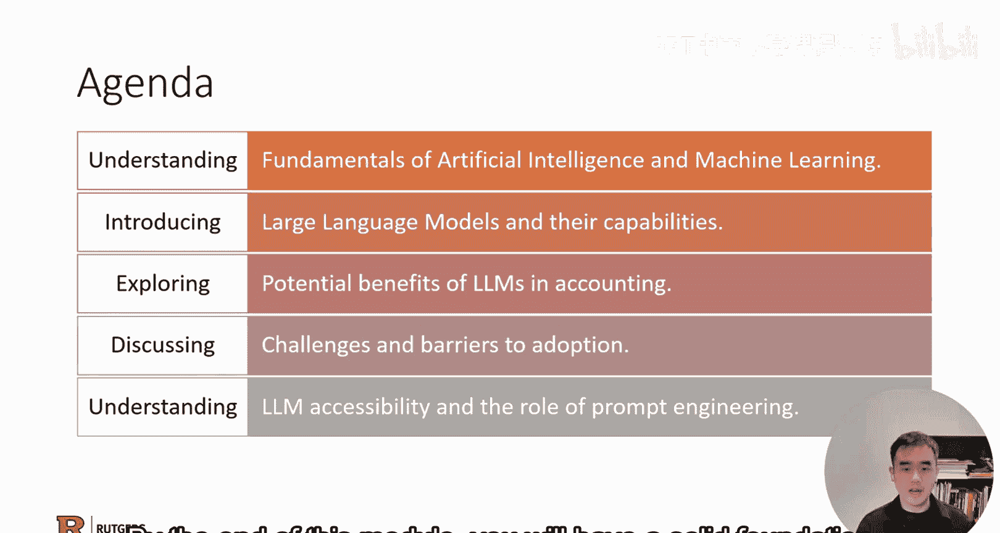
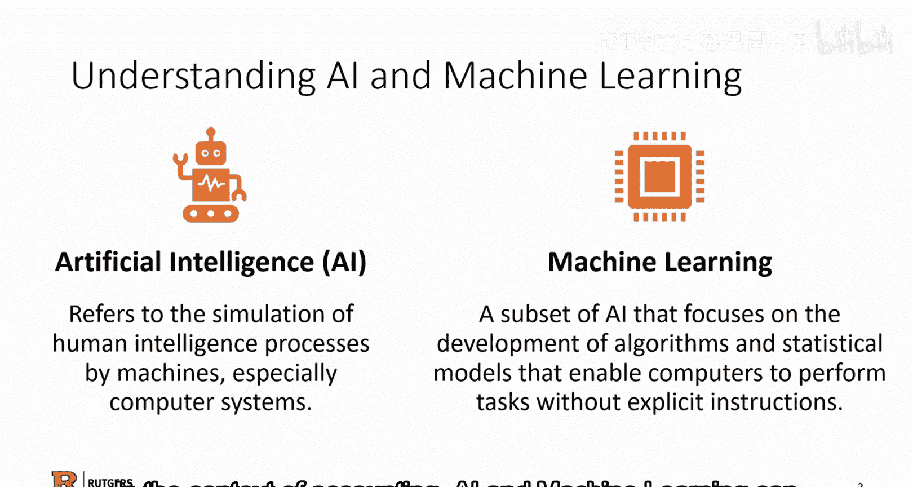
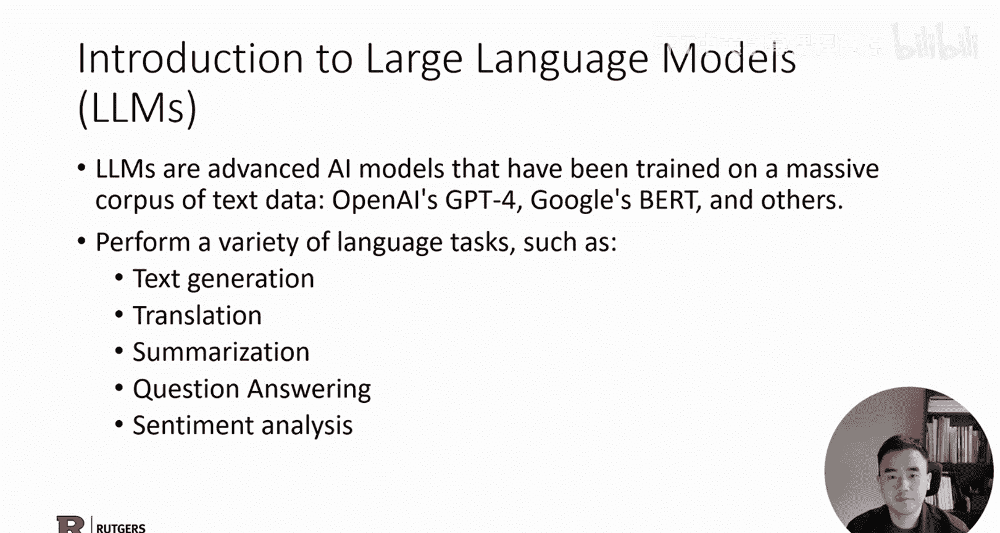

生成式人工智能与政府财务报告：P1：欢迎、议程与介绍 📚

在本节课中，我们将开启生成式人工智能在政府报告与会计领域应用的探索之旅。我们将首先了解人工智能与机器学习的基础概念，然后重点介绍大型语言模型及其能力，并探讨它们为会计行业带来的机遇与挑战。

---

首先，我们来讨论什么是人工智能和机器学习。

**人工智能** 是指机器（特别是计算机系统）对人类智能过程的模拟。这些过程包括学习、推理、解决问题、感知和语言理解。

**机器学习** 是人工智能的一个子集，专注于开发算法和统计模型，使计算机能够在没有明确指令的情况下执行任务。相反，它们依赖于从数据中发现的模式和推断。本质上，它是关于教会计算机从数据中学习并基于数据做出决策。

在会计领域，人工智能和机器学习可以自动化常规任务、分析大型数据集以获得洞察，甚至可以根据历史数据预测未来趋势。

---

上一节我们介绍了人工智能的基础，本节中我们来看看大型语言模型。

**大型语言模型** 是在海量文本数据语料库上训练出来的先进人工智能模型。它们旨在以类人的方式理解、生成和处理人类语言。

以下是大型语言模型的示例：
*   OpenAI 的 GPT-4
*   Google 的 BERT

这些模型可以执行多种语言任务，例如：
*   文本生成
*   翻译
*   摘要
*   问答
*   情感分析

大型语言模型真正具有变革性的地方在于它们处理和生成自然语言的能力，这使它们成为处理涉及非结构化文本数据任务的极其通用的工具。

---

本节课中我们一起学习了人工智能、机器学习以及大型语言模型的基本概念，并初步了解了它们在会计领域的潜在应用。这为我们后续深入探讨生成式人工智能如何变革会计实践奠定了坚实的基础。