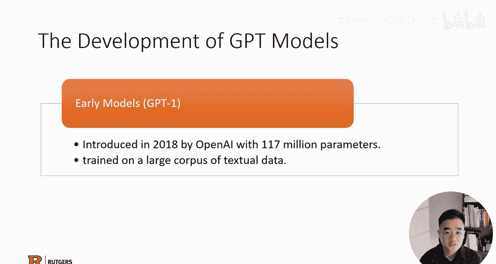
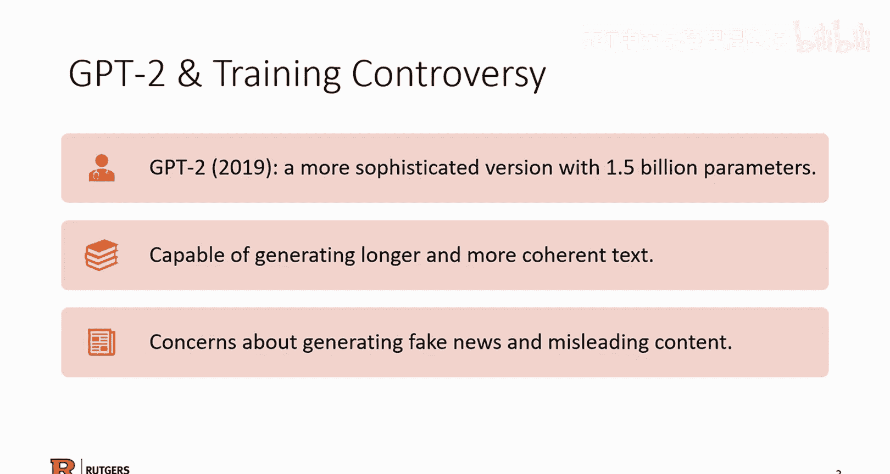
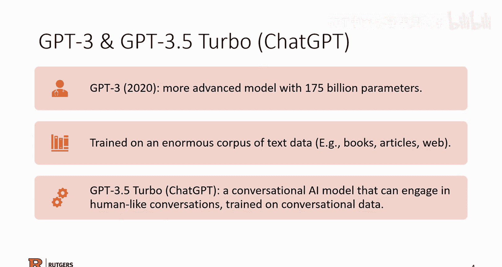
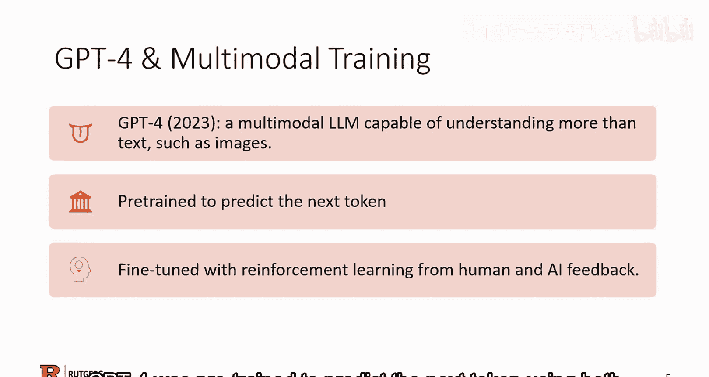
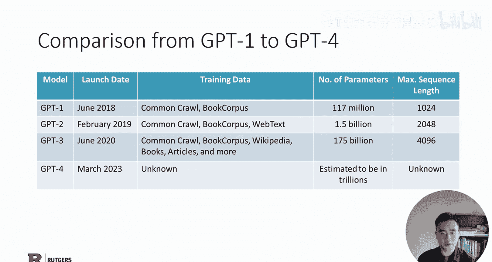

# 生成式人工智能与政府财务报告：P2：GPT模型的发展 📈

在本节课中，我们将学习GPT模型的发展历程。了解这段历史，有助于我们批判性地思考，并理解为何需要学习这些模型，以及它们为何如此具有前景。

## GPT模型的演进之路

上一节我们介绍了课程背景，本节中我们来看看GPT模型是如何一步步发展至今的。理解GPT模型的演进过程，是理解其重要性的关键。

### GPT-1：早期探索

GPT-1于2018年由OpenAI推出，标志着大型语言模型的早期发展。它拥有**1.17亿**个参数，通过无监督学习在大量文本语料库上进行训练，旨在生成连贯的文本。

### GPT-2：能力与争议

GPT-2于2019年发布，是一个更复杂的版本，拥有**15亿**个参数。它能够生成长度更长、更连贯的文本。然而，其发布引发了争议，主要担忧其可能被滥用于生成假新闻和误导性内容。

### GPT-3与GPT-3.5：重大飞跃

GPT-3和GPT-3.5代表了显著的进步，后者正是知名产品ChatGPT的核心。GPT-3于2020年推出，拥有**1750亿**个参数。它在海量文本数据（包括书籍、文章和网页）上训练，使其成为当时最先进的模型。ChatGPT是一个对话式AI模型，在大量对话数据上训练，使其能够生成类人的对话。

### GPT-4：多模态新时代

最新的模型GPT-4于2023年推出。它是一个**多模态**大型语言模型，不仅能理解文本，还能理解图像和表格。GPT-4使用公共数据和许可数据进行预训练以预测下一个标记，并通过人类和AI反馈的强化学习进行微调。

## 为何要学习模型发展史？

我们花时间学习这些模型的历史和发展是至关重要的，这有助于我们理解GPT模型的快速演进。

以下是GPT模型发展的几个关键变化点：

*   **参数规模**：决定模型大小和能力的关键指标，从GPT-1的1.17亿，到GPT-2的15亿，再到GPT-3的1750亿，如今GPT-4的参数估计已达**万亿**级别，呈指数级增长。
*   **模型智能**：早期模型训练集较小，智能有限，只能回答狭窄范围的问题。而GPT-4等现代模型则要智能得多。
*   **序列长度**：模型能处理的最大序列长度也显著增加，进一步增强了其能力。

这种演进突显了模型在规模、准确性以及训练数据复杂性方面的全面进步。

## 总结

本节课中，我们一起学习了从GPT-1到GPT-4的发展历程。我们看到，在短短五年内，模型的参数规模、智能水平和处理能力都实现了巨大飞跃。这种快速演进正是大型语言模型如此重要且前景广阔的原因。在下一讲中，我们将介绍大型语言模型在会计领域应用的潜力、机遇与挑战。