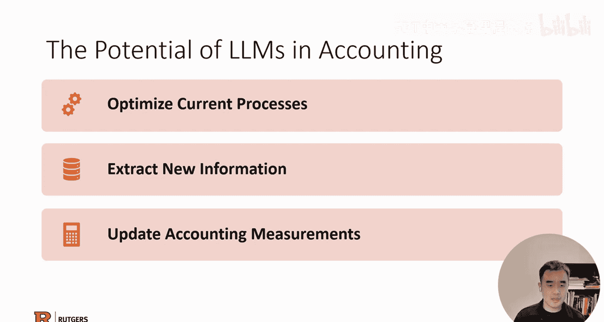
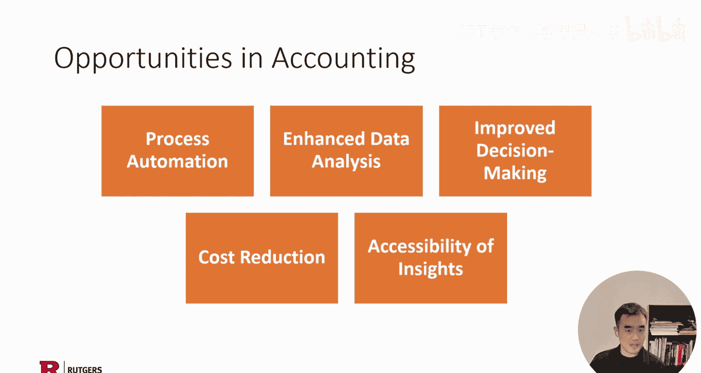
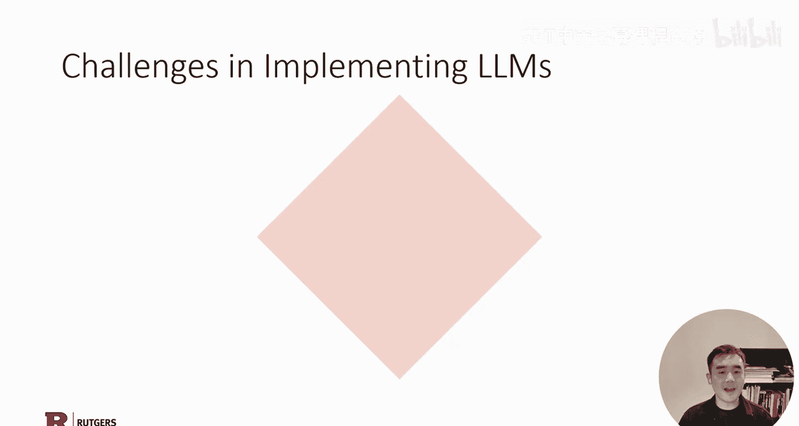
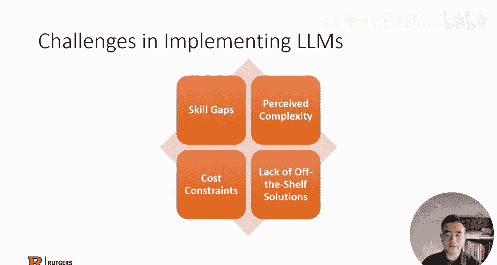

# 生成式人工智能与政府财务报告：P3：大型语言模型与会计 💼

在本节课中，我们将探讨大型语言模型在会计领域应用的潜力、机遇与挑战。

上一节我们介绍了生成式人工智能的基础概念，本节中我们来看看大型语言模型如何具体融入会计世界。

大型语言模型的出现，为改革当前各行业的会计实践带来了巨大潜力。在会计领域，它们可以优化现有流程，例如自动化数据录入、对账和报告生成等日常任务。它们还能从非结构化数据源（如PDF文档或扫描文件）中提取新的、更细粒度的财务信息。此外，大型语言模型可以更新会计计量方式，通过提供实时分析和洞察，实现更准确、更及时的财务报告。例如，一个大型语言模型可以在人类所需时间的一小部分内，阅读数千页财务报表并提取关键财务指标。

---

接下来，让我们更深入地探讨大型语言模型为会计领域带来的具体机遇。

以下是大型语言模型在会计中的五大机遇：

1.  **流程自动化**：大型语言模型可以处理重复且耗时的任务，让会计师能够专注于更高价值的活动。
2.  **增强数据分析**：它们能够分析海量数据，识别传统方法可能遗漏的模式、异常或趋势。
3.  **改善决策制定**：通过从非结构化数据中提供洞察，大型语言模型有助于做出更明智的战略决策。
4.  **降低成本**：自动化和效率提升可以随着时间的推移带来显著的成本节约。
5.  **提升洞察可及性**：大型语言模型可以将复杂的财务数据翻译成利益相关者易于理解的语言。

---

尽管机遇令人鼓舞，但在会计领域实施大型语言模型也面临一些挑战和担忧。

以下是实施过程中需要克服的四大挑战：

1.  **技能差距**：许多会计师可能缺乏有效实施和管理人工智能解决方案所需的技术专长。
2.  **感知复杂性**：将大型语言模型集成到现有系统中，可能因其涉及的技术和后勤复杂性而进展缓慢。
3.  **成本限制**：人工智能解决方案的初始投资和持续维护成本可能很高，对小型公司尤其如此。
4.  **缺乏现成方案**：目前缺乏专门为会计需求量身定制的现成人工智能工具，通常需要定制开发。

这些挑战可能成为采用的障碍，减缓人工智能融入会计实践的速度。

---

本节课中，我们一起学习了大型语言模型在会计领域的应用潜力、具体机遇以及实施过程中面临的主要挑战。下一讲，我们将讨论如何通过提示工程等方法应对这些挑战，并探讨大型语言模型可访问性的演变。

我们下节课见。