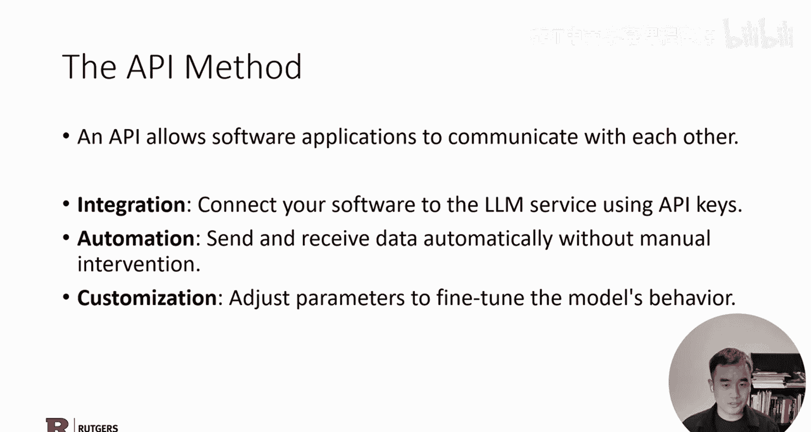
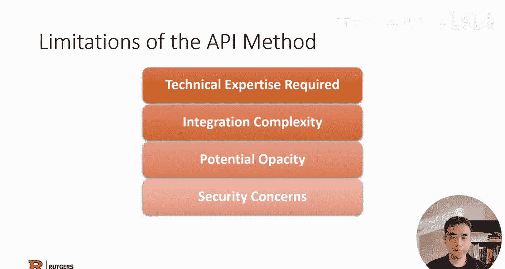
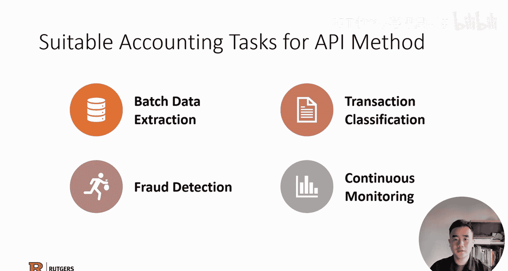

**生成式人工智能与政府财务报告：P6：API方法** 🚀

在本节课中，我们将介绍生成式人工智能的API方法。我们将了解什么是API，它的工作原理、优势、挑战以及适用的任务场景。

---

上一节我们介绍了生成式人工智能的基本概念，本节中我们来看看如何通过编程接口（API）来使用它。

API（应用程序编程接口）允许不同的软件应用程序相互通信。通过大型语言模型（LLM）的API，你可以在自己的应用程序或工作流程中，以编程方式发送提示词并接收模型的响应。

以下是API方法的工作原理：
*   **集成**：使用API密钥将你的软件连接到LLM服务提供商。
*   **自动化**：无需人工干预，自动发送和接收数据。
*   **定制化**：调整参数以微调模型的行为和性能。

---

了解了基本流程后，我们来看看使用API方法有哪些优势。

以下是API方法的几个主要优势：
*   **可扩展性**：无需人工干预，即可高效处理大量数据。
*   **自动化**：无需手动输入和输出数据。
*   **定制化**：可以设置如 `temperature`（温度）、`max_tokens`（最大令牌数）等参数，或指定系统、用户、助手等角色的对话规则。
*   **集成性**：可以将LLM的能力直接嵌入到现有的工作流程或系统中。
*   **自动化效益**：减少大量人工工作和努力，并最大限度地减少错误。

---

然而，API方法也伴随着一些挑战。

API方法面临以下挑战：
*   **技术要求**：API需要编程技能和对机制的基本理解，以便正确设置。
*   **集成复杂性**：可能与不支持API连接的遗留系统或内部系统集成困难。
*   **潜在的不透明性**：API处理过程可能成为一个“黑箱”，使得故障排除过程比UI方法更复杂。
*   **安全顾虑**：通过API传输的数据必须得到保护，以确保敏感信息安全。

---

那么，API方法最适合哪些类型的任务呢？

API方法非常适合以下几类任务：
*   **数据提取**：无需人工干预，高效处理大型数据集。
*   **交易分类**：基于一组预定义的规则和法规，自动对财务交易进行分类。
*   **欺诈检测**：分析海量数据中的模式，以识别异常。
*   **持续监控或持续审计**：结合上述不同功能，执行那些受益于自动化和分类的持续性任务。

总而言之，当你需要扩展操作规模并与其他系统集成时，API方法是最佳选择。

---

本节课中我们一起学习了生成式人工智能的API方法，包括其工作原理、优势、挑战和适用场景。下一讲，我们将介绍机器人流程自动化（RPA）以及如何将其与UI方法相结合。