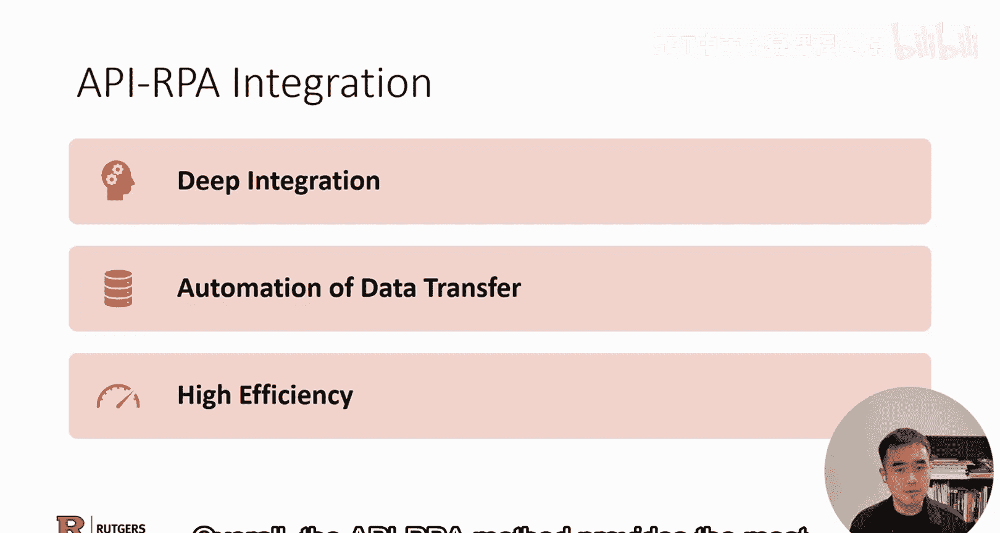
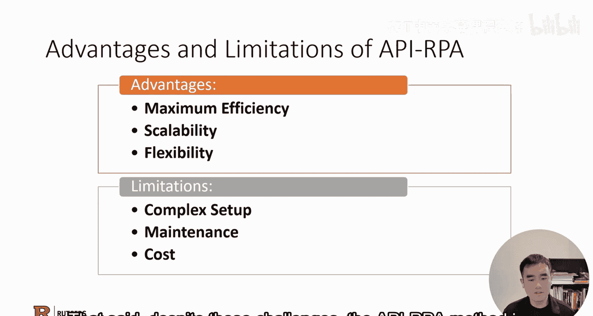
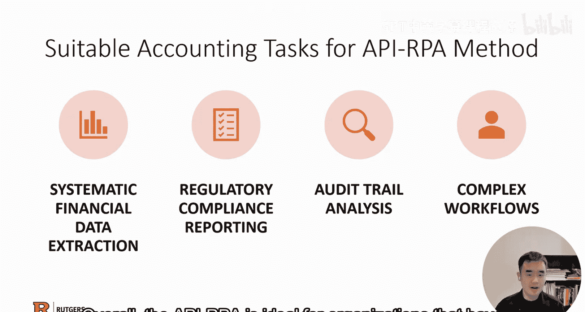
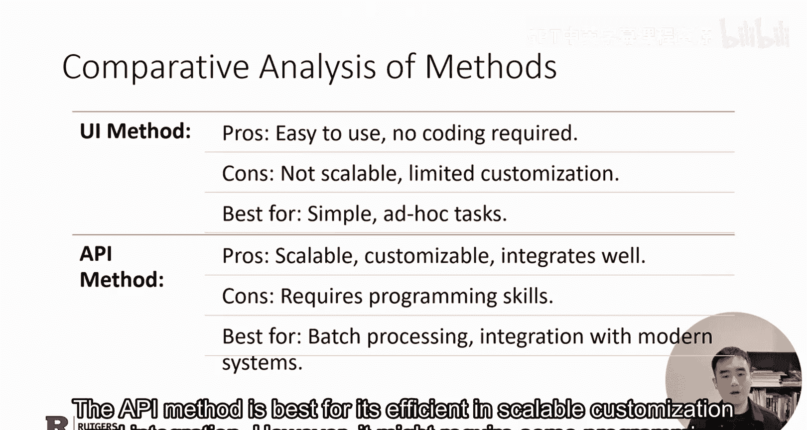
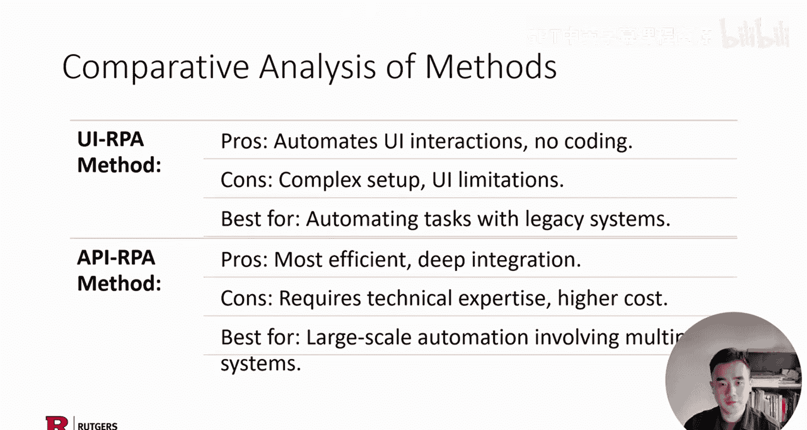

生成式人工智能与政府财务报告：P8：API与RPA集成

在本节课中，我们将要学习如何将API方法与RPA（机器人流程自动化）相结合，以构建一个强大且灵活的自动化解决方案。这种集成方法旨在融合两种技术的优势，实现端到端的高效流程自动化。

上一节我们介绍了单独的API方法和UI方法，本节中我们来看看如何将它们结合起来。

😊 最后，我们来谈谈API-RPA方法，它结合了两种方法的优点：API的强大功能和RPA的灵活性。这种方法提供了深度集成，利用API来执行高效的查询，同时允许自动化数据传输，RPA则介入与不支持API连接的系统进行交互。其结果是高效率，因为端到端的流程可以自动化，几乎无需人工干预，确保工作流程顺畅可靠地运行。总体而言，API-RPA方法提供了最全面的自动化解决方案，通过最大化效率来集成系统和流程。

现在，让我们回顾一下API-RPA方法的优势。

以下是API-RPA方法的主要优点：
*   **最大效率**：它不仅自动化查询，还自动化数据集成。
*   **高度可扩展性**：能够处理大量的数据和工作流。
*   **灵活性**：这种方法能很好地适应涉及多个系统并需要无缝协调的更复杂工作流。

然而，也存在一些需要考虑的限制。

以下是API-RPA方法的主要挑战：
*   **设置复杂**：这是主要挑战之一，因为它需要同时具备API和RPA方面更高水平的技术专长。
*   **维护问题**：由于系统或API的任何更新都可能需要对自动化设置进行调整。
*   **成本考虑**：与UI方法等更简单的解决方案相比，初始的设置和员工培训投资可能更高。

因此，尽管存在这些挑战，对于寻求跨系统深度集成和全面自动化的组织而言，API-RPA方法是最佳选择。

现在，让我们谈谈API-RPA真正大放异彩的领域。

以下是API-RPA方法的最佳应用场景：
*   **系统性财务数据提取**：它可以自动化从各种来源提取数据并将其集成到数据库中。
*   **监管合规报告**：通过自动化报告的生成和提交，确保组织保持合规，无需持续的人工干预。
*   **审计线索分析**：系统可以持续监控异常或潜在的欺诈行为，提供对财务流程的实时洞察。
*   **涉及多个系统和大量数据的复杂工作流**：API-RPA被证明是最有效的解决方案，能够轻松处理这些复杂的任务。

总体而言，API-RPA非常适合那些具备技术支持能力来处理这种复杂程度，并寻求稳健、可扩展自动化解决方案的组织。

为了总结，以下是我们在本模块中介绍的不同方法的比较。

以下是不同自动化方法的对比：
*   **UI方法**
    *   **优点**：易于使用，无需编码。
    *   **缺点**：不可扩展，定制化有限。
    *   **适用场景**：最适合简单和临时性任务，例如客户互动。
*   **API方法**
    *   **优点**：高效、可扩展、可定制和集成。
    *   **缺点**：可能需要一些编程技能来连接。
    *   **适用场景**：适合批处理、与现代系统集成等任务。
*   **UI-RPA方法**
    *   **优点**：终极UI集成，无代码环境。
    *   **缺点**：设置复杂，受限于UI自身的限制。
    *   **适用场景**：适合自动化遗留系统的任务。
*   **API-RPA方法**
    *   **优点**：高效，具备最深度的集成能力。
    *   **缺点**：需要技术专长，涉及更高成本。
    *   **适用场景**：适合涉及多个系统的大规模自动化。

本节课中我们一起学习了API与RPA的集成方法，了解了其优势、挑战以及最佳应用场景。通过对比不同方法，我们可以根据具体任务需求和技术能力选择最合适的自动化策略。在下一讲中，我们将总结本模块并提供一些实用建议。感谢观看。

