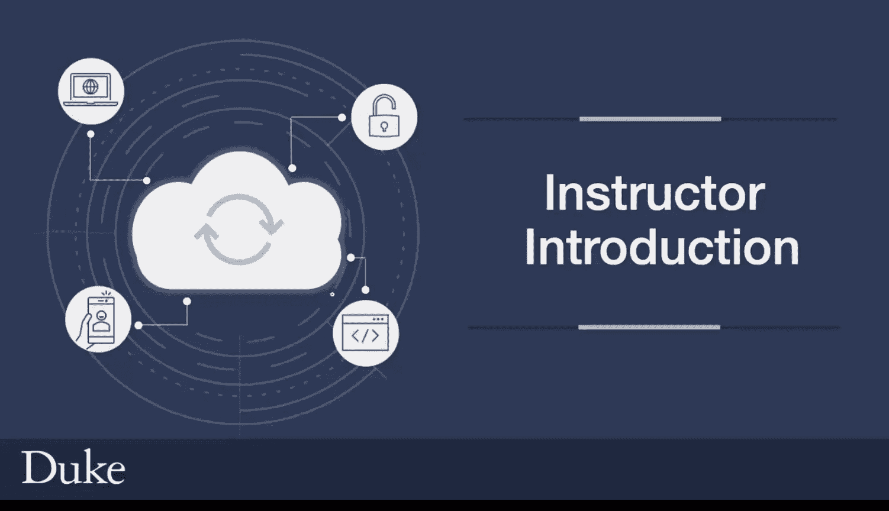

# 构建大规模云计算解决方案：P01：讲师介绍

在本节课中，我们将认识本课程的讲师，了解他的背景、专业领域和行业经验，这有助于我们理解后续课程内容的基础和视角。

## 讲师背景

讲师是Noah Gi，他将担任本课程的教学工作。

## 教学与学术经历

Noah Gi在全球多所顶尖大学拥有教学经验。

以下是他的部分教学经历：
*   杜克大学数据科学项目
*   西北大学数据科学项目
*   加州大学伯克利分校
*   加州大学戴维斯分校

## 著作与出版

他在技术写作方面也有丰富经验，著有多本畅销书。

他的著作包括：
*   **《Python for DevOps》**
*   **《Pragmatic AI and Cloud Computing for Data》**
*   **《Practical MLOps》**

其中多本书籍已被翻译成中文出版。

## 行业经验

Noah Gi在工业界拥有广泛的经验，涉足多个技术领域。

他的行业经验涵盖：
*   游戏与电影产业
*   软件即服务
*   机器学习与工程

他成功交付了许多**按时、按预算**完成的产品项目。

## 专业理念与专长

如果你在过去20年深度参与过软件行业，你会知道**自动化**是当前的一个关键重点。这正是Noah Gi职业生涯中投入大量精力的领域。

他认为，**未能实现自动化的工作流程是有缺陷的**。他的大量经验都围绕自动化展开。

他的专长领域包括：
*   构建**持续集成/持续部署**服务器
*   实施测试，包括**负载测试**
*   建立安全机制，确保公司能够按时发布产品

## 荣誉与认证

近年来，他获得了一些行业荣誉和认证。

部分荣誉包括：
*   **AWS机器学习英雄**
*   参与AWS、GCP和Azure的教育机构合作项目
*   为顶尖内容平台制作课程，包括Udacity、Coursera、O‘Reilly和DataCamp
*   **Python软件基金会研究员**

## 课程展望

综上所述，你将在一位经验丰富的专家指导下学习。Noah Gi期待与你分享他的知识。

让我们开始学习吧。

---

本节课中，我们一起了解了讲师Noah Gi的丰富背景。他融合了顶尖学术机构的教学经验、畅销技术书籍的写作经历、广泛的工业界实践以及对自动化技术的深刻见解，这为我们学习构建大规模云计算解决方案奠定了坚实的信心和基础。接下来，我们将正式进入课程的技术内容部分。