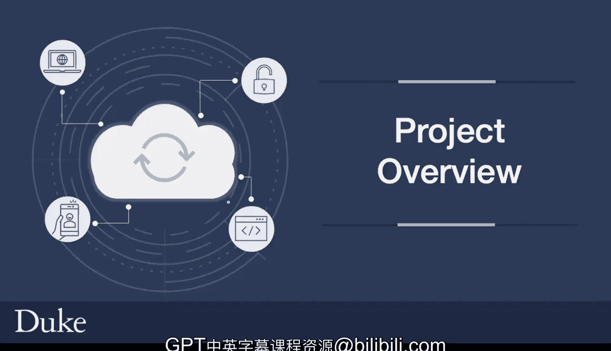
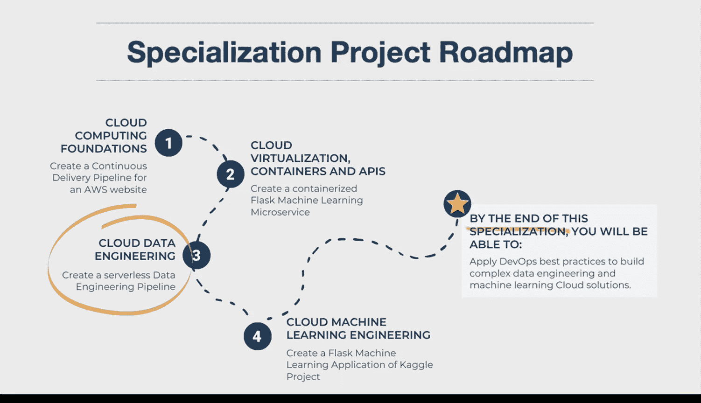
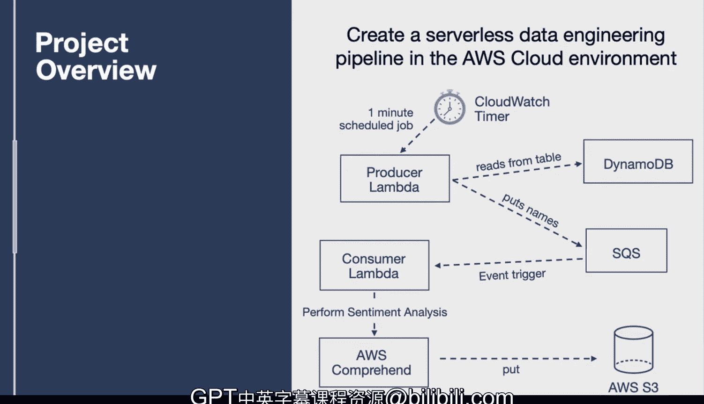

# 构建大规模云计算解决方案：课程3：项目概览 🚀

在本节课中，我们将一起学习课程3的最终项目。我们将构建一个无服务器数据工程管道，它融合了云计算的最佳实践和新兴技术。通过这个项目，你将掌握如何设计并实现一个典型的、可扩展的云原生AI处理流程。

## 项目架构总览

上一节我们介绍了项目的目标，本节中我们来看看这个无服务器数据工程管道的具体架构。下图清晰地展示了整个数据流的处理过程。

从架构图中可以看到，整个流程始于一个定时触发器。以下是数据处理流程的核心步骤：

1.  **定时触发器**：一个定时器会启动整个无服务器作业的初始运行。
2.  **生产者Lambda函数**：该函数会从一个无服务器数据库（DynamoDB）中拉取数据。
3.  **消息队列（SQS）**：生产者Lambda将获取到的信息放入一个SQS队列中。
4.  **消费者Lambda函数**：SQS队列会自动触发一个监听它的Lambda函数。**队列中的每条消息都会一对一地调用一次此Lambda函数**。
5.  **情感分析**：消费者Lambda函数会使用AWS Comprehend API对数据进行情感分析。
6.  **结果存储**：分析结果最终被存入一个S3存储桶。

## 技术实现要点

这是一个非常典型的无服务器AI处理管道，你可以亲手构建它。这个项目将成为你作品集中的一个亮点，展示你整合多种云服务解决实际问题的能力。

## 总结

本节课中我们一起学习了课程3的最终项目。我们概述了一个完整的无服务器数据工程管道，它从定时触发开始，经过数据提取、队列分发、AI情感分析，最终将结果存储。这个项目将帮助你实践如何利用AWS的核心服务（如Lambda、DynamoDB、SQS、Comprehend和S3）来构建可扩展、高效的云解决方案。