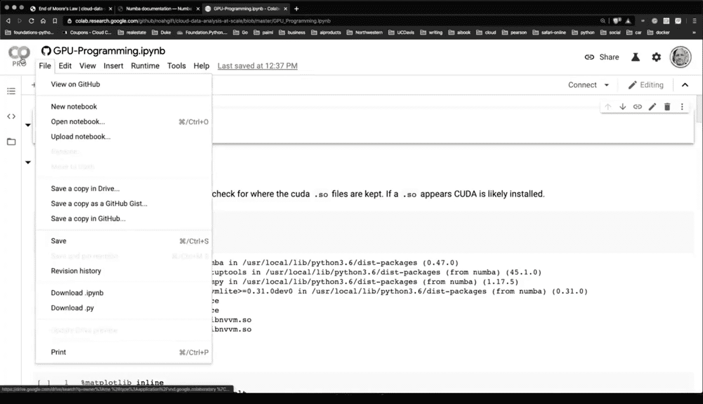
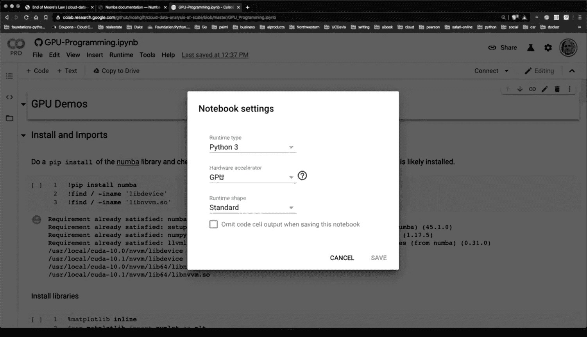
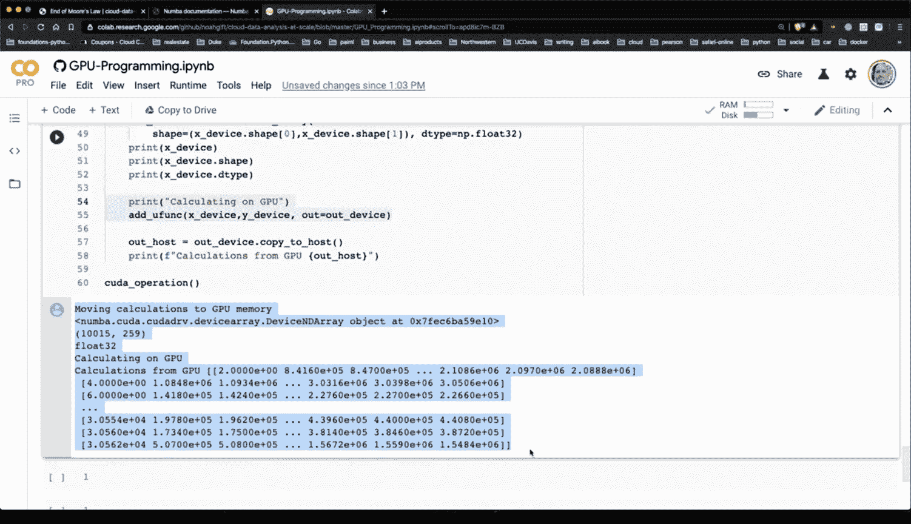

# 构建大规模云计算解决方案：3-4：使用CUDA和Numba加速计算 🚀


在本节课中，我们将学习如何利用GPU和即时编译器来加速计算密集型任务。我们将通过一个具体的例子，使用Numba库和CUDA技术，对比CPU、即时编译和GPU三种方式在计算性能上的差异。

---

## 概述

我们将通过一个计算曼德博集合（Mandelbrot set）图像的例子，来演示如何将Python代码转换为更快的机器码，并最终在GPU上运行。这个过程涉及安装Numba库、配置GPU环境，以及理解如何将代码向量化以利用GPU的并行计算能力。

---

## 环境配置与库安装

首先，我们需要在支持GPU的环境中设置我们的工作区。我们将使用Google Colab Pro，并启用GPU硬件加速器。

以下是配置环境的步骤：

1.  打开Colab笔记本，并确保运行时类型已设置为使用GPU。
2.  安装Numba库，并验证CUDA驱动是否可用。

```python
# 安装Numba库
!pip install numba

# 验证CUDA驱动版本
!nvidia-smi
```

安装并验证后，我们可以导入必要的库。

```python
import numpy as np
from numba import jit, cuda
from numba import float32, int32
```

---

## CPU基准测试：计算曼德博集合



上一节我们配置好了环境，本节中我们来看看如何在CPU上执行一个计算密集型的任务作为基准。



曼德博集合的计算非常消耗资源，是常用的性能基准测试工具。以下是在纯Python（CPU）上运行的代码：

```python
def mandelbrot_cpu(x, y, max_iters):
    c = complex(x, y)
    z = 0.0j
    for i in range(max_iters):
        z = z*z + c
        if (z.real*z.real + z.imag*z.imag) >= 4:
            return i
    return max_iters

def create_fractal_cpu(min_x, max_x, min_y, max_y, image, iters):
    height, width = image.shape
    pixel_size_x = (max_x - min_x) / width
    pixel_size_y = (max_y - min_y) / height
    for x in range(width):
        real = min_x + x * pixel_size_x
        for y in range(height):
            imag = min_y + y * pixel_size_y
            color = mandelbrot_cpu(real, imag, iters)
            image[y, x] = color

# 创建图像数组并运行
image = np.zeros((1024, 1536), dtype=np.uint8)
%timeit -n 1 -r 1 create_fractal_cpu(-2.0, 1.0, -1.0, 1.0, image, 20)
```

运行上述代码，在CPU上生成图像大约需要4.37秒。

---

## 使用Numba即时编译器加速

既然CPU计算较慢，我们能否做得更好？答案是肯定的。接下来，我们使用Numba的即时编译器（JIT）来加速。

即时编译器将Python代码在运行时编译为机器码，从而绕过解释器的开销，直接为CPU生成指令。

以下是使用`@jit`装饰器加速的代码：

```python
@jit(nopython=True)
def mandelbrot_jit(x, y, max_iters):
    # 函数体与CPU版本完全相同
    c = complex(x, y)
    z = 0.0j
    for i in range(max_iters):
        z = z*z + c
        if (z.real*z.real + z.imag*z.imag) >= 4:
            return i
    return max_iters

@jit(nopython=True)
def create_fractal_jit(min_x, max_x, min_y, max_y, image, iters):
    # 函数体与CPU版本完全相同
    height, width = image.shape
    pixel_size_x = (max_x - min_x) / width
    pixel_size_y = (max_y - min_y) / height
    for x in range(width):
        real = min_x + x * pixel_size_x
        for y in range(height):
            imag = min_y + y * pixel_size_y
            color = mandelbrot_jit(real, imag, iters)
            image[y, x] = color

# 运行JIT版本
image = np.zeros((1024, 1536), dtype=np.uint8)
%timeit -n 1 -r 1 create_fractal_jit(-2.0, 1.0, -1.0, 1.0, image, 20)
```

使用JIT编译后，计算时间大幅缩短至约0.39秒。

---

## 利用GPU进行并行计算

JIT编译已经带来了显著的提升，但GPU在处理高度并行化任务时潜力更大。本节我们来看看如何将计算任务转移到GPU上执行。

使用CUDA进行GPU编程需要将代码标记为GPU内核，并指定数据类型。以下是步骤：

1.  使用`@cuda.jit`装饰器定义GPU内核函数。
2.  在主机（CPU）上准备数据，并将数据复制到GPU设备内存。
3.  配置线程网格和块，启动GPU内核。
4.  将结果从设备内存复制回主机内存。

以下是使用CUDA GPU计算曼德博集合的代码：

```python
@cuda.jit
def mandelbrot_gpu_kernel(min_x, max_x, min_y, max_y, image, iters):
    # 获取当前线程的全局位置
    x, y = cuda.grid(2)
    height, width = image.shape
    
    if x < width and y < height:
        pixel_size_x = (max_x - min_x) / width
        pixel_size_y = (max_y - min_y) / height
        real = min_x + x * pixel_size_x
        imag = min_y + y * pixel_size_y
        c = complex(real, imag)
        z = 0.0j
        for i in range(iters):
            z = z*z + c
            if (z.real*z.real + z.imag*z.imag) >= 4:
                image[y, x] = i
                return
        image[y, x] = iters

# 准备数据并运行GPU内核
image = np.zeros((1024, 1536), dtype=np.uint8)
d_image = cuda.to_device(image) # 复制数据到GPU

# 配置线程（例如，16x16的线程块）
threadsperblock = (16, 16)
blockspergrid_x = (image.shape[1] + threadsperblock[0] - 1) // threadsperblock[0]
blockspergrid_y = (image.shape[0] + threadsperblock[1] - 1) // threadsperblock[1]
blockspergrid = (blockspergrid_x, blockspergrid_y)

# 启动内核并计时
%timeit -n 1 -r 1 mandelbrot_gpu_kernel[blockspergrid, threadsperblock](-2.0, 1.0, -1.0, 1.0, d_image, 20)
cuda.synchronize() # 等待GPU计算完成
image = d_image.copy_to_host() # 将结果复制回CPU
```

在GPU上，同样的计算仅需约0.005秒，速度比JIT版本又提升了一个数量级。

---

## 更广泛的GPU应用：向量化操作

除了编写内核，我们还可以使用Numba的`vectorize`装饰器创建通用函数（ufunc），使其能在GPU上运行。这对于处理数组运算特别有用。

以下是一个将Pandas DataFrame数据转移到GPU进行向量化计算的示例：

```python
import pandas as pd
from numba import vectorize

# 1. 准备数据
df = pd.DataFrame({'a': np.random.rand(1000000), 'b': np.random.rand(1000000)})
array_a = df['a'].to_numpy()
array_b = df['b'].to_numpy()

# 2. 定义一个在GPU上运行的向量化函数
@vectorize([float32(float32, float32)], target='cuda')
def vectorized_add_gpu(a, b):
    return a + b

# 3. 将数据复制到GPU并执行计算
d_a = cuda.to_device(array_a.astype(np.float32))
d_b = cuda.to_device(array_b.astype(np.float32))
d_result = cuda.device_array_like(d_a)

# 启动计算
vectorized_add_gpu(d_a, d_b, out=d_result)
cuda.synchronize()

# 4. 将结果复制回CPU
result = d_result.copy_to_host()
```

需要注意的是，将数据在主机内存和设备内存之间移动存在开销。因此，GPU加速最适合那些计算本身非常耗时（例如需要数小时或数天），且能高度并行化的任务。

---

## 总结

本节课中我们一起学习了如何利用GPU和即时编译技术来加速Python计算。



1.  **CPU基准**：我们首先在CPU上运行了曼德博集合计算，作为性能基准。
2.  **Numba JIT加速**：通过使用`@jit`装饰器，我们将Python代码编译为机器码，使计算速度提升了十倍以上。
3.  **GPU并行计算**：我们利用CUDA将计算任务转移到GPU上，通过数千个线程并行执行，获得了比JIT更快的速度，适用于高度并行化的问题。
4.  **向量化GPU函数**：我们还了解了如何使用`@vectorize`装饰器创建能在GPU上运行的通用函数，用于处理数组运算。


通过像Google Colab Pro这样的平台，我们可以轻松访问强大的GPU资源，将个人电脑变为指尖上的超级计算机。关键在于识别可并行化的任务，并有效地管理主机与设备之间的数据移动。