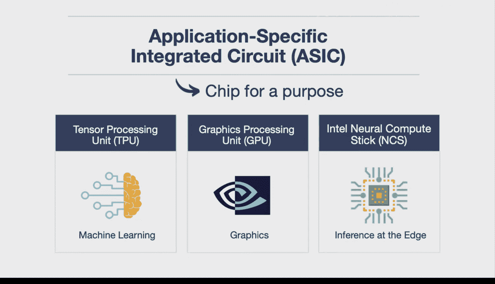

# 构建大规模云计算解决方案：3-4课：什么是专用集成电路 (ASIC) 🧠

在本节课中，我们将要学习专用集成电路（ASIC）的概念。我们将了解ASIC是什么，它与通用处理器的区别，并通过几个具体的例子来理解其应用场景和优势。

---

## 概述

专用集成电路（ASIC）是一种为特定目的而设计的芯片。与通用处理器不同，ASIC专注于执行单一类型的任务，从而在特定领域实现更高的效率和性能。

## 什么是专用集成电路 (ASIC)？

ASIC 是 “Application-Specific Integrated Circuit” 的缩写。其核心含义是，它是一种为特定用途设计的芯片。

这个芯片专为单一任务设计，这与为处理多种不同任务而设计的中央处理器（CPU）形成鲜明对比。

## ASIC 的实例

以下是几个ASIC的具体例子，帮助我们理解其“专用”的特性。

### 1. 张量处理单元 (TPU)

TPU 是 “Tensor Processing Unit” 的缩写。它是由谷歌从头开始设计，专门用于执行机器学习任务的芯片。

这意味着TPU可以针对使用TensorFlow框架的机器学习代码进行优化。它是一种非常特定类型的芯片。事实上，甚至存在小型版本，允许你在基于边缘的设备上运行TensorFlow Lite模型。

因此，这个特定的芯片解决一个特定的问题，并且为TensorFlow进行了优化。

**核心概念**：`TPU = 专为TensorFlow机器学习优化的ASIC`

### 2. 图形处理单元 (GPU)

GPU是专门为图形编程设计的ASIC。

GPU与CPU的一个关键区别在于，GPU的架构非常密集，并且拥有大量不同的核心。这使得图形处理可以成为一种高度并行的操作。这就是为什么它是一种具有非常特定用途的芯片。

**核心概念**：`GPU = 专为并行图形计算设计的ASIC`

### 3. 英特尔神经计算棒

英特尔生产这些基于边缘的计算棒，它们专门为在边缘设备上进行推理（模型预测）而优化。

这意味着，如果你将一个机器学习模型部署到设备上，你可以将其插入一个移动计算框架（例如树莓派Raspberry Pi）。然后，你就可以使用该移动设备上的摄像头进行预测。

## 总结与展望

总而言之，我们生活的世界将会看到越来越多的ASIC。我们尤其会在计算机视觉等领域看到这些ASIC的出现。

了解并精通这项技术至关重要，这样你才能利用这些非常特定的技术来构建应用。

本节课中，我们一起学习了专用集成电路（ASIC）的定义、它与通用CPU的区别，并探讨了TPU、GPU和英特尔神经计算棒等具体实例。掌握ASIC知识，有助于你为特定计算任务选择最合适的硬件解决方案。