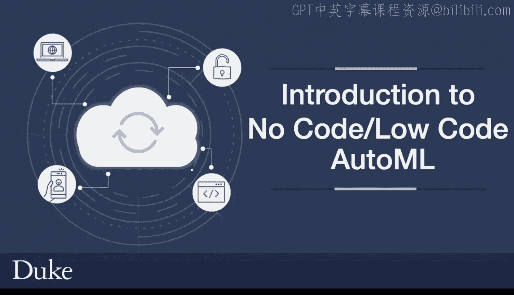

# 构建大规模云计算解决方案：3-4：无代码/低代码简介 🚀

在本节课中，我们将要学习数据科学和云计算领域的一个新兴趋势：无代码和低代码解决方案。我们将探讨这些工具如何让业务分析、数据科学和商业智能领域的专业人士，在不编写或仅编写少量代码的情况下，完成数据分析、建模和问题解决。

数据科学的一个有趣之处在于，你并不一定需要编写任何代码。这就是今天要讨论的主题：无代码和低代码。这是一个新兴的趋势。当然，掌握Python等编程语言很有用，但很多时候，作为业务分析专业人士，你并不一定需要进行编程。你可以从一些想法开始，利用低代码和无代码解决方案来解决这些问题。

上一节我们提到了无代码/低代码的概念，本节中我们来看看一些具体的解决方案平台。

以下是主要的无代码/低代码解决方案平台，它们通常由大型科技公司或云服务商提供：

*   **Apple**：提供低代码的机器学习工具，主要涉及**计算机视觉**和**电子邮件**处理。
*   **Google Cloud Platform (GCP)**：提供包括**计算机视觉**和**AutoML**在内的低代码/无代码工具。
*   **Amazon Web Services (AWS)**：拥有大量低代码/无代码功能。其核心能力包括：
    *   处理**表格数据**，这是业务分析的理想格式。
    *   提供**AI API**，例如计算机视觉和自然语言处理（NLP）的API。
*   **Microsoft Azure**：同样提供丰富的API，包括**计算机视觉**、**Outttawa Mill**以及其他多种能力。

对于业务分析、商业智能或数据科学领域的人员来说，这些云平台和科技巨头可能是开始探索的首选之地。如果你想进行探索性数据分析（EDA）阶段的工作，这里可以解决问题。

具体而言，在这些云平台和科技巨头的生态系统中，你可以利用它们提供的工具来解决实际问题。这意味着，你有可能完全不需要编写代码，就能完成高质量的分析，并在解决问题时形成报告。

本节课中我们一起学习了无代码和低代码解决方案的核心概念及其主要提供者。我们了解到，利用这些平台，可以处理**数据摄取（Ingestion）**、**探索性数据分析（EDA）** 和**建模（Modeling）** 等关键环节，从而更高效地开展业务分析和数据科学工作。