# 构建大规模云计算解决方案：3-4：Azure 无代码机器学习实战

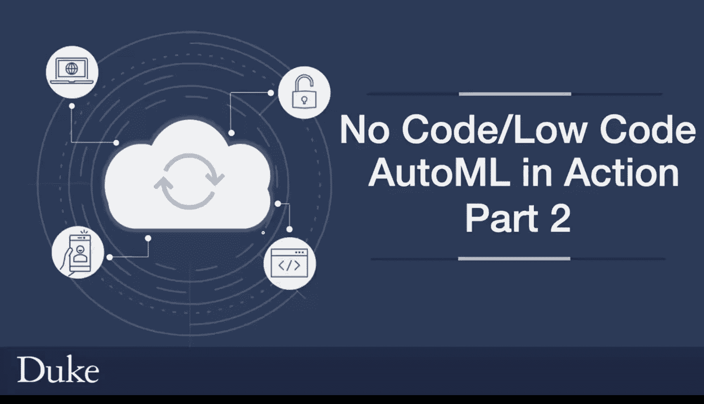

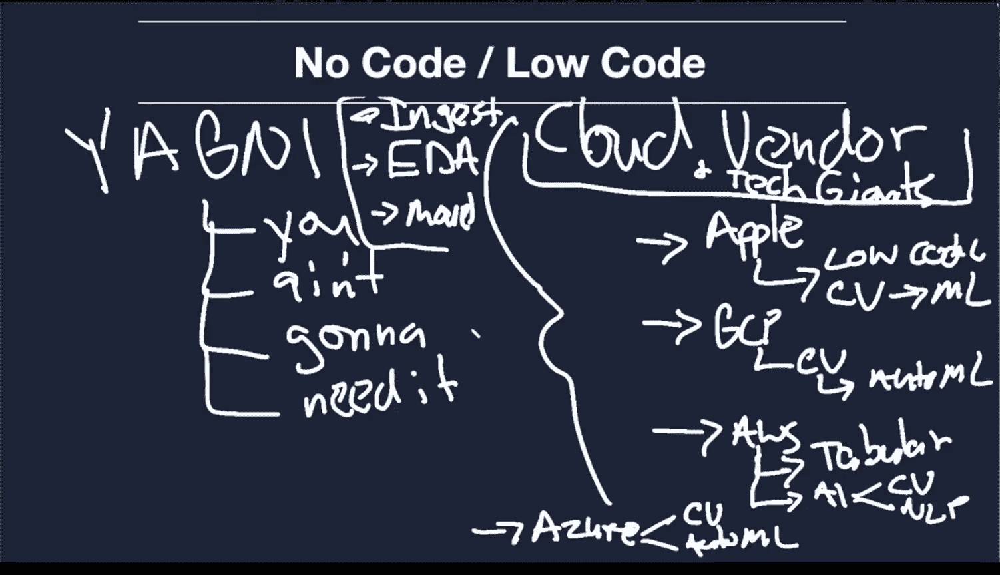

在本节课中，我们将学习如何在微软Azure平台上，使用其无代码/低代码工具（特别是Azure Machine Learning Studio的自动化机器学习功能）来构建和部署一个预测模型。我们将通过一个预测NBA球员薪水的实例，演示从数据上传、模型自动训练到结果解释和商业报告撰写的完整流程。

上一节我们介绍了AWS和GCP的无代码工具，本节中我们来看看微软Azure平台提供了哪些强大的同类解决方案。

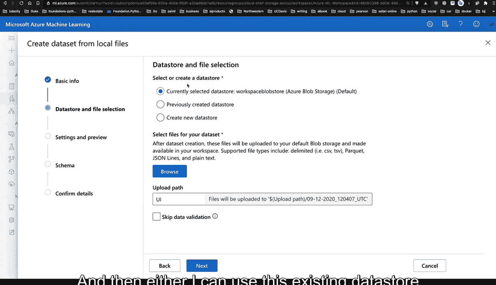

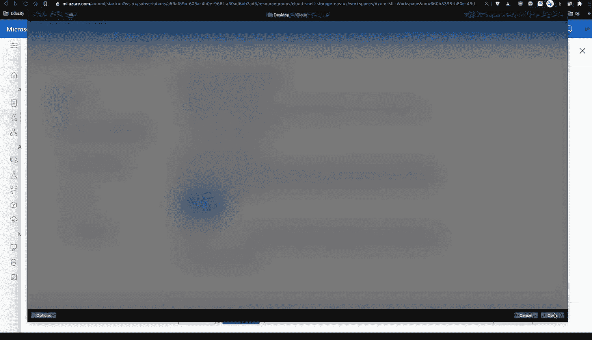

## Azure Machine Learning Studio 简介

Azure提供了一系列低代码、无代码的有趣工具。其中一个功能强大的工具是现成的自动化机器学习（AutoML）。他们也有现成的计算机视觉服务，但本节我们将重点介绍其机器学习平台。

如果进入Azure的ML平台，我们会看到 **Azure Machine Learning Studio**。这是一个用于管理端到端产品的沉浸式体验环境。点击进入后，会看到一个功能丰富的仪表盘。

以下是仪表盘中一些关键功能的简要介绍：
*   **自动化机器学习**：这是我们将要重点使用的功能，它可以自动完成模型训练和选择。
*   **数据集管理**：允许用户上传和管理用于训练的数据。
*   **实验管理**：用于创建、运行和跟踪机器学习实验。

## 创建自动化机器学习实验

现在，让我们开始创建一个新的自动化机器学习实验。

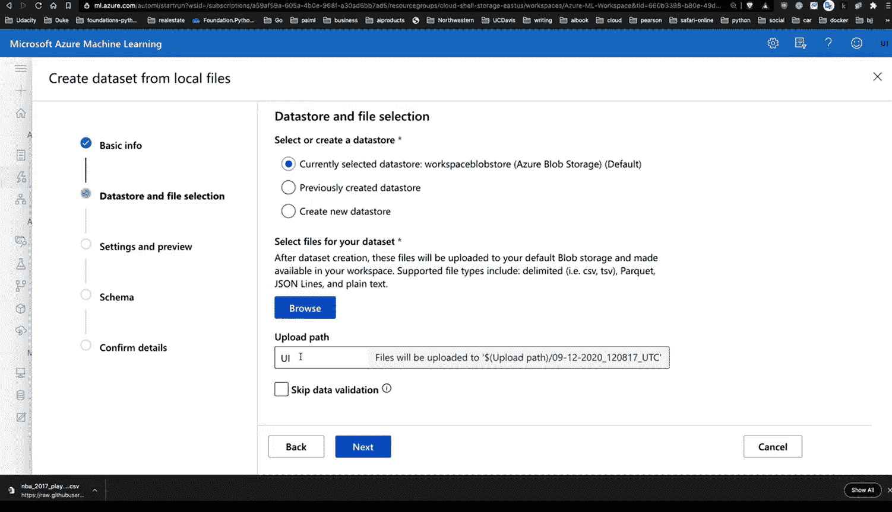

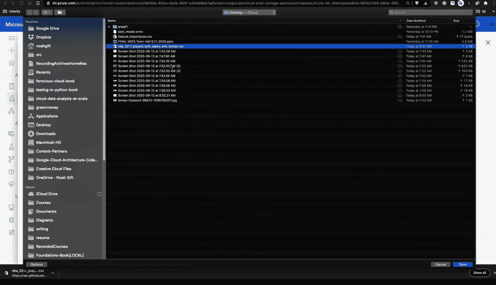

首先，我需要创建或选择数据集。我可以从本地文件上传，也可以从Azure数据存储、Web文件或开放数据集中获取。我们先从本地文件开始。

我选择上传一个名为“NBA球员薪水”的数据集。这个数据集包含了NBA球员的各种信息，如姓名、位置、年龄、上场时间、得分等，我们的目标是预测他们的薪水（以百万美元计）。

上传文件后，系统会自动验证数据并推断其结构（即模式）。整个过程无需编写任何代码。数据被成功摄取后，我就可以基于它创建一个新的实验。

我将其命名为“NBA薪水预测实验”。接下来，系统会询问我想要预测的目标列。我选择“薪水（百万）”作为预测目标，这是一个连续的数值，因此这是一个**回归**问题。

在选择了合适的计算集群后，我点击“完成”。自动化机器学习过程随即开始。系统会自动尝试多种不同的机器学习算法和预处理步骤，以找到预测目标的最佳模型。

## 解读自动化机器学习结果

由于训练需要一些时间，我们可以查看一个之前运行过的类似实验的结果报告。

在一个使用银行客户数据预测存款行为的分类实验报告中，自动化机器学习运行了多种模型，如投票集成、最大绝对值缩放器、稀疏标准化器等。系统会标识出表现最佳的模型。

更重要的是，我可以查看模型的**特征重要性解释**。这能告诉我哪些因素对模型的预测影响最大。

例如，在银行案例中，“客户与银行关系时长”被识别为最重要的特征，其重要性几乎是第二重要特征“是否在职”的两倍。这非常直观：客户关系越久，越可能存款；如果没有工作，则不太可能存款。

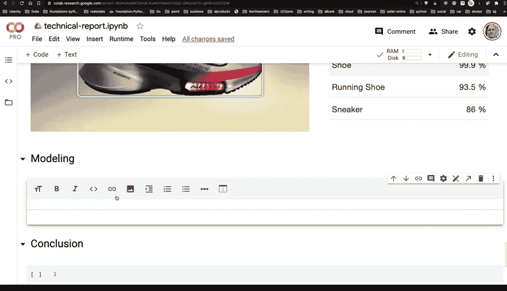

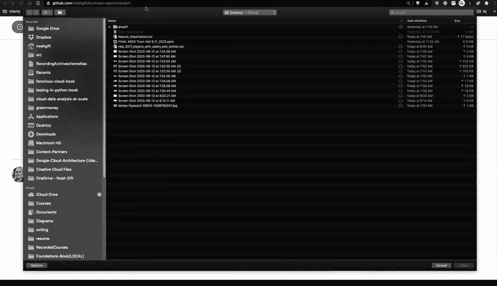

我还可以查看**绝对值视图**，它显示了每个特征对模型预测的正向和负向影响程度。例如，“有存款”具有最强的正向影响，而“未在职”则具有强烈的负向影响。

这些工具的强大之处在于，我无需编写任何代码，只需点击按钮运行，就能获得结果和深入的解释。我可以进行高级的机器学习、计算机视觉甚至深度学习任务。

## 从分析结果到商业报告

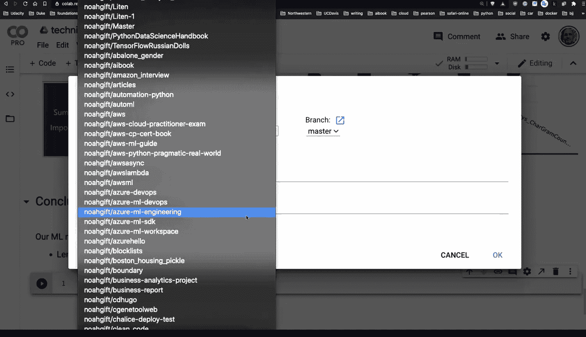

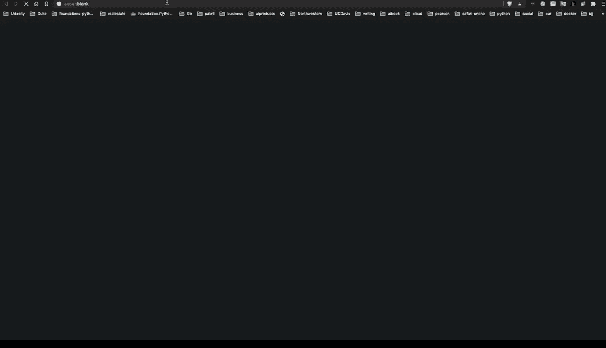

获得技术分析结果后，关键的一步是如何将其转化为对业务决策者（如CEO）有意义的商业报告。

对于高层管理者而言，过于技术化的细节（如“绝对值为负二”、“时长中值”、“时长均值”、“输入器”等术语）是无效的。他们需要清晰、直接、可执行的结论。

因此，在撰写报告时，结构至关重要。报告应以一个强有力的、非模糊的结论和行动建议作为结尾。

以下是一个基于银行案例分析的商业报告结论示例：
*   **结论**：我们的银行需要增加收入。
*   **建议**：为了增加收入，我们需要发起一项专项营销活动。
*   **行动**：向那些与银行有5年或以上关系的客户发送邮件，并提供激励：如果他们向定期存款账户存入5000美元，将获得一张50美元的礼品卡。

这样的结论简洁明了，给出了明确的行动号召。它基于数据分析（长期客户是存款的关键预测因素），但以商业语言呈现，直接告诉决策者需要做什么。

采用这种方法，你将成为组织中备受重视的资源，因为你总是能直击要点，提供他人所需，并帮助组织做出数据驱动的决策。

## 课程总结

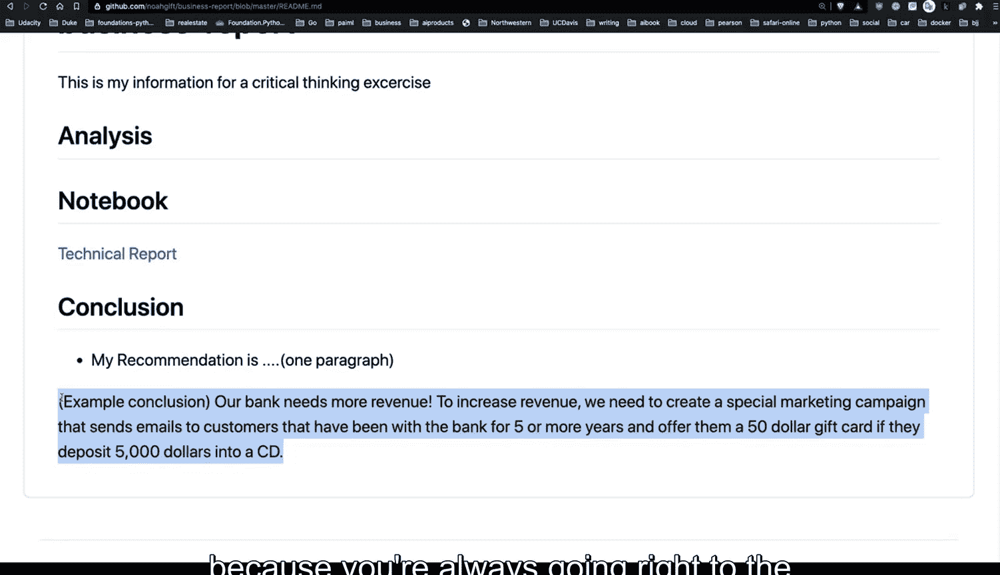

本节课中我们一起学习了如何在Azure Machine Learning Studio中使用无代码的自动化机器学习功能。我们从数据上传开始，创建并运行了一个回归预测实验，并学会了如何解读模型结果和特征重要性。最后，我们探讨了将复杂的技术分析转化为简洁、有力、可执行的商业报告的关键技巧，这是向非技术背景的决策者传达数据洞察的核心能力。通过掌握这些工具和方法，你可以在不编写代码的情况下，完成从数据到商业决策的完整闭环。