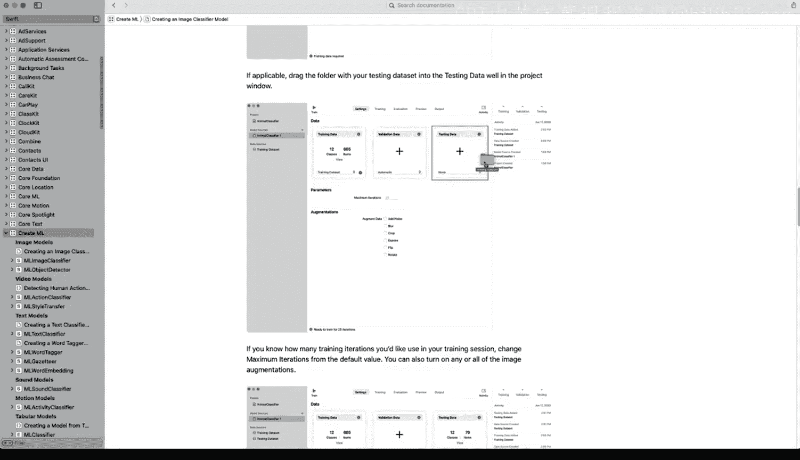
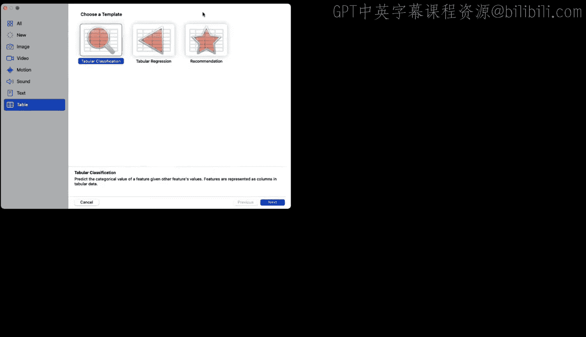
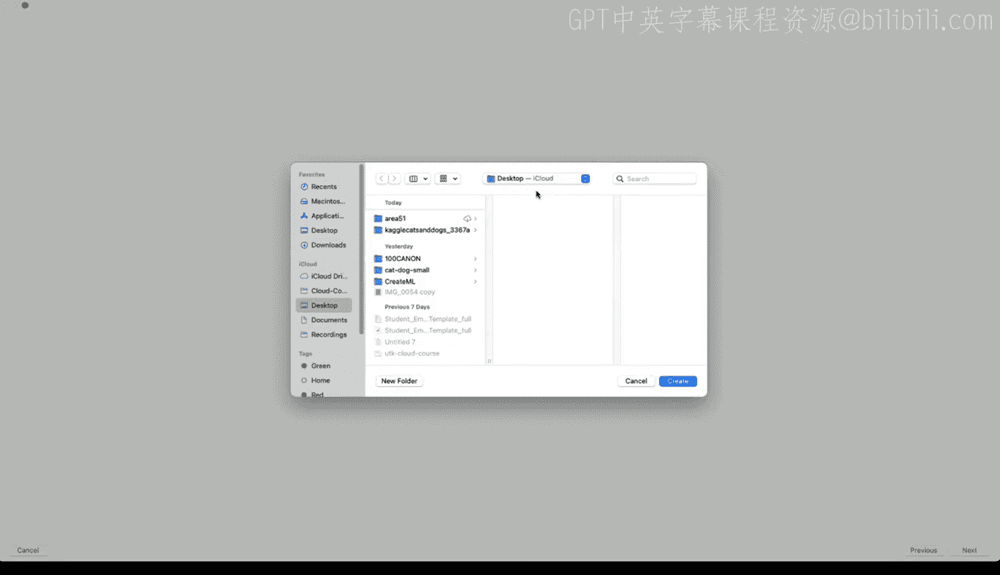
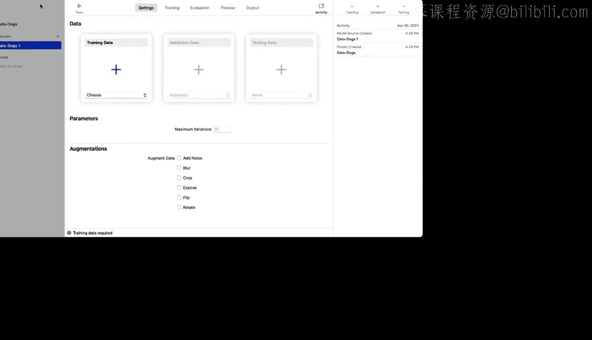
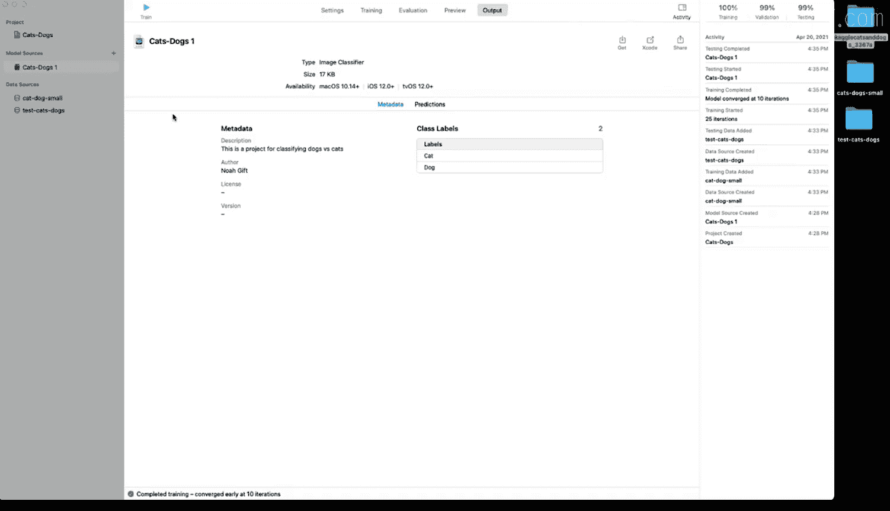
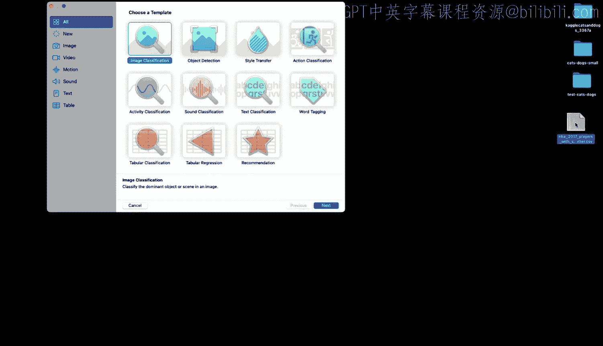
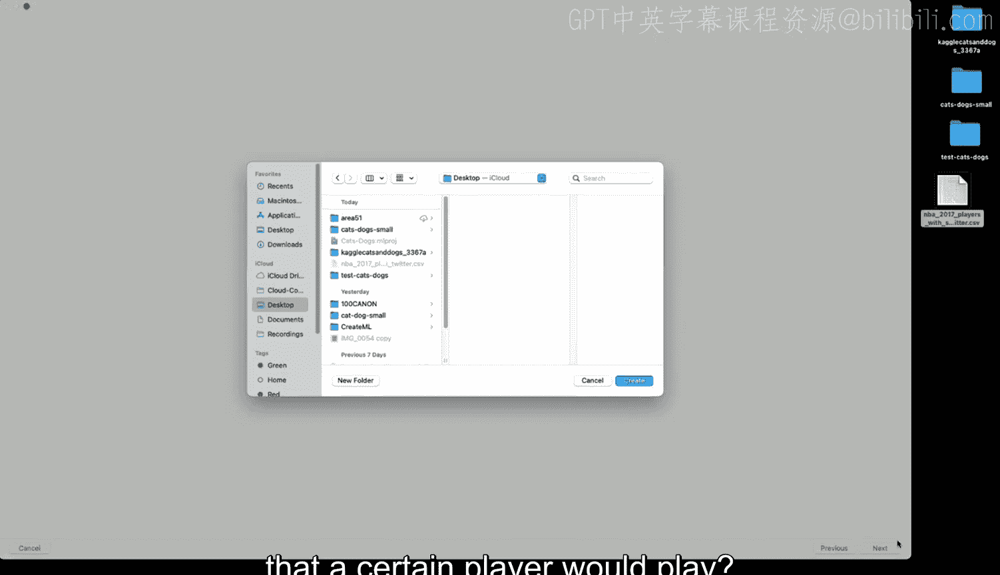
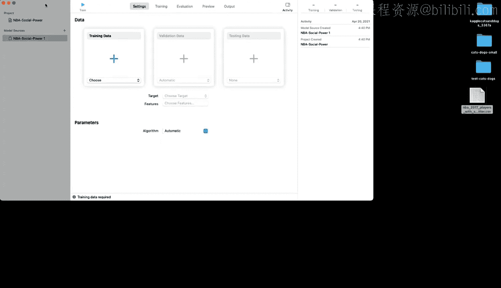
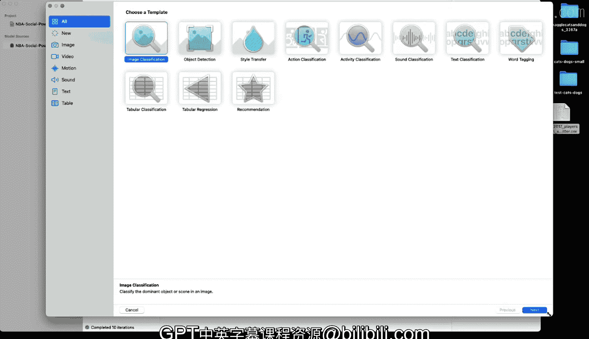

# 构建大规模云计算解决方案（数据工程、机器学习）：3-4课：使用 Apple Create ML 进行自动机器学习 🍎🤖

在本节课中，我们将学习如何使用苹果公司提供的 Create ML 工具，无需编写代码即可构建和训练机器学习模型。我们将从图像分类开始，然后探索表格数据分类，了解这个强大工具的基本工作流程。

## 概述

Create ML 是集成在 Xcode 开发环境中的一个自动机器学习工具。它允许开发者通过简单的拖放操作来训练模型，无需深厚的数据科学或编程背景。我们将通过两个具体示例来掌握其用法：一个经典的“猫狗图像分类”项目和一个“NBA球员位置预测”的表格分类项目。

## 图像分类入门 🖼️

上一节我们概述了 Create ML 的能力，本节中我们来看看如何创建一个基础的图像分类器。根据官方文档，要创建一个图像分类模型，你至少需要为每个类别准备10张不同的图片。

以下是准备训练数据的关键步骤：
*   **数据要求**：每个类别至少需要10张图像。数据越多、越多样（例如不同角度、光照条件），模型性能越好。
*   **图像格式**：支持能被 QuickTime 播放器打开的文件，如 JPG、PNG。建议图像尺寸至少为 **299 x 299** 像素。
*   **数据组织**：为每个标签（类别）创建一个单独的文件夹。例如，要分类水牛、猎豹、大象、长颈鹿，就创建四个对应的文件夹，并将相应图片放入其中。
*   **测试数据**：为了评估模型在真实世界中的表现，建议为每个类别准备至少25张测试图像。

## 启动 Create ML 项目 🚀

了解了基本要求后，我们来看看如何启动一个 Create ML 项目。首先，你需要下载并打开 Xcode。

启动 Create ML 模板的方法有些特别：
1.  打开 Xcode。
2.  在程序坞（Dock）中右键点击 Xcode 图标。
3.  在弹出的菜单中找到并选择 **“Develop Tools”** 选项，然后选择 **Create ML**。

在 Create ML 中，你可以创建多种类型的模型：
*   **图像分类**
*   **物体检测**
*   **风格迁移**
*   **动作分类**
*   **声音分类**
*   **文本分类**
*   **词性标注**
*   **表格分类**
*   **表格回归**
*   **推荐系统**

这个工具对于数据科学家快速原型化解决方案非常有用。

## 构建猫狗分类器 🐱🐶

现在，让我们动手构建一个猫狗图像分类器。首先，选择“图像分类”模板，并将项目命名为“cats-dogs”。

为了高效训练，建议从一个小型数据集开始。我们可以从 Kaggle 的猫狗数据集中各选取前100张图片，分别放入 `cat` 和 `dog` 文件夹，组成训练集。同样，再选取100-200号的图片组成测试集，并放入 `test/cat` 和 `test/dog` 文件夹。

在 Create ML 界面中配置训练：
1.  **选择训练数据**：指向我们创建的 `cats-dogs-small` 文件夹。工具会自动识别出两个类别（猫和狗），共计200个项目，并自动拆分出一部分作为验证集。
2.  **添加测试数据**：点击“+”号，添加我们准备好的 `test-cats-and-dogs` 文件夹。
3.  **增强训练（可选）**：可以添加“噪声”和“裁剪”等增强选项，以提高模型对现实场景中不完美图像的鲁棒性，但这会增加训练时间。
4.  **开始训练**：设置最大迭代次数（例如25次），然后点击 **“Train”** 按钮。无需任何代码，训练即刻开始。

训练过程中，你可以实时看到准确率、精确度和召回率等指标。训练完成后，可以使用“预览”功能，拖入模型从未见过的新图片（例如编号233的图片）进行测试，查看模型的预测置信度。

## 模型输出与应用 🌐

模型训练完成后，Create ML 会生成一个 **`.mlmodel`** 格式的模型文件。这个文件非常有用：
*   可以直接在 Xcode 中打开，并用于构建 iOS 应用程序。
*   可以分享给他人。
*   可以下载到本地。
*   该格式可以转换为其他标准格式，如 **ONNX**，从而部署到 Microsoft Azure 或 AWS 等云平台上。

本质上，这个工具完成了一个数据科学团队在组织中的许多工作，而你只需要在桌面上进行拖放操作。

## 表格数据分类：预测NBA球员位置 🏀

接下来，我们切换方向，看看如何使用 Create ML 处理表格数据分类。我们将用一个包含NBA球员信息的数据集来预测球员的场上位置。

首先，从 GitHub 获取一个包含球员薪水、社交媒体受欢迎度和维基百科页面浏览量等信息的 CSV 数据文件。

在 Create ML 中新建一个项目，这次选择 **“表格分类”** 模板。将项目命名为“NBA-Social-Power”，目标是预测球员的“位置”。

配置训练数据：
1.  **选择数据文件**：上传我们下载的 CSV 文件。
2.  **选择预测目标**：在“Target”中选择 `position` 列，即我们想要预测的球员位置（如控球后卫、中锋等）。
3.  **选择特征**：这些是用于预测的输入变量。我们可以选择年龄、投篮命中数、三分尝试数、罚球、进攻篮板、防守篮板、助攻、抢断、盖帽、失误、得分、薪水等列作为特征。注意，如果某些特征（如“Twitter 点赞数”）存在缺失值导致训练错误，可以回到此步骤将其从特征中移除。
4.  **开始训练**：点击“Train”。Create ML 会自动选择合适的算法（如随机森林、提升树等）进行训练。

训练完成后，评估界面会显示模型在预测五个球员位置（中锋、大前锋、控球后卫、小前锋、得分后卫）上的精确度和召回率。在这个例子中，模型取得了非常好的效果。我们同样可以使用“预览”功能，输入新的球员数据来预测其位置。

## 总结

本节课我们一起学习了苹果 Create ML 工具的核心用法。我们通过构建一个“猫狗图像分类器”，掌握了图像分类项目的创建、数据准备、训练和测试流程。随后，我们通过“NBA球员位置预测”项目，探索了表格数据分类的能力。Create ML 极大地降低了机器学习的门槛，使没有编程或数据科学背景的人也能快速构建和原型化机器学习模型，无论是处理图像、文本还是表格数据。我们正处于 MLOps 的工业化革命时代，鼓励你亲自尝试并探索 Create ML 和自动机器学习的各种可能性。