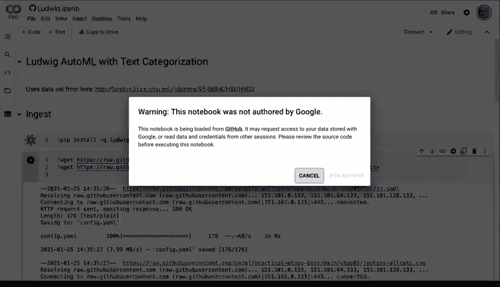
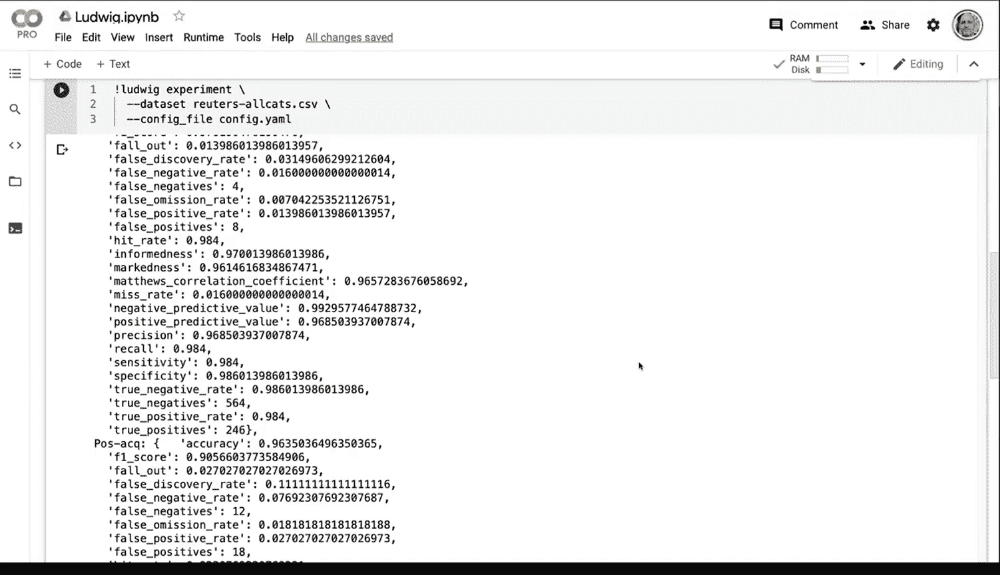

# 构建大规模云计算解决方案：3-4：Ludwig自动机器学习实例 🚀


在本节课中，我们将学习如何使用Ludwig这一自动机器学习工具，快速构建一个文本分类模型。整个过程无需编写大量代码，只需通过配置文件即可驱动模型训练与评估。

---

## 概述


我们将使用Ludwig处理一个包含21,000条记录、6个类别的新闻文本数据集。目标是训练一个模型，使其能够根据文本内容自动分类。我们将从环境准备开始，逐步完成数据探索、模型配置、训练和结果分析。

---

## 环境准备与数据探索

首先，我们需要安装Ludwig库并下载数据集与配置文件。



以下是安装Ludwig的命令，使用 `-q` 参数以减少冗长的输出信息：
```bash
pip install ludwig -q
```

安装完成后，下载训练所需的配置文件与原始数据集。

为了对数据有一个初步了解，我们可以使用Pandas进行快速的探索性数据分析。

以下是加载并查看数据前几行的代码：
```python
import pandas as pd
df = pd.read_csv('path_to_your_dataset.csv')
df.head()
```

执行上述代码后，可以看到数据包含“类别”和“文本”两列，例如“负面”、“正面”等标签及其对应的文本内容。这确认了我们的任务是基于文本进行分类。

---

## 模型配置

接下来，我们查看定义模型结构的配置文件。该文件决定了Ludwig如何处理输入和输出。

以下是配置文件的示例内容：
```yaml
input_features:
  - name: text
    type: text
    level: word
    encoder: parallel_cnn
output_features:
  - name: class
    type: category
```

此配置表明：输入特征“text”是文本类型，在单词级别进行处理，并使用并行卷积神经网络编码；输出特征“class”是一个类别，即我们的分类目标。

---

## 模型训练

有了数据和配置，我们就可以启动训练过程。训练命令非常简单。

以下是启动Ludwig实验的训练命令：
```bash
ludwig experiment --data_csv path_to_your_dataset.csv --config_file config.yaml
```

运行该命令后，Ludwig会基于TensorFlow开始训练。控制台会显示训练进度、当前周期等信息。训练过程将自动划分训练集、验证集和测试集。

为了节省时间，我们直接查看一个已完成的训练结果。在最终周期，我们可以看到模型在各项指标上的表现。

---

## 结果分析

训练完成后，Ludwig会提供详细的评估报告。我们主要关注损失值和分类指标。

在最后的训练周期中，模型在训练集、验证集和测试集上的损失值分别为0.02、0.35和0.27。系统会自动选择验证集上表现最佳的模型。

对于分类任务，关键的评估指标如下：
*   **平均F1分数**：0.93
*   **平均Kappa分数**：0.89

此外，报告还提供了诸如假阳性率、假阴性率等更细致的分类指标。这些结果说明我们通过Ludwig快速构建的模型具有不错的分类性能。

---

## 总结

本节课我们一起学习了使用Ludwig进行自动机器学习的完整流程。我们首先安装了必要的库并探索了数据，然后通过一个YAML配置文件定义了模型结构，接着启动了训练并分析了结果。



Ludwig这类工具的核心价值在于，它让开发者或数据科学家能够从编写大量样板代码中解放出来，更专注于模型创建和业务问题本身。通过简单的配置即可驱动复杂的机器学习流程，这代表了未来机器学习工具发展的重要方向。