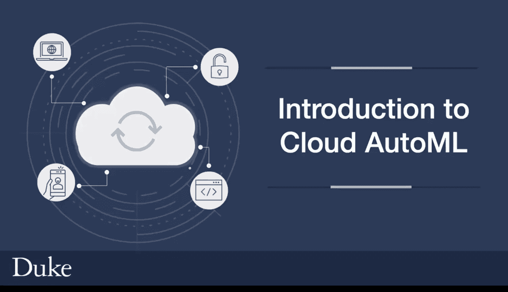
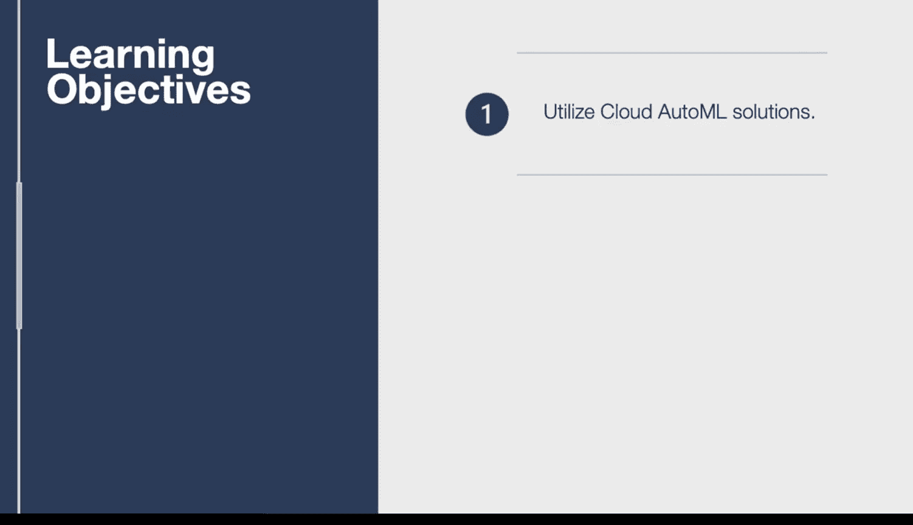

# 构建大规模云计算解决方案：3-4：云自动机器学习简介

在本节课中，我们将学习基于云的自动机器学习。云是进行AutoML的理想场所，因为它提供了存储数据的位置，并内置了相应的平台。我们将探讨如何利用云端的自动化技术，例如AWS SageMaker或Azure ML Studio，通过API或简单的点击操作来完成高级别的模型训练，从而提升生产效率。



## 什么是云自动机器学习？

上一节我们介绍了课程的整体目标，本节中我们来看看云自动机器学习的核心概念。

云自动机器学习是指在云计算平台上，利用自动化工具和技术来执行机器学习工作流程的各个环节。其核心优势在于，云平台集成了数据存储、计算资源和专门化的ML服务，使得整个流程，从数据准备到模型部署，都可以更高效、更便捷地完成。

## 云平台的优势

了解了基本概念后，我们来看看为什么云平台特别适合AutoML。

以下是云平台为AutoML提供的几个关键优势：

*   **集成化数据存储**：云平台提供可扩展的存储服务（如Amazon S3, Azure Blob Storage），方便集中管理和访问训练数据。
*   **强大的计算资源**：可以按需获取高性能计算实例（如GPU、TPU），用于模型训练，无需前期硬件投资。
*   **托管的ML服务**：云服务商提供了专门的自动化机器学习工具，降低了技术门槛。

## 主要云AutoML服务

接下来，我们将介绍一些主流的云AutoML服务。

目前，各大云服务商都提供了自己的自动化机器学习解决方案。以下是两个典型的例子：

1.  **AWS SageMaker Autopilot**：这项服务可以自动探索数据、应用不同的特征工程与算法组合，并生成多个候选模型供用户选择。其核心是自动执行完整的ML管道。
    ```python
    # 示例：使用SageMaker Autopilot的简化流程
    from sagemaker import AutoML
    automl = AutoML(role=execution_role,
                    target_attribute_name='target_column',
                    output_path=s3_output_location)
    automl.fit(inputs=train_data_s3_path)
    ```
2.  **Azure Machine Learning 自动化ML**：在Azure ML工作室中，用户可以通过图形界面或SDK，配置自动化实验来分类、回归或预测时间序列数据。
    ```python
    # 示例：配置Azure自动化ML实验
    from azureml.train.automl import AutoMLConfig
    automl_config = AutoMLConfig(task='classification',
                                 primary_metric='accuracy',
                                 training_data=train_data,
                                 label_column_name='label')
    ```

## 如何有效利用云AutoML

认识了这些工具之后，本节中我们来看看如何有效利用它们来提升工作效率。

要充分发挥云AutoML的价值，而不仅仅是将其当作一个黑箱，可以遵循以下策略：



*   **明确问题与指标**：在开始前，清晰定义机器学习要解决的业务问题，并选择合适的评估指标（如准确率、AUC）。
*   **准备高质量数据**：确保输入数据的质量。进行必要的数据清洗、处理缺失值，并理解特征的含义。公式 `高质量数据 + 自动化工具 = 更优模型` 概括了这一点。
*   **理解自动化流程**：了解你使用的AutoML服务大致做了哪些步骤（如特征工程、算法选择、超参数调优），这有助于解读结果和进行后续优化。
*   **结果分析与迭代**：仔细评估AutoML生成的候选模型，分析其错误案例，并考虑进行多轮迭代或加入领域知识进行特征工程，以进一步提升性能。


## 总结

本节课中我们一起学习了云自动机器学习的基础知识。我们了解到，云平台凭借其集成的存储、计算和专业化服务，为自动化机器学习提供了强大的支持。我们介绍了AWS SageMaker和Azure ML等核心服务，并探讨了通过明确目标、准备数据、理解流程和分析结果来高效利用这些工具的策略。掌握云AutoML能帮助数据工程师和科学家更快速地构建和部署有效的机器学习模型。