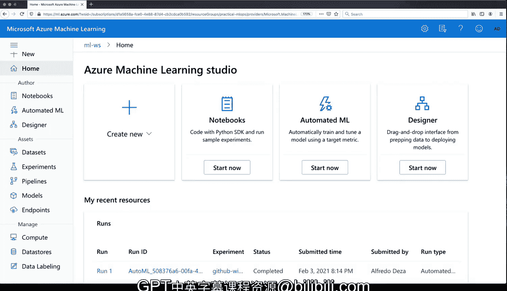

# 构建大规模云计算解决方案：3-4：Azure机器学习工作室简介 🧠

在本节课中，我们将学习Azure机器学习工作室（Azure Machine Learning Studio）的基本界面和核心功能。这是一个功能丰富的平台，用于构建和部署机器学习模型，尤其适合自动化机器学习（AutoML）任务。

---

## 界面概览

上一节我们介绍了课程背景，本节中我们来看看Azure机器学习工作室的界面。初次使用时，界面可能显得复杂，包含多个菜单和选项。

界面右侧是账户设置和订阅管理区域。订阅信息至关重要，因为后续使用SDK时，通常需要下载一个配置文件（config file）。这个文件包含了你的订阅、目录和工作区信息，是一个JSON格式的文件，可以在其他地方使用。

## 核心功能区

从主页（Home）开始，你可以执行多种操作。以下是主要功能区域的介绍。

**“创建新项目”（Create new）** 下拉菜单列出了所有可创建的项目类型，包括：
*   **Notebook**： 用于编写和运行代码。
*   **Automated ML run**： 创建自动化机器学习运行任务，这是本节课的重点。
*   **Pipeline**： 创建自动化的工作流管道。
*   **Data**： 管理数据集。

需要注意的是，某些功能入口存在重复。例如，你既可以通过“Create new” > “Automated ML run”来创建任务，也可以在左侧导航栏的“作者”（Author）部分直接点击“Automated ML”来完成相同操作。

## 自动化机器学习（AutoML）相关组件

对于自动化机器学习任务，有几个关键组件需要了解。

以下是AutoML工作流中涉及的核心组件列表：
*   **数据集（Datasets）**： 训练模型所需的数据。
*   **实验（Experiments）**： 创建新的AutoML运行后，对应的实验会出现在这里。
*   **模型（Models）**： 训练完成的模型会在此列出，你可以进行部署、下载等操作。
*   **管道（Pipelines）**： 这是一个类似于CI/CD的环境，用于创建自动化的步骤流水线以实现特定目标。

## 计算资源

最后，要开始训练模型，你必须配置计算资源。

在“计算”（Compute）部分，你需要创建**计算集群（Compute cluster）**或**计算实例（Compute instance）**，才能利用特定数据集开始训练，并最终获得训练好的模型。这是执行AutoML任务的硬件基础。

---

本节课中，我们一起学习了Azure机器学习工作室的主要界面布局和核心功能模块，包括账户设置、项目创建、AutoML相关组件（数据集、实验、模型、管道）以及计算资源的配置。理解这些部分是使用该平台进行自动化机器学习的基础。