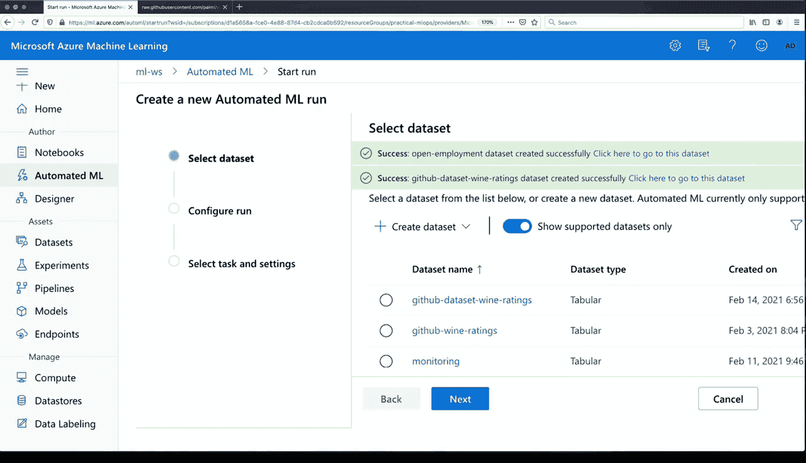

# 构建大规模云计算解决方案：3-4：在Azure机器学习工作室中创建数据集 🗂️

在本节课中，我们将学习如何在Azure机器学习工作室中创建数据集。这是进行自动化机器学习（AutoML）的第一步。我们将探索创建数据集的不同方法，并了解其核心概念和步骤。

## 概述

要进行自动化机器学习，首先需要一个数据集。Azure机器学习工作室提供了多种创建数据集的方式，包括从本地文件、数据存储、Web文件或开放数据集中导入。我们将逐步探索这些选项，了解如何配置和验证数据集，为后续的AutoML运行做好准备。

## 创建数据集的不同途径

上一节我们介绍了数据集的重要性，本节中我们来看看在Azure机器学习工作室中创建数据集的具体方法。

要开始一个AutoML运行，可以从左侧导航栏的“自动化ML”进入，然后点击“新建自动化ML运行”。或者，也可以直接在主界面点击“使用目标指标自动训练和调整模型”。这三种方式都会引导至相同的起点。

在开始之前，如果没有数据集，则需要先创建一个。创建数据集的入口清晰可见。

以下是创建数据集的几种主要方式：
*   **从本地文件**：上传已存在于您计算机上的文件。
*   **从数据存储**：使用已连接到工作区的云存储中的数据。
*   **从Web文件**：通过URL链接导入公开可访问的数据文件。
*   **从开放数据集**：直接使用Azure预置的公开数据集。

## 使用开放数据集

让我们首先尝试从开放数据集中创建。这种方式非常便捷，您可以直接搜索并选择所需的数据集。

例如，输入“employment”进行搜索，会出现相关的数据集选项。选择其中一个后，系统会自动为其命名并分配版本号（如`dataset version 1`）。版本管理功能很有用，如果您后续修改了数据集，可以创建新版本（如`version 2`）以跟踪变化。

选择好数据集后，点击“下一步”即可完成创建，过程非常直接。

## 从Web文件创建数据集

除了预置的开放数据集，您也可以从任何公开的URL链接导入数据，例如托管在GitHub仓库中的文件。

从“Web文件”选项创建时，需要提供数据文件的直接链接。例如，一个GitHub上CSV文件的“原始”(Raw)链接。在输入URL后，为数据集命名并添加描述。

**关键步骤**是选择是否跳过数据验证。如果不跳过，系统会尝试解析文件，让您在创建前预览和调整数据架构。

## 配置与验证数据集

当您选择不跳过验证时，系统会引导您进行数据集配置。

首先，需要指定数据格式。对于CSV文件，格式是“限定文本”，分隔符为逗号(`,`)，编码通常是`UTF-8`。您还可以指定是否使用文件第一行作为列标题。

配置完成后，Azure机器学习工作室会分析数据样本，并展示各列的推断类型（如字符串、整数、小数）。您可以在此界面检查数据，并决定包含或排除某些列。例如，如果某列（如`grape`）存在大量空值且对分析无用，可以选择将其删除。

确认所有设置无误后，即可完成数据集的创建。

## 总结

本节课中我们一起学习了在Azure机器学习工作室中创建数据集的全过程。我们了解到，数据集是AutoML的基石，可以通过多种源（本地、Web、开放数据集）导入。核心步骤包括选择数据源、提供访问路径、配置格式（如**限定文本，分隔符=‘,’**），以及进行必要的数据预览和列筛选。完成这些步骤后，我们就拥有了一个可用于启动自动化机器学习任务的数据集。