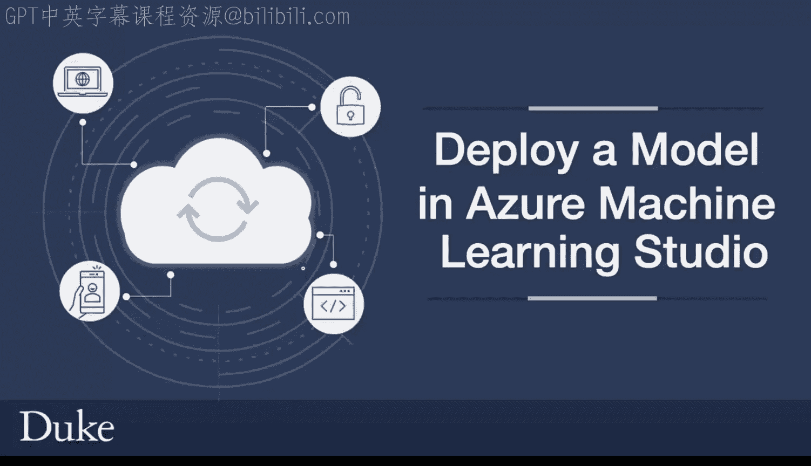
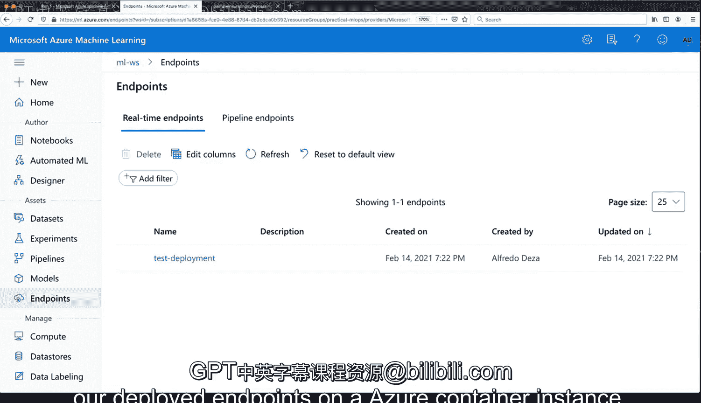

# 构建大规模云计算解决方案：3-4：在Azure机器学习工作室中部署模型 🚀

在本节课中，我们将学习如何在Azure机器学习工作室中部署一个已训练好的机器学习模型。我们将从查看一个自动化机器学习（AutoML）实验的结果开始，了解如何识别最佳模型，并最终将其部署为一个可供调用的实时HTTP API端点。

---

上一节我们介绍了如何运行自动化机器学习实验。本节中，我们来看看如何解读实验结果并部署最佳模型。

我们的AutoML实验仍在强劲地进行中。已经过去了几分钟。

这里有一个之前运行完成的实验。我们来查看一下。

我们将进入“实验”页面。这是我之前运行的同类实验。

你可以在这里看到大量信息，包括精确度指标和各种图表。

你可以获得不同类型的视图，可以保存视图，也可以进行一些调整。

让我们查看这个大约两周前完成的实验。

当当前的AutoML运行完成时，你会看到状态变为“已完成”。

你当然也可能看到“错误”状态，但你会获得重要且关键的信息，例如哪个算法效果最佳。

系统在幕后尝试了多种不同的算法，试图找出能为你提供最高准确率的那个。

在本例中，这是我们获得的最佳准确率。

这个准确率是由这个特定算法实现的。如果我返回或进入“模型”页面。

你会看到我们有许多不同的模型。

我们甚至有尝试过的、分好几页显示的模型。看，这是第一页。

你会看到这些，例如运行59。

所以你可以看到这个实验运行了59次，耗时11分钟、4分钟、5分钟不等。

这就是为什么这个过程耗时较长。它针对相同的数据集尝试不同的算法进行训练，试图找出最准确的那个。

让我们点击这个模型。它似乎是最佳准确率的模型。

这里有一个“解释”功能。解释功能可以运行，它会提供一系列指标。

我想你可以在这里探索数据集。看，这里有名称和索引。

我认为你可以更改这些内容，看，特征，我想说的是“葡萄”。

选择后，你可以看到其中一些内容（如索引）略有变化。索引是什么？

我认为那是编号。是的，没错，就像你的轴值。所以你可以操作这个功能，花上整整一个小时来探索数据集的方方面面。是的，指标。

看看那个准确率，这里有很多内容可以查看。有趣的是，如果我把这个调小。

你可以看到所有不同的图表。

我把它调大是为了在录制时更容易阅读。不仅如此。

如果我们回到模型页面，我们有这个“标准缩放包装器，LightGBM”，很好。你可能会说。

好吧，这很不错。我喜欢这个。现在，我该怎么做？哦，我可以部署。

让我们点击“部署”。我们来测试一下。

部署。使用Github数据集测试成功。

测试部署。我来操作一下。

计算类型你可以选择容器实例或Kubernetes。

Kubernetes允许你进行扩展。我们不需要那个，容器实例就可以。

你可以启用身份验证。我强烈建议你始终启用身份验证，否则如果有人发现了这个端点，它基本上会将这个模型发布到互联网上任人访问，如果有人访问并开始发送请求，你将产生费用。启用身份验证可以防止未经授权的访问。

高级设置。我通常不需要。启用应用程序洞察通常是个好主意，如果你想开始收集指标、进行调试并获取一些有用的信息。我将点击启用，这个设置你之后可以回来更改。

然后就这样了。你可以启用SSL或不启用。没问题。这样很好。我将部署它。

正在部署模型。这非常有用。部署需要一点时间。

但一旦部署完成，你就拥有了一个可以交互的实时HTTP API。

你可以发送请求，并且因为我们启用了应用程序洞察，你将获得所有这些图表。

所以图表将开始有数据点。我们之前在“实验”页面，然后去了“模型”页面。

现在我们正在生成端点。这就是我们接下来要在Azure容器实例上查看的已部署端点。

---

本节课中，我们一起学习了如何解读Azure机器学习工作室中AutoML实验的结果，识别出最佳性能的模型，并将其部署为一个安全的、可监控的实时API端点。这个过程涵盖了从模型评估到生产部署的关键步骤。