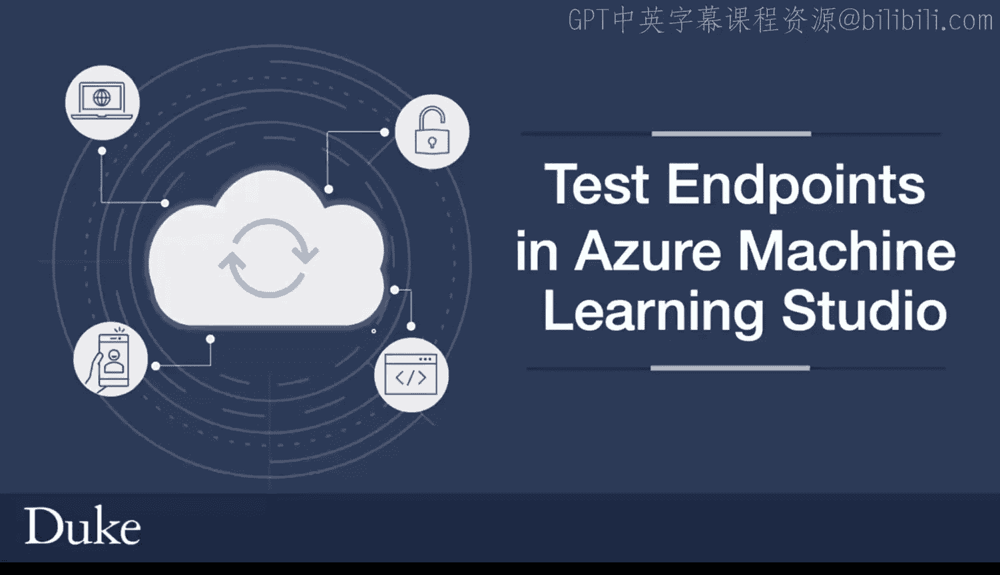
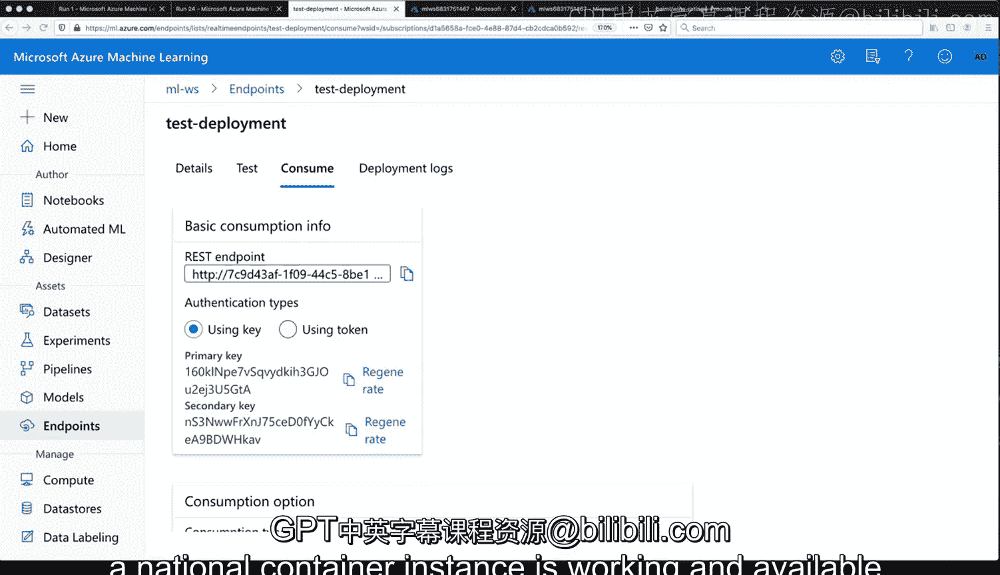

# 构建大规模云计算解决方案：3-4：在Azure机器学习工作室中测试端点 🧪

在本节课中，我们将学习如何在Azure机器学习工作室中测试一个已部署的模型端点。我们将了解如何访问端点、发送测试请求、查看响应，并利用Application Insights监控端点的性能。

---

上一节我们介绍了如何部署模型。本节中，我们来看看如何验证部署是否成功，并测试端点的功能。

我们已将模型部署到Azure容器实例（ACI）。现在，我们可以在“端点”部分找到它。点击“测试部署”选项，进入测试界面。

以下是测试部署的详细信息：
*   **计算类型**：我们选择了**Azure容器实例（ACI）**。
*   **REST端点**：这是一个完整的URL，用于通过HTTP请求与模型交互。
*   **身份验证**：启用了基于密钥的身份验证。
*   **Swagger URL**：此链接提供了如何与端点交互的API文档。
*   **Application Insights**：已启用，用于监控应用程序性能。

在深入细节之前，让我们先测试一下端点。在测试选项卡中，系统提供了一个示例输入值。

以下是测试步骤：
1.  在输入框中，我们可以修改示例数据。例如，将酒名改为“Alfredo‘s Red Wine”。
2.  点击“测试”按钮。
3.  查看返回的响应结果，其中包含模型的预测“分数”。

我们可以尝试输入不同的值，例如“Napa Valley”或“White Wine”，然后再次测试，观察预测结果是否会发生变化。通过这种方式，我们可以探索模型对不同输入数据的反应。

测试功能不仅限于此。我们还可以检查端点的授权机制。例如，尝试访问端点URL而不提供正确的API密钥，应返回“未授权”的错误信息，这证实了安全性在正常工作。

“使用”选项卡提供了多种与端点交互的示例代码，这非常方便。

以下是可用的代码示例：
*   **Python**：使用`requests`库发送POST请求的代码片段。
*   **R**：使用`httr`库的示例代码。
*   **C#**：使用`HttpClient`的示例代码。
*   **cURL**：直接在命令行中使用的命令示例。

这些代码片段已预填充了你的端点URL、API密钥和内容类型，可以直接复制使用。

此外，我们还可以查看部署日志。但更重要的是，我们启用了Application Insights进行监控。

我们可以在部署详情底部找到Application Insights的URL。点击该链接，将跳转到监控仪表板。

在Application Insights中，我们可以查看以下关键指标：
*   **服务器响应时间**：显示处理每个请求所花费的时间。在我们的测试中，平均响应时间约为279毫秒，表现良好。
*   **服务器请求数**：显示已处理的请求总数。
*   **可用性**：显示端点的正常运行状态。在我们的测试期间，所有请求都成功，没有失败。

这就是与Azure机器学习工作室中已部署端点进行交互和验证的完整流程。你可以通过工作室的测试界面快速验证，也可以通过提供的代码示例用编程方式调用，并利用Application Insights持续监控其性能和健康状况。

---

本节课中，我们一起学习了如何测试Azure机器学习工作室中的模型端点。我们实践了发送测试请求、解读响应、使用多种编程语言调用端点，并利用Application Insights监控其性能指标，确保部署的模型能够正常工作并可供使用。