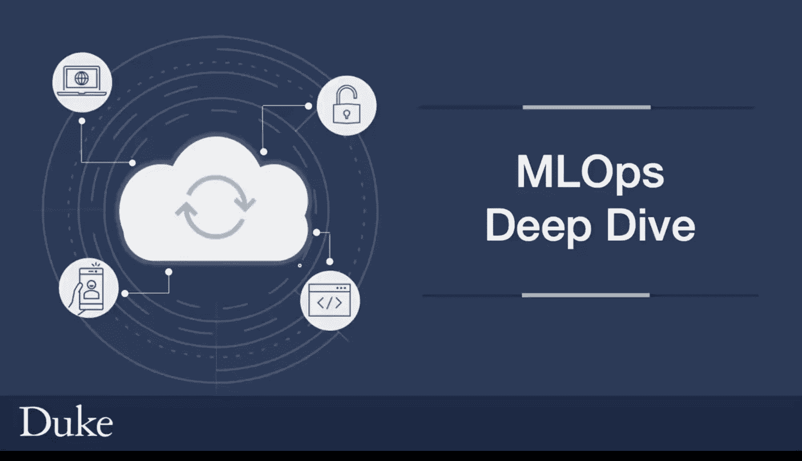
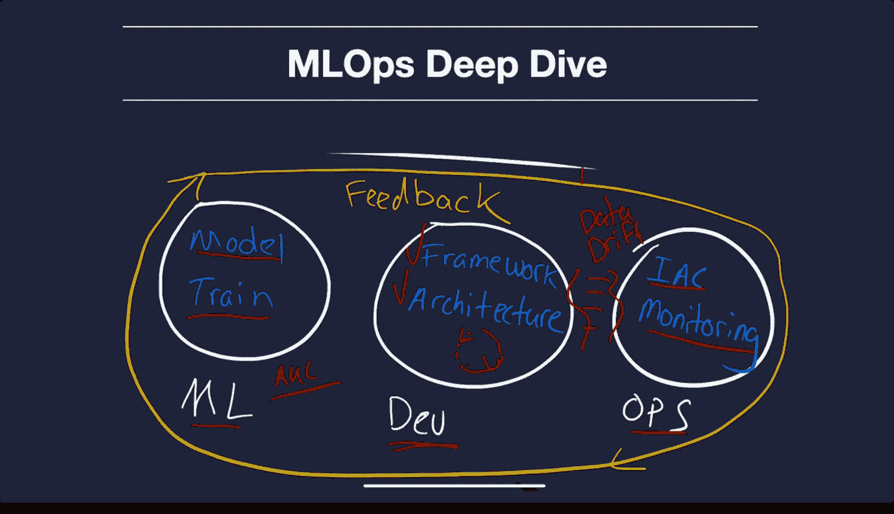

# 构建大规模云计算解决方案：3-4：MLOps深入解析 🚀

在本节课中，我们将深入探讨MLOps的核心概念。MLOps是机器学习、开发与运维实践的融合，旨在将机器学习模型高效、可靠地投入生产环境并持续维护。我们将解析其工作流程、核心组件及其重要性。

---

## 什么是MLOps工作流程？🤔

简而言之，MLOps工作流程是**机器学习**、**开发**和**运维**最佳实践的**组合**。正是这种组合使其既有趣又略显复杂。

通常，数据科学家会专注于建模或训练，确保模型具有可解释性并能准确进行预测。这可能涉及查看AUC（曲线下面积）等指标，并与领域专家一同验证模型是否确实在准确执行其预期任务。

然而，故事远不止于建模阶段。要将模型投入生产，还有更多工作要做，而这正是MLOps的核心：**我能否将其投入生产？**

---

## 开发组件：构建系统管道 🔧

为了将模型投入生产，需要一个开发组件。这时，MLOps实践者会介入，使用诸如Python Flask等框架，或审视基于AWS等云服务的架构，进而构建数据湖和用于来回传输数据的管道。

所有这些让系统像城镇供水系统一样流动起来的架构部分，是MLOps开发环节的关键组成部分。这确保了数据能够被有效地获取、处理和供给模型。

---

## 运维组件：部署与监控 🔄

当进入运维阶段时，意味着模型和框架已经开发完成，能够进行预测。但接下来面临的问题是：

*   你能否**重复地**将该模型部署到生产环境？
*   你能否检测到诸如**数据漂移**等现象的发生？例如，你上次训练模型可能是三个月前，而情况已经发生巨大变化，你该如何修复？

这关乎一个**反馈循环**。MLOps的本质正是将**机器学习**、**开发**和**运维**这三个核心能力组合成一个持续运行的反馈循环。

它并非静态的、一次完成即可置之不理。它需要像一个活的有机体，不断审视并确保你能让这个模型持续在生产中运行。

---

## 反馈循环的重要性与实例 🔁

一个很好的例子是为公司创造收入。如果你销售的是有时效性的产品，比如电影：电影在一段时间后会过时，如果大家都看过了，它就不会像刚上映时那样赚钱。

因此，你需要通过流媒体服务找到下一部电影推荐给用户。这就是一个反馈循环——一个持续的反馈循环。但你的反馈循环的好坏，完全取决于这三者（机器学习、开发、运维）的结合效果。

---

## 总结 📝

本节课我们一起学习了MLOps的核心理念。MLOps是一个新兴领域，本质上是**机器学习**、**开发**和**运维**实践的融合，旨在通过一个**持续的反馈循环**，将模型可靠地部署到生产环境并长期维护。对于组织而言，认真对待并实施MLOps至关重要，它能确保机器学习解决方案不仅被构建出来，更能持续创造价值。