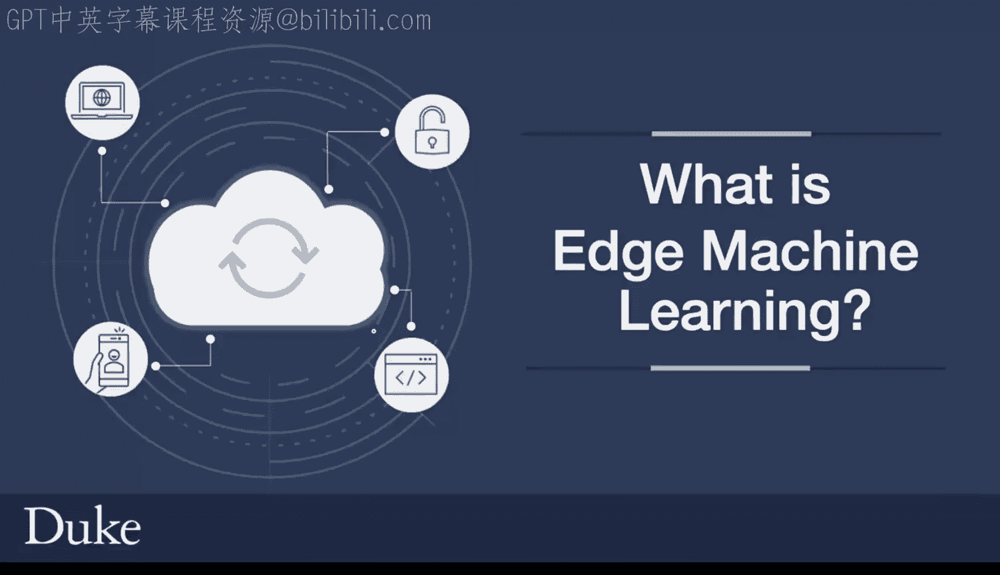

# 构建大规模云计算解决方案：3-4：什么是边缘机器学习 🧠

在本节课中，我们将要学习边缘机器学习的基本概念。我们将了解什么是边缘计算，以及它如何将机器学习模型直接部署到设备上运行，而无需依赖云端服务器。

---

上一节我们介绍了云计算的基本架构，本节中我们来看看机器学习的另一种部署方式——边缘机器学习。

边缘机器学习意味着在设备本地进行机器学习推理。其核心理念是，无需与云端或远程服务器通信来获取预测结果。设备自身已具备所需的一切。

以下是边缘机器学习的一个关键硬件示例：

*   **Coral TPU**：这是一个TensorFlow处理单元芯片。它允许你将一个小型机器学习模型部署到该芯片上，并直接在此边缘设备上进行预测。

这种专用芯片的硬件通常经过优化，能够以低功耗运行，并且在某些情况下，由于其专为并行处理而设计（无需处理复杂的用户界面和操作系统任务），其推理性能甚至可能超过台式计算机。

---

除了专用芯片，市面上还有许多集成了边缘计算能力的完整设备。以下是几个典型的例子：

*   **AWS DeepLens**：这是一款内置摄像头的设备。它支持Wi-Fi连接，背面可能配有HDMI端口用于输出信号。它允许你在设备上进行实时处理，例如物体识别或图像转换。
*   **AWS DeepRacer**：这辆小车本身就是一个边缘设备。你可以先在云端训练模型，然后将模型部署到该设备上。此后，这台边缘设备无需连接互联网即可自主运行。
*   **英特尔神经计算棒**：这是一个外形类似U盘的设备。你可以将其插入USB接口或集成到无人机中。该设备无风扇设计，噪音小、功耗低，便于在设备端直接进行预测。

---

那么，为什么我们需要在边缘进行机器学习处理呢？主要原因有以下几点：

*   **低延迟**：延迟可能是关键问题。例如，一架飞越山区的无人机，如果需要通过卫星或互联网与云端通信才能做出导航决策，一旦通信中断就可能导致坠毁。边缘计算使其能在本地芯片上直接处理导航任务。
*   **离线运行**：在无法保证稳定网络连接的环境中，边缘设备可以独立、可靠地工作。
*   **隐私与安全**：数据在本地处理，无需上传至云端，可以减少数据泄露的风险。
*   **节省带宽**：无需将大量原始数据（如视频流）持续传输到云端，节省了网络带宽。

边缘机器学习是一个新兴且持续发展的领域。花时间熟悉并掌握它非常值得，因为它代表了未来计算的一个重要方向。

---

本节课中我们一起学习了边缘机器学习。我们了解了其核心是在设备端直接进行模型推理，认识了如Coral TPU、AWS DeepLens等边缘硬件设备，并探讨了边缘计算在降低延迟、支持离线运行等方面的优势。