# 构建大规模云计算解决方案：3-4：AWS的边缘机器学习

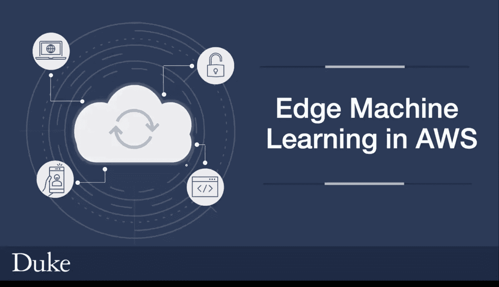

## 概述
在本节课中，我们将学习如何使用AWS的DeepLens设备进行边缘机器学习。我们将了解如何设置设备、部署预构建的机器学习项目，并探索如何将实时视频分析与AWS云服务集成。

---

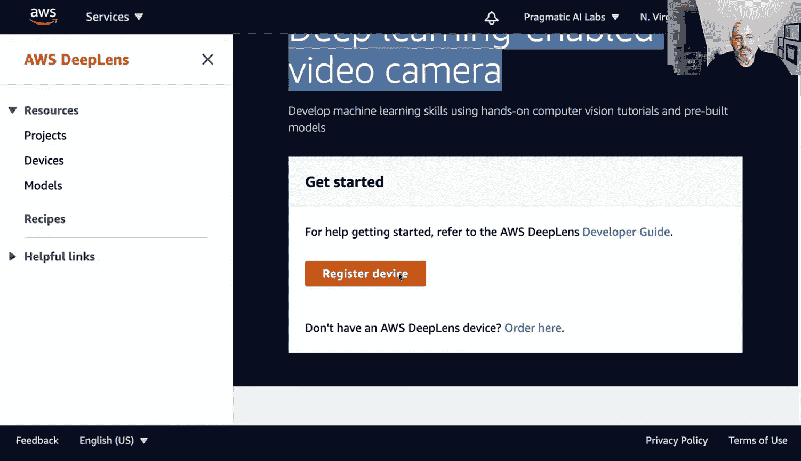

## 设备注册与项目创建

上一节我们介绍了边缘计算的概念，本节中我们来看看如何具体操作AWS DeepLens。

首先，你需要一台DeepLens设备。这是一款支持深度学习的视频摄像头。使用前，需要将其连接到电源并注册为AWS账户下的一个设备。注册是使用该设备的第一步。

目前硬件有V1.0和V1.1等版本，后续可能还会有更新。设备注册成功后，你可以在AWS控制台中看到它。

接下来，我们需要创建一个项目。AWS DeepLens提供了多种项目模板，类似于TensorFlow Lite生态系统，简化了开发流程。

以下是可用的项目模板示例：
*   **物体检测**：识别图像中的常见物体。
*   **艺术风格迁移**：将视频帧实时转换为特定艺术风格（如梵高画风）。
*   **人脸检测**：检测画面中的人脸。
*   **热狗识别**：专门识别热狗。
*   **猫狗动作识别**：识别猫狗及其动作。

对于初学者，从**物体检测模板**开始是一个不错的选择。当然，你也可以创建一个空白项目，从头开始构建。

## 项目部署与架构

我们选择了物体检测模板并创建了一个名为“September Object Detection”的项目。现在，我们需要将其部署到DeepLens设备上。

部署过程大约需要20秒。部署成功后，项目架构开始运行。其核心流程可以用以下伪代码描述：

```python
# 简化架构流程
while True:
    raw_video_stream = camera.capture() # 摄像头捕获原始视频流
    predictions = lambda_function.infer(raw_video_stream) # Lambda函数调用模型进行推理
    annotated_stream = annotate(raw_video_stream, predictions) # 用预测结果标注视频流
    output(annotated_stream) # 输出标注后的视频流
```

这个架构的关键在于，DeepLens设备不仅能在本地进行预测，还能与AWS云深度集成，利用云服务的强大能力，这是单独使用硬件设备难以实现的。

## 监控与输出查看

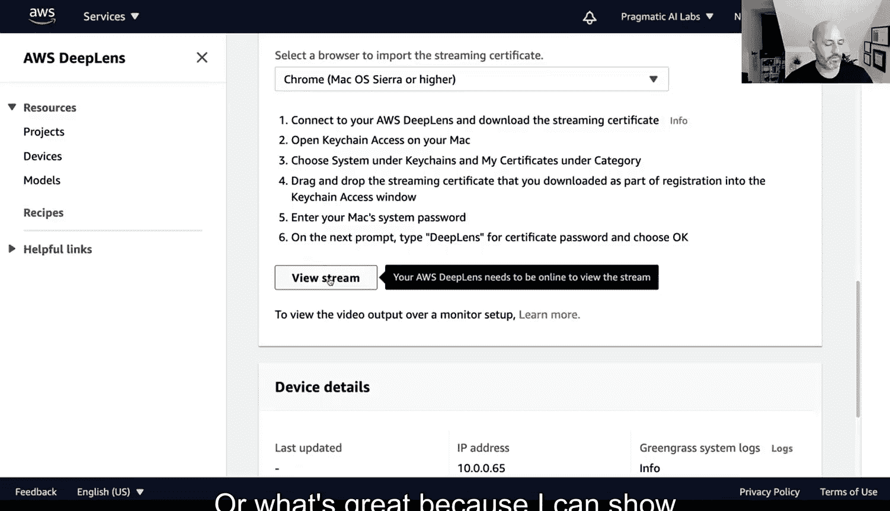

项目运行后，有两种主要方式来监控结果。

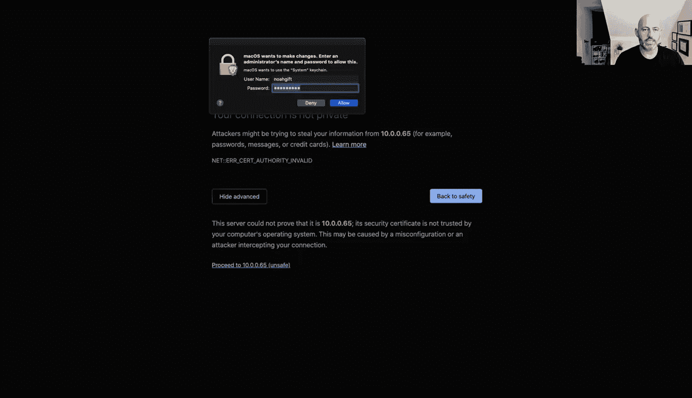

第一种方式是直接查看视频输出。你可以通过HDMI线将DeepLens连接到显示器，或者更方便地，直接在AWS控制台的浏览器中查看实时视频流。视频流会显示检测到的物体及其标签（例如“沙发”、“盆栽植物”、“人”）。

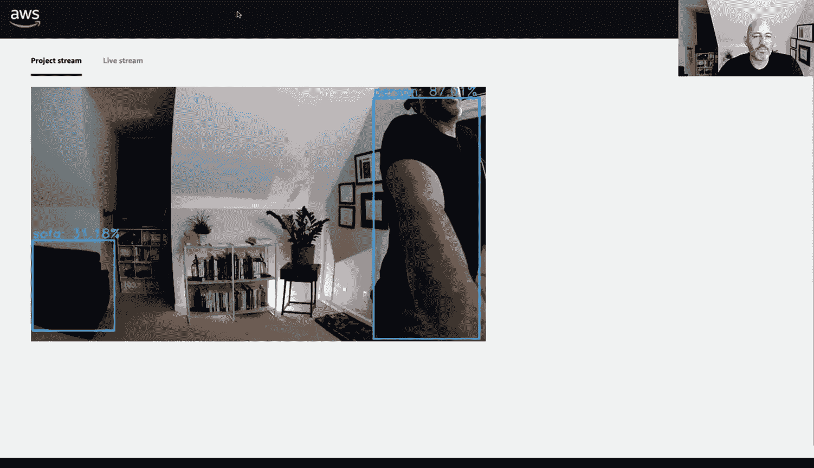

第二种方式是查看数据流。DeepLens可以通过MQTT协议，将检测到的标签和置信度等数据，以消息的形式实时发送到AWS IoT Core服务。

我们可以在IoT控制台的MQTT客户端中，订阅特定的主题来查看这些消息。当摄像头检测到物体时，相应的JSON格式消息就会实时显示出来。例如：

```json
{
  "object": "person",
  "confidence": 0.92,
  "bounding_box": [x, y, width, height]
}
```

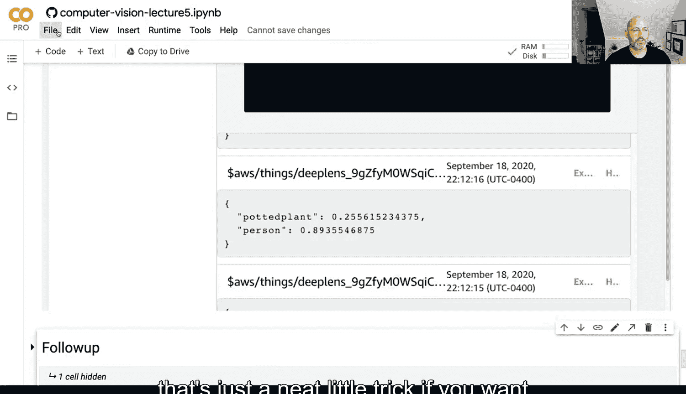

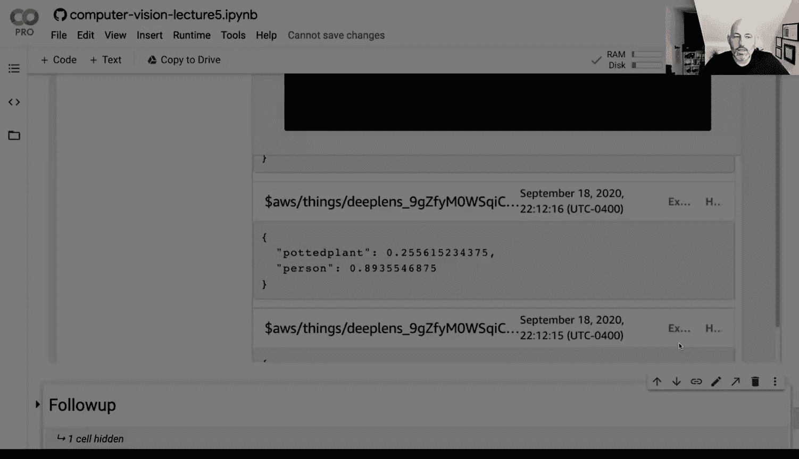

这意味着，你不仅可以“看到”检测结果，还可以用Python代码或其他服务订阅这些数据流，进行进一步处理，比如触发警报或记录日志。

## 项目自定义与深入探索

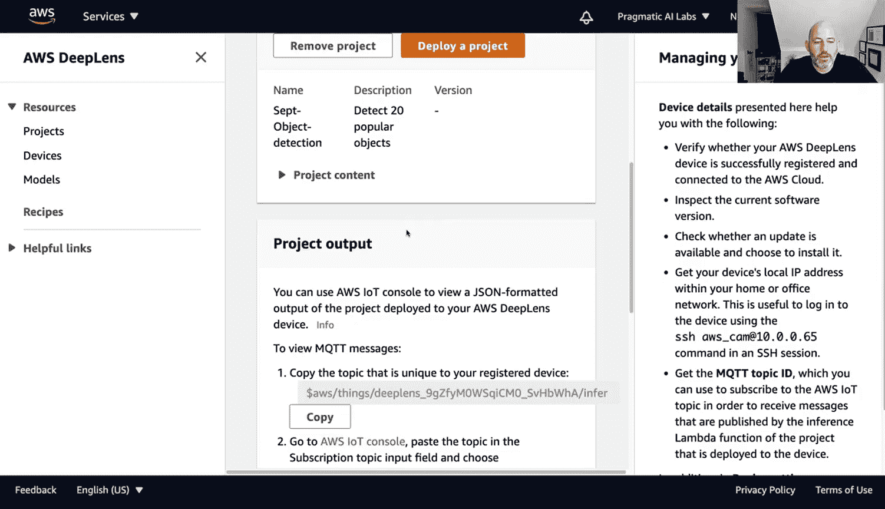

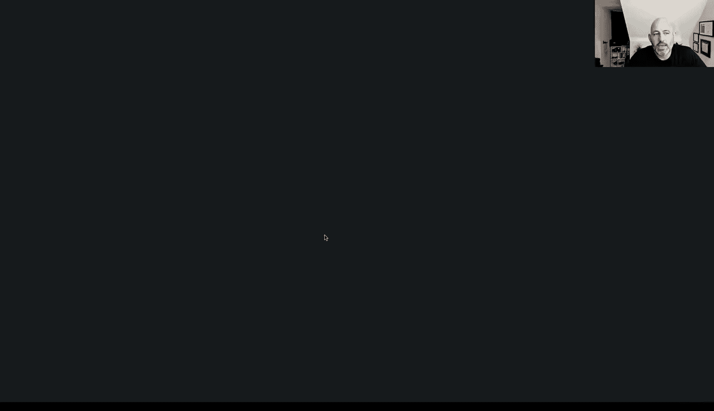

DeepLens项目的核心是一个AWS Lambda函数。部署模板后，你可以直接进入AWS Lambda控制台查看和修改该函数的代码。

例如，在物体检测项目的Lambda函数中，你可以找到定义检测标签的列表和主要的推理逻辑。你可以修改它来过滤特定物体，或者改变数据发送到IoT的方式。

更重要的是，项目所使用的机器学习模型存储在Amazon S3中。这意味着你有完全的自由度：
1.  你可以使用AWS SageMaker或其他服务训练自己的自定义模型。
2.  你可以利用本节课学到的知识，将其他框架（如PyTorch）训练的模型，通过ONNX或MXNet转换工具，转换成DeepLens兼容的格式。
3.  最后，更新Lambda函数中的代码和S3中的模型路径，即可部署你的自定义模型。

为了展示DeepLens的另一种能力，我们创建并部署了第二个项目：**艺术风格迁移**。这个项目不再进行物体识别，而是实时将摄像头画面进行风格化处理，使其看起来像指定的艺术作品（如梵高的《星夜》）。这展示了边缘设备在增强现实（AR）等场景中的应用潜力。

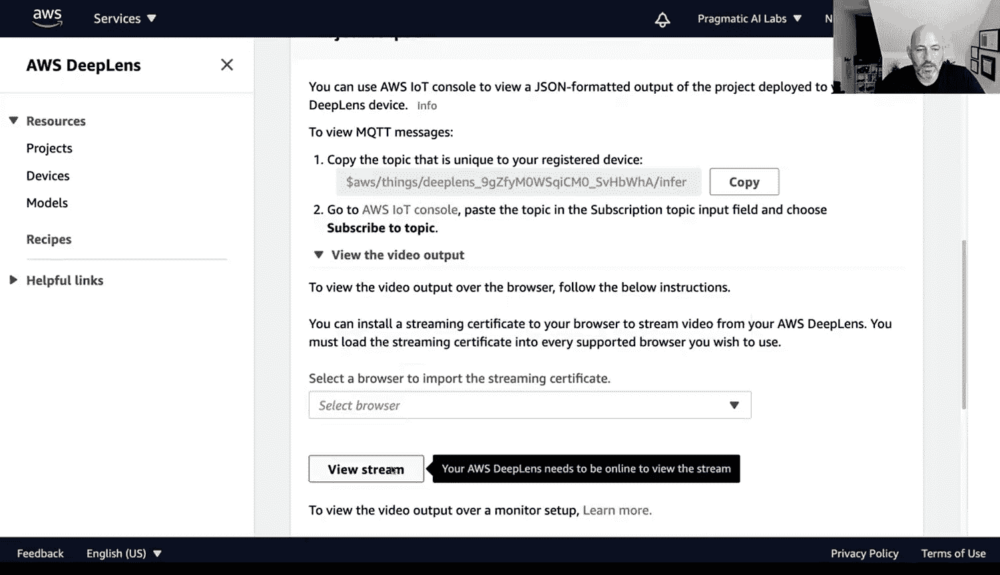

## 总结

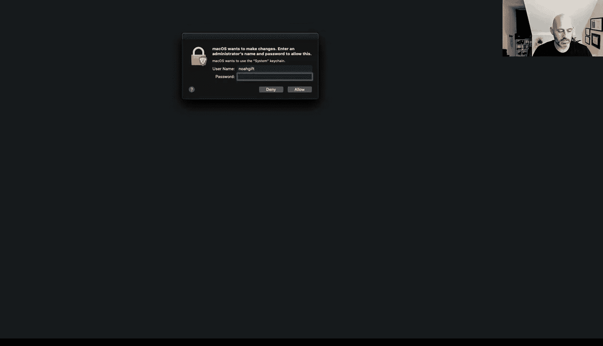

本节课中我们一起学习了AWS DeepLens边缘机器学习设备。我们从设备注册和项目创建开始，深入了解了其部署架构，它巧妙地将本地推理与云服务（Lambda， IoT Core， S3）结合。我们探索了两种监控结果的方式：实时视频流和IoT数据流。最后，我们认识到DeepLens项目具有高度可定制性，允许开发者替换模型和修改业务逻辑，并体验了风格迁移这种不同的计算机视觉应用。

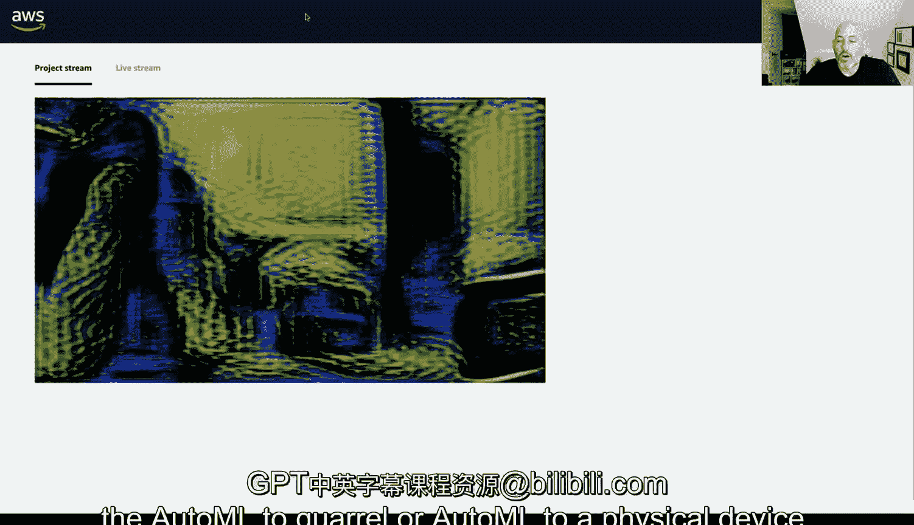

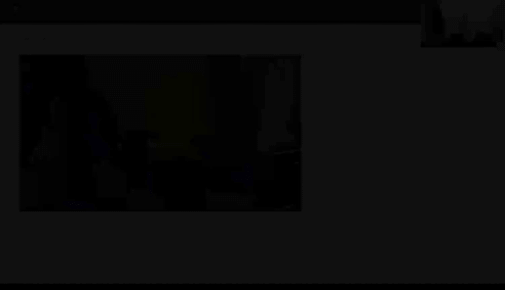

总而言之，进行计算机视觉开发有多种路径，包括使用像Coral这样的独立硬件。而一个高效的工作流可能是：使用AutoML等服务训练模型，然后将其优化并部署到DeepLens或Coral这类物理设备上，实现智能的边缘计算解决方案。