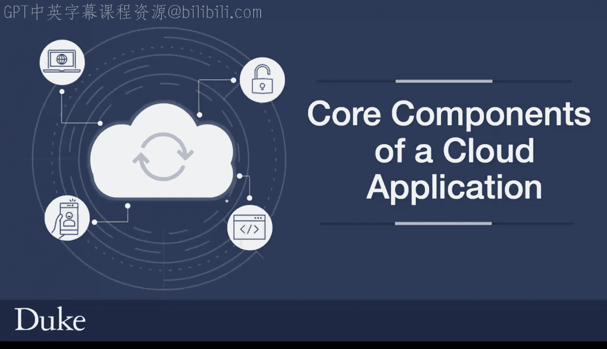
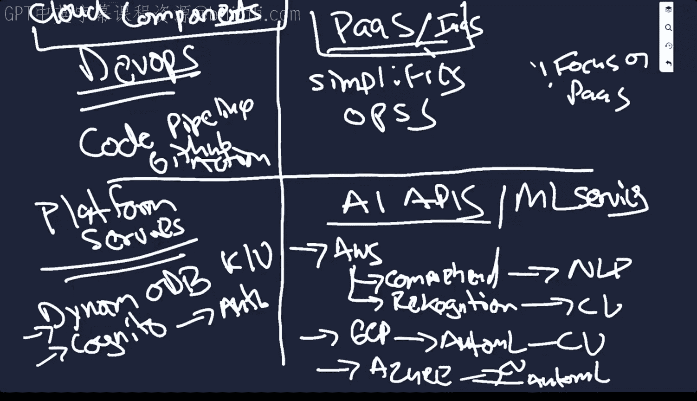

# 构建大规模云计算解决方案：3：云应用核心组件 🧱

在本节课中，我们将探讨云应用的核心构成组件，并了解如何有效利用云服务来构建应用，特别是针对数据工程和机器学习场景。

上一节我们讨论了平台即服务（PaaS）的优势。本节中，我们来看看构成云应用的其他关键组件。

## 核心组件概览

构建云应用时，可以将其核心功能分解为几个关键“桶”或类别。以下是每个类别及其作用的简要说明。

### 1. 平台即服务（PaaS）

PaaS的核心优势在于简化运维。公式表示为：**PaaS = 简化运维（Simplified Ops）**。它让开发者能更专注于代码开发，而无需管理底层基础设施。

### 2. AI/ML 服务

云平台提供了可直接调用的AI API和机器学习服务，这极大地加速了智能功能的集成。以下是各主流云厂商提供的部分服务：

*   **AWS**：
    *   **Comprehend**：用于自然语言处理（NLP）的Web服务。
    *   **Rekognition**：用于计算机视觉的服务。
*   **GCP**：
    *   **AutoML Vision**：用于计算机视觉的自动化机器学习服务。
*   **Azure**：
    *   **Computer Vision**：计算机视觉服务。
    *   **Azure Cognitive Services**：通用的自动化AI服务。

### 3. 平台服务

平台服务是用于支撑应用核心功能的基础服务，主要包括数据存储和用户认证等。

*   **数据库服务**：例如AWS的**DynamoDB**，它是一个高性能的键值数据库，非常适合存储和快速检索数据。代码示例可视为对NoSQL数据库的调用。
*   **认证服务**：例如AWS的**Cognito**，它提供了完整的用户注册、登录和访问控制功能。

### 4. DevOps与自动化

这一部分涉及持续集成和持续部署（CI/CD）工具链，用于实现代码的自动构建、测试和部署。

*   **示例工具**：AWS的CodeBuild、CodePipeline，或**GitHub Actions**等。

## 构建策略总结

本节课中我们一起学习了构建云应用，特别是AI/ML应用时，可以遵循的组件化策略。

你可以将这四类服务视为构建应用的“食材”：
1.  **基础平台**：优先考虑**PaaS**以简化运维。
2.  **智能功能**：从**AI API/ML服务**中选择所需能力。
3.  **数据与身份**：从**平台服务**中选择数据库和认证方案。
4.  **交付流水线**：利用**DevOps自动化**工具实现高效部署。

通过从这四个“桶”中各选取合适的组件进行组合，你就能像厨师搭配食材一样，快速、高效地构建出功能强大的云应用。