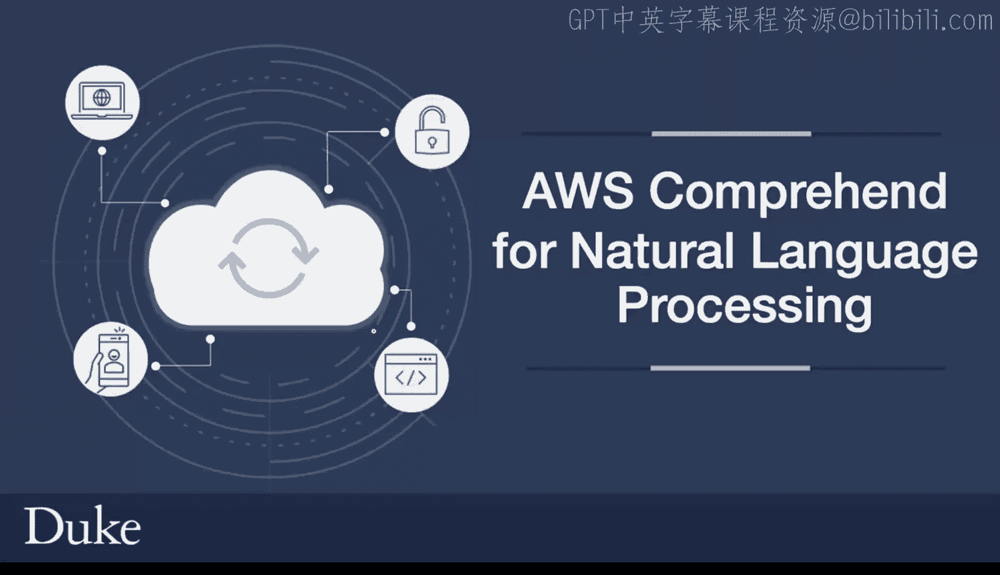
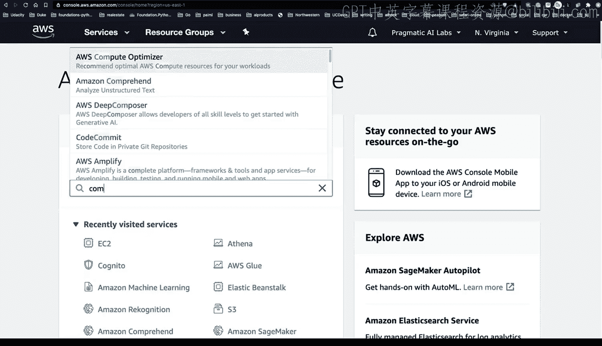
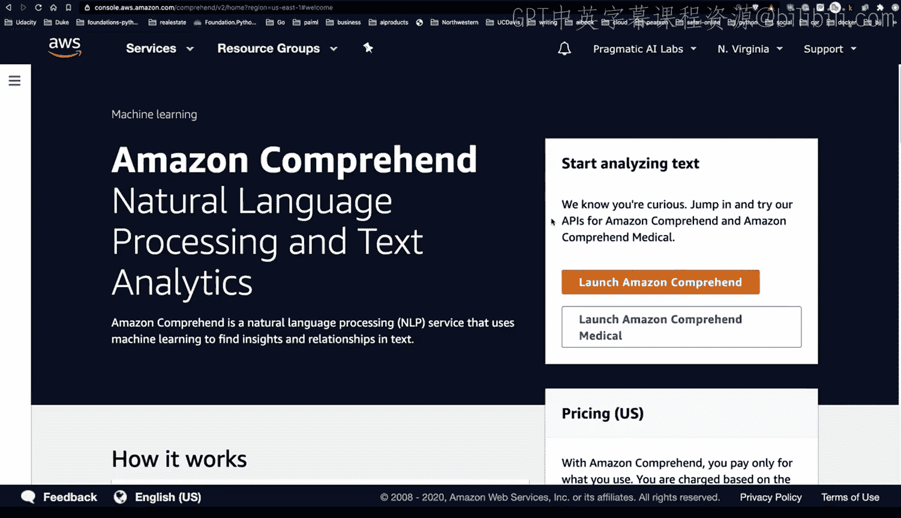
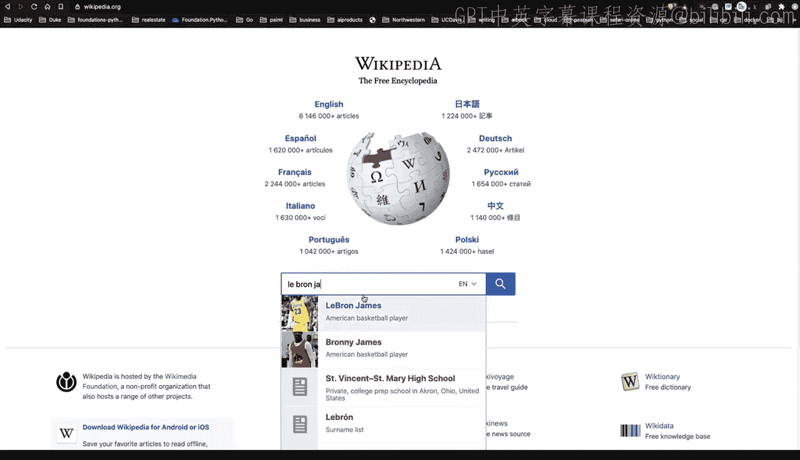
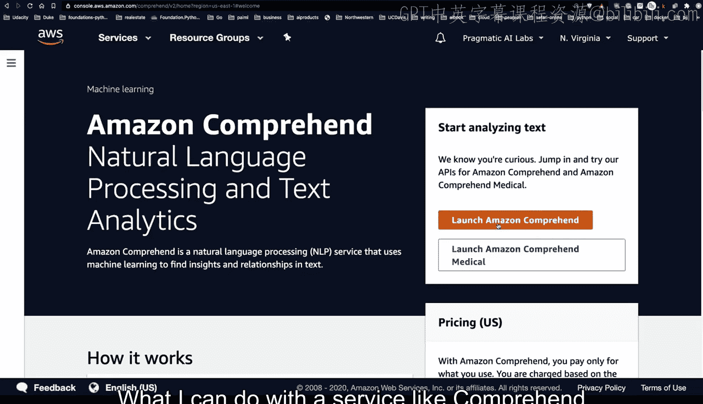
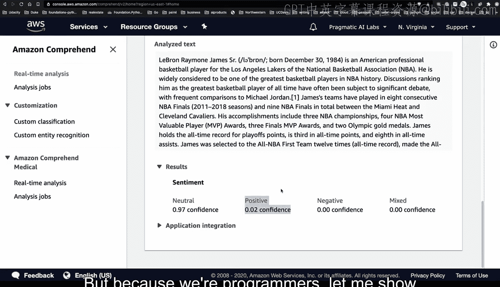
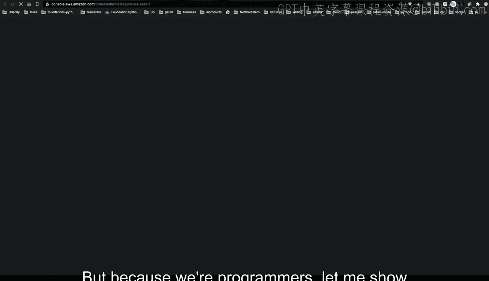
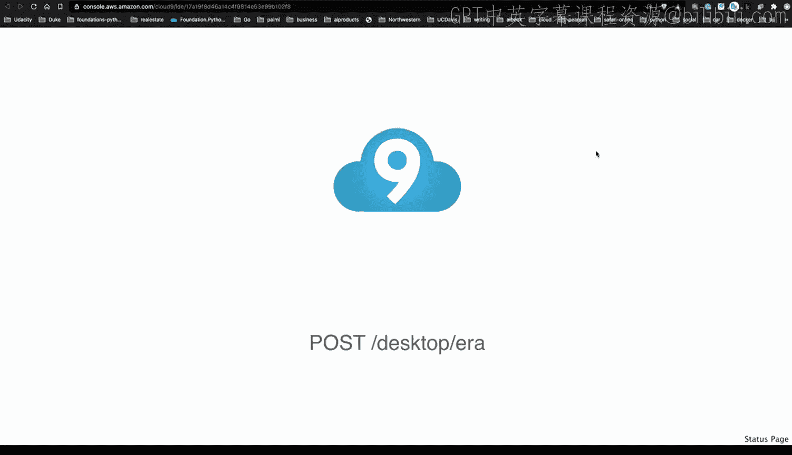
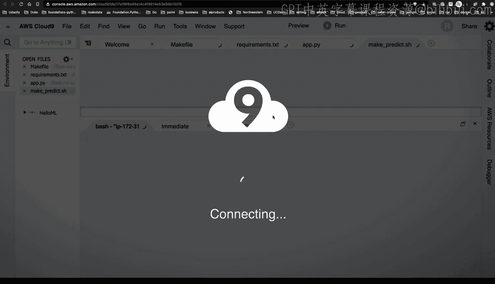
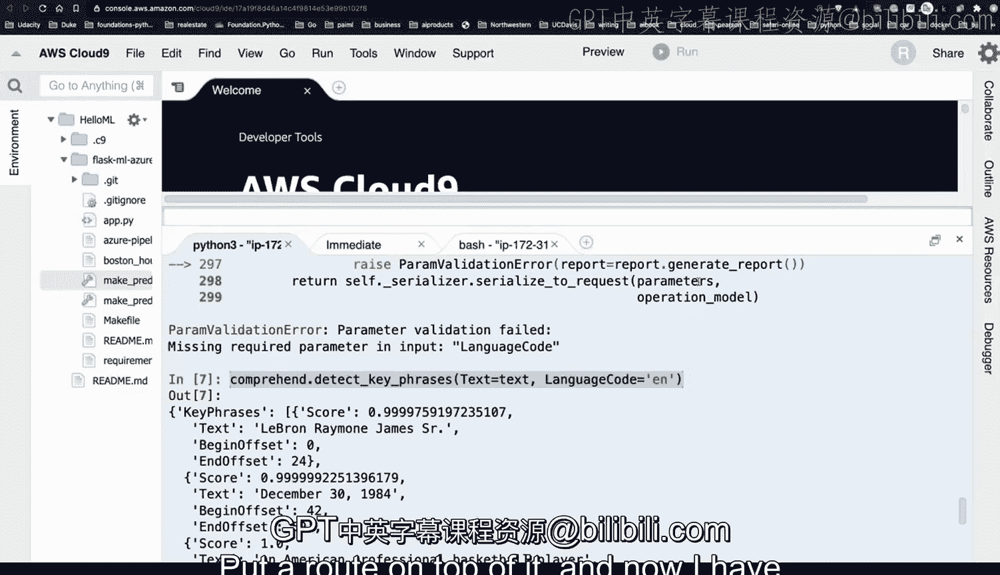

# 构建大规模云计算解决方案：3-4：AWS Comprehend 自然语言处理 🧠





在本节课中，我们将学习如何使用 AWS Comprehend 服务进行自然语言处理。AWS Comprehend 是一项完全托管的服务，无需训练模型即可从文本中提取见解。我们将通过控制台和编程两种方式来探索其核心功能。



## 概述



AWS Comprehend 提供预训练的 NLP 模型，可以执行实体识别、关键短语提取和情感分析等任务。本节将演示如何快速利用此服务分析文本。

## 通过控制台使用 AWS Comprehend



首先，我们通过 AWS 管理控制台来直观地了解 Comprehend 的功能。

登录 AWS 控制台并导航到 Comprehend 服务。该服务的 AI API 设计精良，使用便捷。

接下来，我将展示两种使用方式。假设我想分析维基百科上关于篮球运动员勒布朗·詹姆斯的页面文本。



我复制了该页面的一部分文本。对于 Comprehend 这类服务，我无需训练模型或进行复杂设置，只需将文本粘贴到控制台的“实时分析”功能中。



服务将立即为我进行文本分析。这非常强大，因为我不必自己进行复杂的高级 NLP 处理，可以直接利用 AWS 平台的能力。

在这个具体示例中，你可以看到它提取了**实体**（如人名、地点、组织）。我也可以选择提取**关键短语**。

这里列出了文章中的所有关键短语。我甚至可以进行**情感分析**。





结果显示这篇文章带有轻微的积极情感。这非常实用，因为我只需简单的复制粘贴操作即可获得分析结果。

## 通过 Boto3 编程使用 AWS Comprehend

上一节我们介绍了如何在控制台进行交互式分析。本节中我们来看看如何通过编程方式，在应用程序中集成 AWS Comprehend。

因为我们是程序员，让我展示如何在应用程序中实现并使用它。实际上，在应用中使用它相当简单。

我通常会从 Cloud 9 开始，我认为这是一个构建服务的绝佳环境。

如果使用 Boto3 API，可以轻松集成此服务。为了节省时间，我将使用一个现有的 Flask 应用程序示例。

我已经有一个现成的 Flask 应用程序。为了快速演示，我将在此环境中操作。

首先，我需要确保已安装 Boto3 库。Boto3 是 AWS 的官方 Python SDK，可以让你以编程方式控制几乎所有 AWS 服务。

使用 Boto3 的好处在于，它是通过编程控制 AWS 各项服务的核心方式。每个 AWS 服务都可通过 Boto3 调用。

以下是调用 Comprehend 进行关键短语检测的核心代码步骤：

1.  导入 Boto3 并创建 Comprehend 客户端。
2.  准备要分析的文本。
3.  调用 `detect_key_phrases` 方法。

以下是实现此功能的示例代码：

```python
import boto3

# 1. 创建 Comprehend 客户端
comprehend = boto3.client('comprehend')

# 2. 准备文本
text = """LeBron Raymone James Sr. is an American professional basketball player for the Los Angeles Lakers of the National Basketball Association (NBA)."""

# 3. 调用关键短语检测API
response = comprehend.detect_key_phrases(
    Text=text,
    LanguageCode='en'
)

# 打印结果
print(response['KeyPhrases'])
```

执行这段代码后，它会进行 API 调用，并从关于 NBA 的文本中提取出关键短语。

希望你能看到，这只是很少量的代码，仅仅几行。我可以将其放入一个 Flask 应用，为其添加路由，现在我就拥有了一个自然语言处理 API。

## 总结




本节课中我们一起学习了 AWS Comprehend 服务。我们首先在控制台通过粘贴文本的方式，体验了其实体识别、关键短语提取和情感分析功能。接着，我们通过 Boto3 SDK 以编程方式实现了关键短语检测，演示了如何将 Comprehend 轻松集成到自己的应用程序中。这展示了无需深厚 NLP 知识也能利用强大 AI 能力的便捷性。