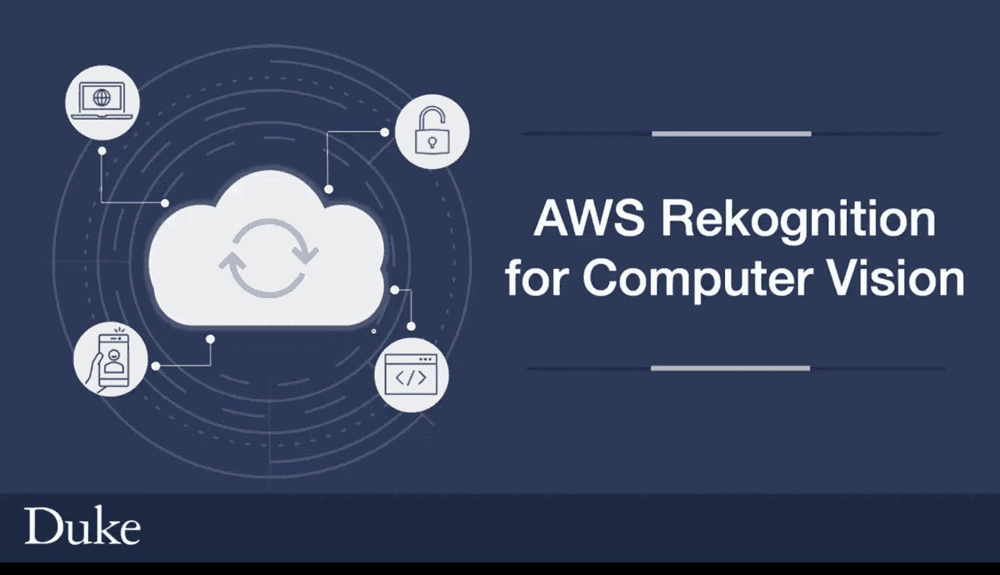
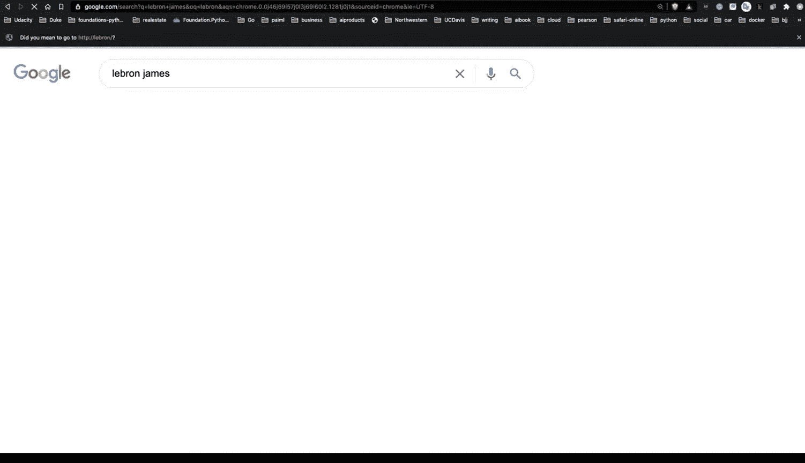
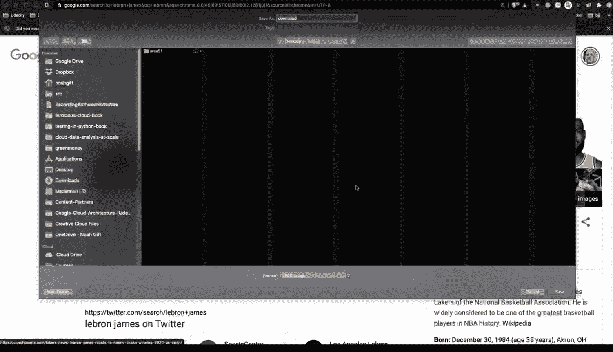
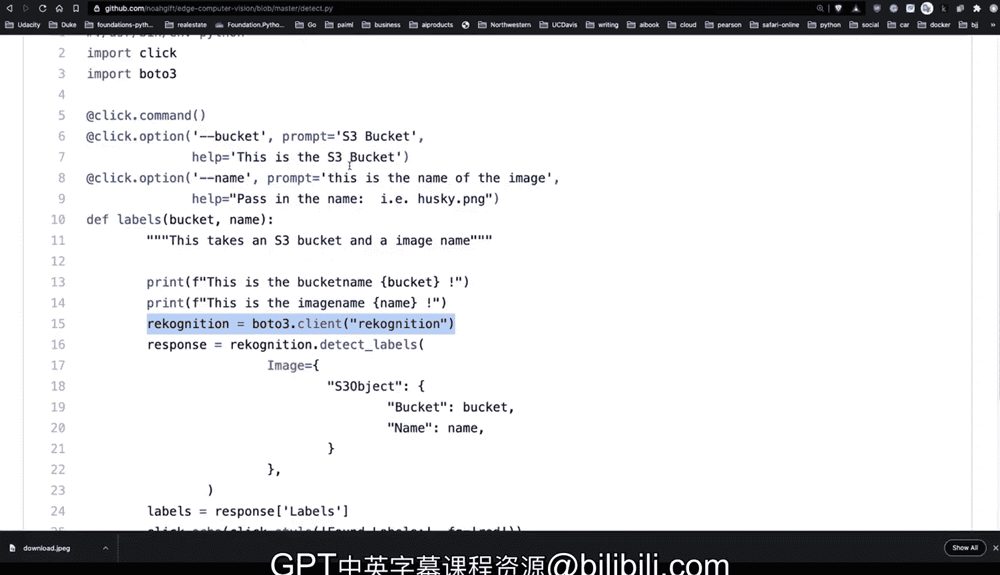

# 构建大规模云计算解决方案：3-4：AWS Rekognition计算机视觉服务



在本节课中，我们将学习AWS提供的计算机视觉服务——Rekognition。我们将了解其核心功能、使用方法，并将其与其他云服务商（如Google和Azure）的解决方案进行对比。

## 概述

AWS目前不要求用户上传自己的计算机视觉模型进行训练。但是，AWS提供了名为Rekognition的服务。通过Rekognition，用户可以非常便捷地上传和分析图像。

## 使用Rekognition进行对象与场景检测

接下来，我们来看看如何使用Rekognition进行对象与场景检测。



用户可以直接拖放图像到服务界面。例如，如果我们想尝试对象检测功能，可以上传一张像勒布朗·詹姆斯这样的图片。




选择图片后，返回Rekognition服务界面并上传。服务将返回对象检测的结果。


我们可以从结果中看到识别出的标签，例如：人物、团队、运动等。虽然AWS目前可能还没有最完整的自动化计算机视觉训练流程，但他们提供了这种便捷的上传识别功能。预计相关功能会很快完善。

## 通过API编程调用

除了网页界面，更重要的是可以通过API以编程方式调用这些功能。

用户可以通过API来调用视觉识别服务。例如，可以使用类似以下的代码结构（伪代码）：
```python
# 示例：调用Rekognition API进行对象检测
response = rekognition_client.detect_labels(
    Image={'Bytes': image_bytes}
)
```
在我的“边缘计算机视觉”相关代码中有大量此类示例。在AWS文档中也能找到很多编程调用案例。

## 与其他云服务商的对比

上一节我们介绍了AWS Rekognition的基本使用和API调用，本节我们来对比一下不同云服务商的计算机视觉解决方案。

以下是Google Cloud和Microsoft Azure的典型工作流程：
1.  **上传图像**至云端。
2.  服务自动**训练**一个定制化模型。
3.  用户可以直接**使用**训练好的模型，或将其**下载**到本地。

特别值得一提的是，Google的解决方案对**本地模式**有非常好的支持。

而AWS的方案则侧重于：用户将图像放入指定的S3存储桶中，然后服务对该存储桶中的内容进行**转换**和**标签检测**。




## 总结


本节课我们一起学习了AWS Rekognition计算机视觉服务。我们了解了其无需自定义模型训练、通过拖拽或API即可进行图像分析的核心特点，并通过对象检测实例演示了其使用过程。最后，我们对比了AWS、Google Cloud和Azure在计算机视觉服务上不同的侧重点和工作流程，认识到AWS方案在基于存储桶的批量处理方面具有优势。