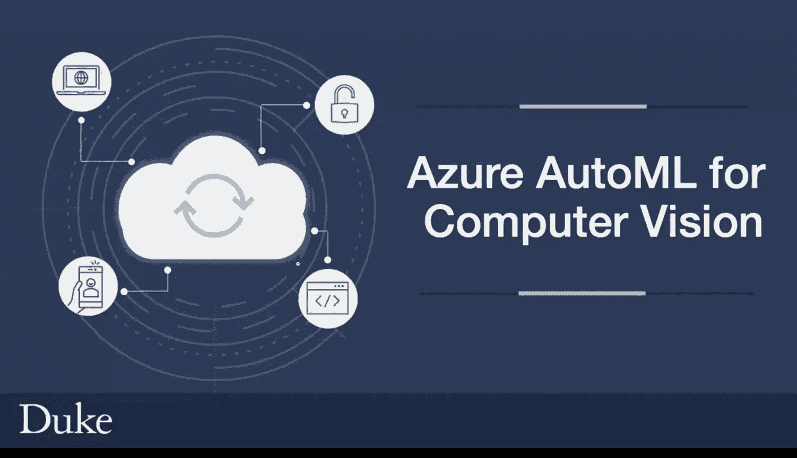
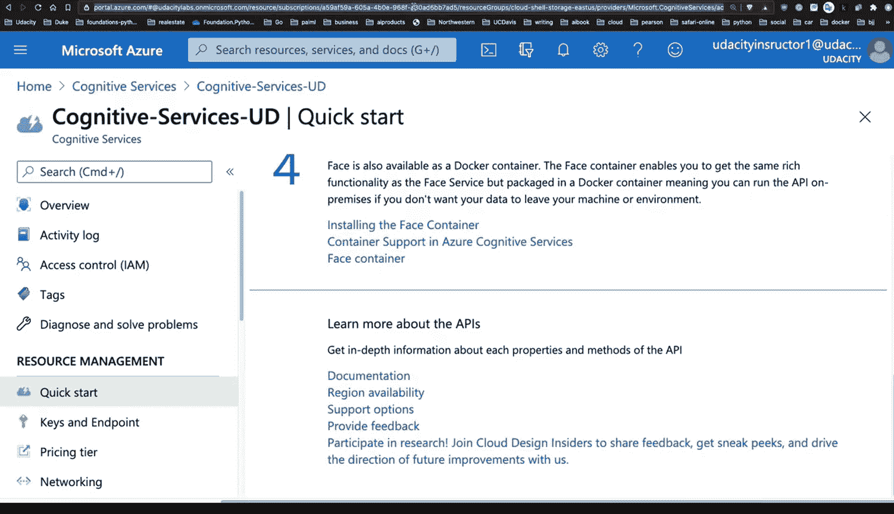
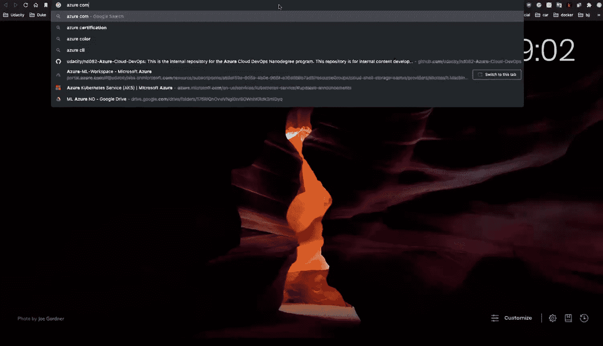
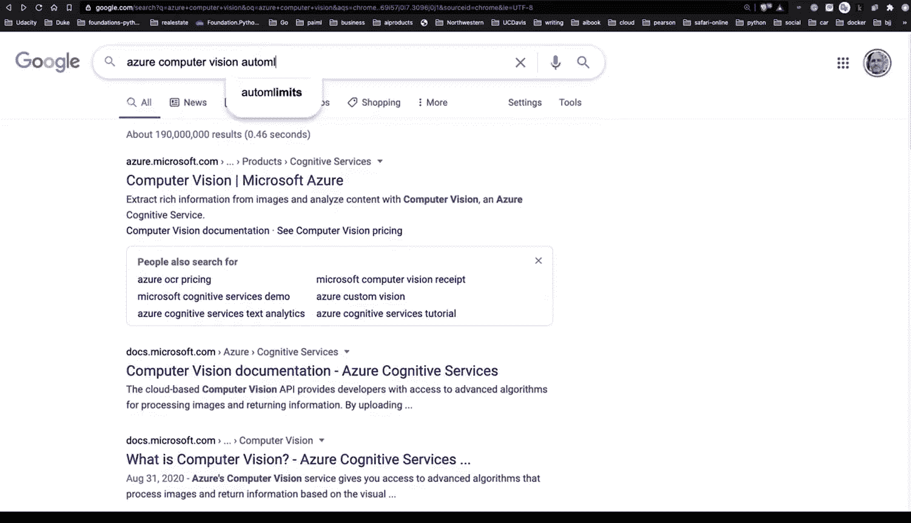
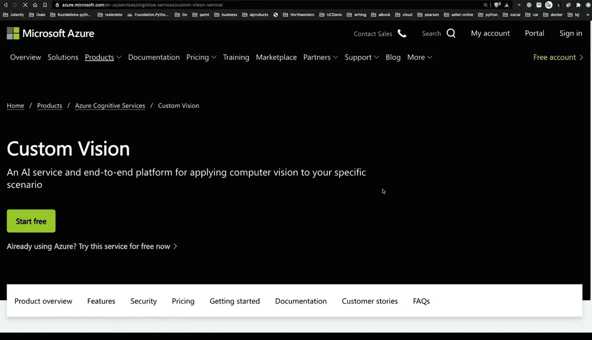
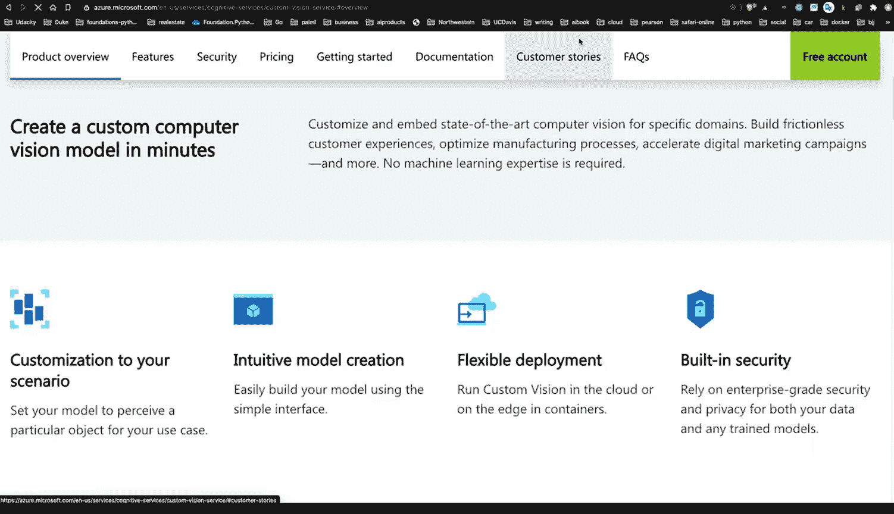
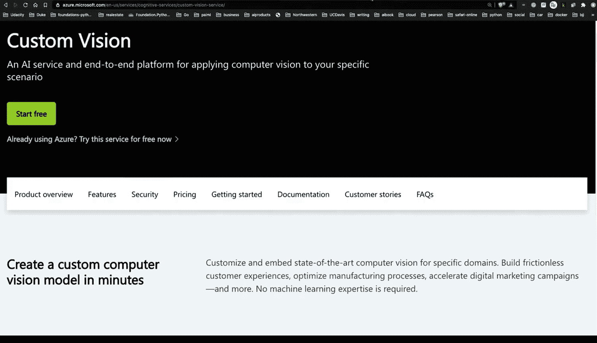
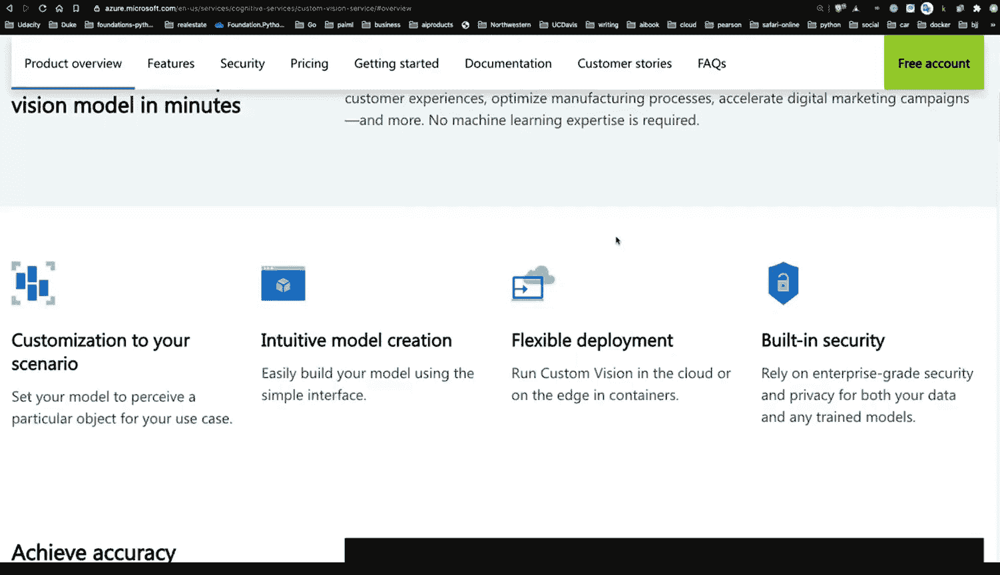
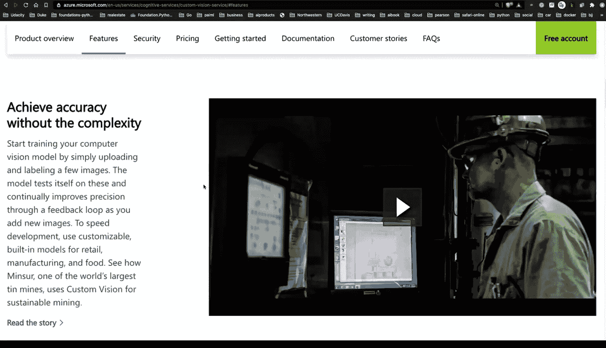

# 构建大规模云计算解决方案：3-4：Azure自动机器学习计算机视觉

在本节课中，我们将要学习Azure平台上的计算机视觉服务，特别是其“自定义视觉”功能。我们将了解它如何与之前介绍的Google Cloud服务类似，帮助用户无需深厚机器学习知识即可构建和训练图像识别模型。

## 概述

Azure提供了名为“认知服务”的套件，其中包含实现计算机视觉自动化的功能。这项服务允许开发者便捷地构建视觉AI模型。

## Azure自定义视觉服务

上一节我们介绍了云平台提供自动化机器学习工具的普遍概念。本节中我们来看看Azure的具体实现。

Azure的计算机视觉API服务中，有一个与Google Cloud的“自定义视觉”类似的功能，同样名为“自定义视觉”。该服务承诺能在数分钟内创建一个模型。

其使用流程与在Google Cloud上进行操作基本相同。

以下是使用Azure自定义视觉的核心步骤：
1.  创建模型。
2.  上传用于训练的图像数据。
3.  为图像添加标签。
4.  点击按钮开始训练模型。
5.  使用训练好的模型进行预测。

从界面来看，Azure自定义视觉与Google Cloud的服务非常相似。用户上传图像、进行标注，然后通过“训练”按钮启动模型训练过程，最后可进行预测验证。

## 总结

本节课中我们一起学习了Azure的计算机视觉服务。我们了解到，Azure通过其“自定义视觉”服务，提供了与Google Cloud类似的、流程化的图像模型构建与训练功能，使得自动化计算机视觉模型的开发变得简单高效。