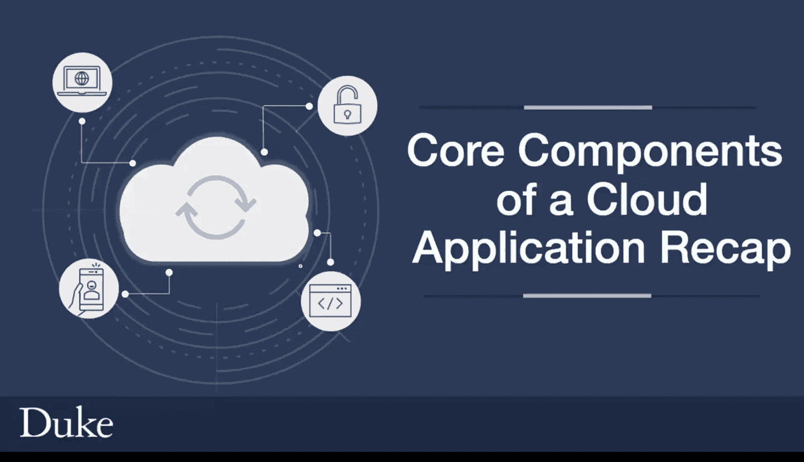
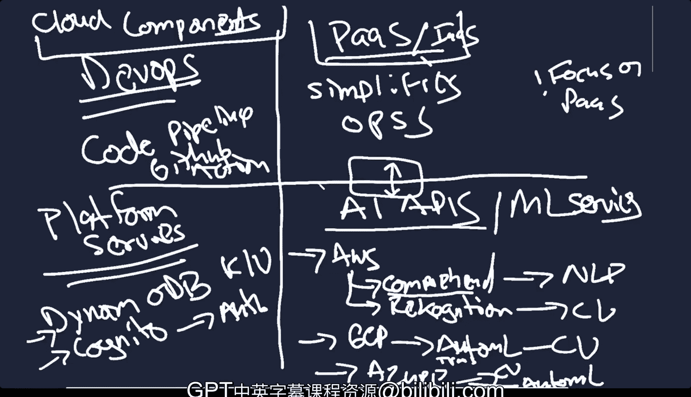

# 构建大规模云计算解决方案：3-4：云应用核心组件回顾 🧩

在本节课中，我们将回顾构建现代云应用，特别是机器学习应用时，所需的核心组件。我们将这些组件比作烹饪的四种关键原料，并了解如何将它们组合起来。

上一节我们讨论了云计算的宏观架构，本节中我们来看看构成具体应用的核心要素。

想象你是一位主厨。要构建一个功能完整的现代云应用，你至少需要准备好以下四种“原料”：

以下是构建云应用所需的四个核心组件列表：

1.  **DevOps**：这代表开发与运维的实践与工具链，用于实现应用的自动化构建、测试、部署和监控。
2.  **PaaS基础设施服务**：这是推荐的基础平台，它提供了运行应用所需的计算、网络和存储环境，开发者无需管理底层服务器。
3.  **AI API或高级服务**：对于机器学习应用，这指用于模型训练、推理或特定AI能力（如视觉、语言识别）的托管服务。
4.  **平台服务**：当你需要持久化存储数据时，应使用的数据库、数据仓库或其他数据管理服务。

在应用开发的初始阶段，你可以从PaaS和AI API开始。当你进展到需要存储和管理数据时，就应引入平台服务。

本节课中我们一起学习了构建云应用（尤其是机器学习应用）的四个核心组件：DevOps、PaaS基础设施服务、AI API和平台服务。理解并合理组合这些组件，是成功在云端构建和部署应用的关键。