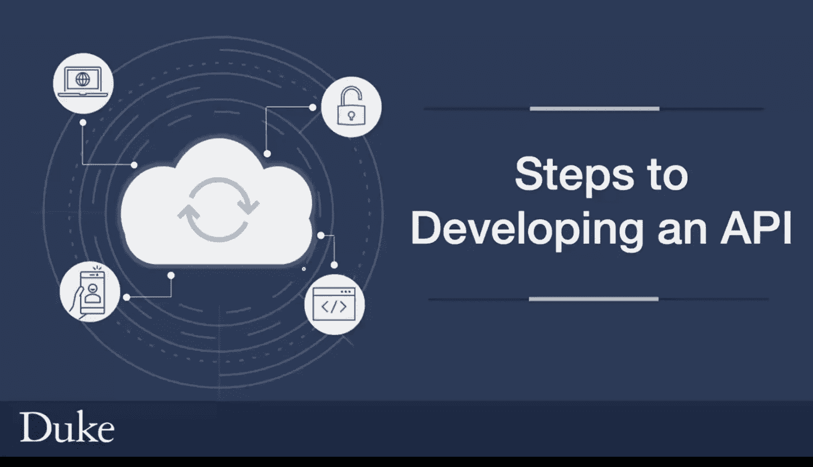
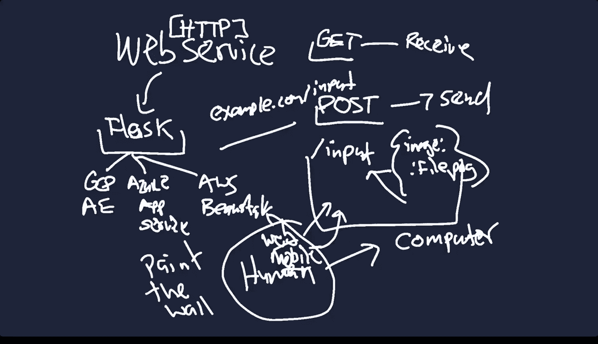
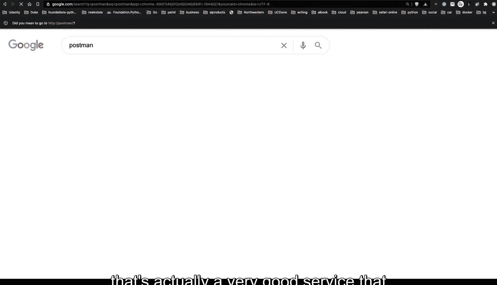
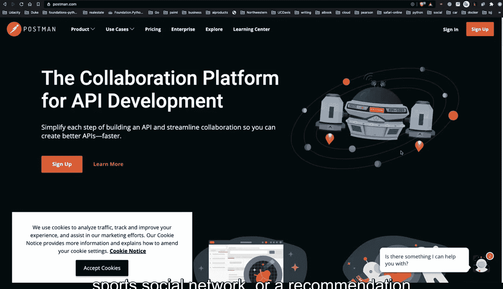
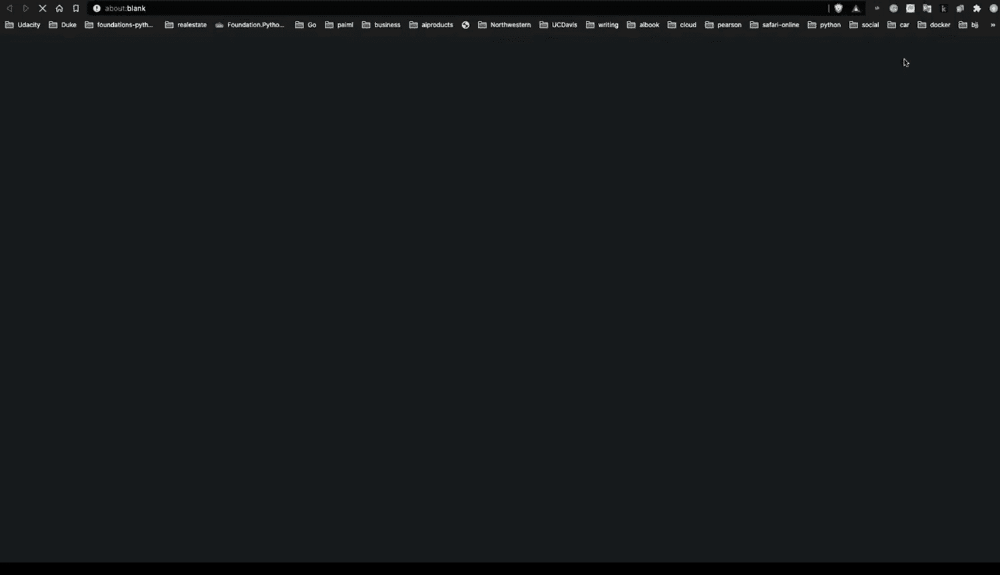
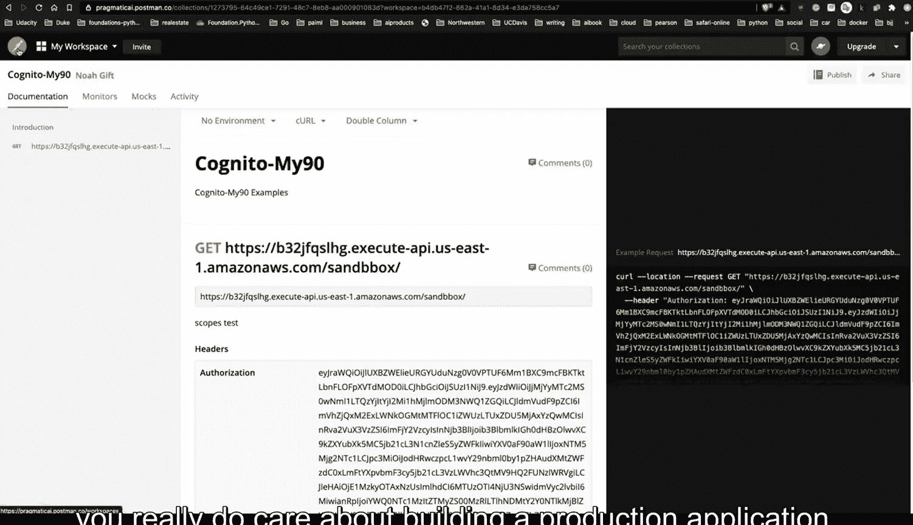
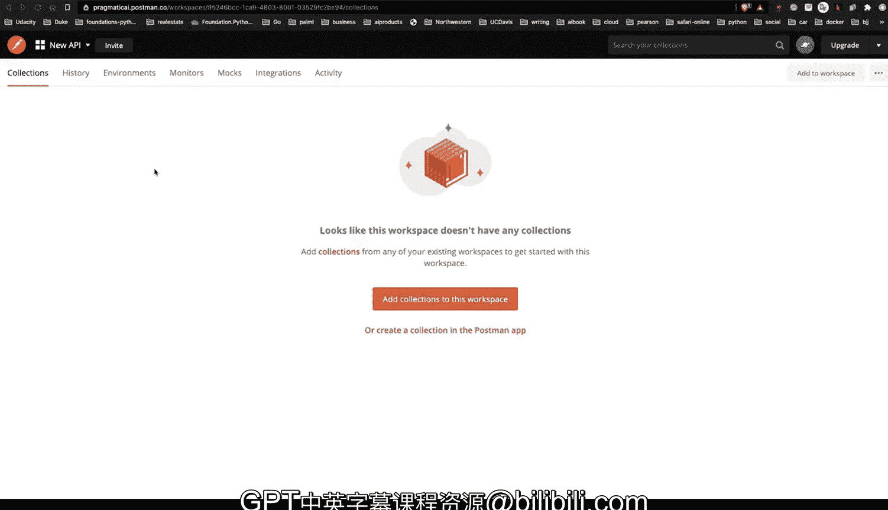

# 构建大规模云计算解决方案：3-4：开发API的步骤



在本节课中，我们将要学习如何为Web服务开发API，包括如何接收用户数据、如何部署服务，以及如何通过工具（如Postman）来测试和规划后端功能，而无需过早构建前端界面。

## 概述

如果你有一个Web服务，你如何将数据传递给用户，又如何处理用户的数据？在我的职业生涯中，我通常会构建一个Web服务。这个Web服务，正如我们刚才讨论的，可以基于Flask框架来构建。然后，你需要做的就是将它部署到某个平台上。

## 部署Web服务

上一节我们介绍了构建Web服务的概念，本节中我们来看看如何将其部署到云端。

你可以将服务部署到任何云平台上。以下是几个主要的部署选项：

*   **GCP**：通过App Engine部署。
*   **Azure**：通过App Services部署。
*   **AWS**：通过Elastic Beanstalk部署。

这些都是部署Web服务的优秀方式。

## 接收用户输入

部署好服务后，你可能会问，如何实际获取用户的输入呢？方法是为你的Flask服务添加一个POST方法。

这是一个HTTP Web服务。HTTP Web服务有几个与之关联的“动词”（或称方法）。动词是你可以对特定路由执行的操作。最常见的两个动词是**GET**和**POST**。

*   **GET**：意味着你将接收数据。
*   **POST**：意味着你将向Web服务发送数据。

要获取用户输入，你只需要在Flask中创建一个路由，并指定它只接受POST方法。例如，你可以创建一个路由 `/input`。用户将把内容“发布”到这个Web服务地址。

这个过程可以分为两个阶段来理解。

**第一阶段：计算机交互**

当你构建这类Web服务时，你实际上是在构建一个让计算机能与你的服务交互的接口。你告诉计算机，它将接收特定类型的JSON负载。这个JSON负载可以包含各种数据，例如一张图片。

```json
{
  "image": "file.png"
}
```

Web服务接收到这个图像后，可以将其传递给你正在进行的任何处理流程，比如图像识别。

**第二阶段：人类交互**

然而，普通用户通常不知道如何调用Web服务并放入JSON负载，因为这需要使用POST方法发送数据。因此，人们通常的做法是构建一个与后端交互的应用程序。

这个应用程序可以是网页，也可以是移动应用。无论是哪种形式，它们的作用都是“包装”那个输入端点。例如，应用程序会提供一个表单来提示用户输入数据，用户将数据填入表单后，表单数据会被发送到Web服务，服务处理后再将结果返回。



所以，关键的区别在于：你需要Flask服务来处理逻辑；之后，如果你想让人类用户与之交互，你还需要某种应用程序，比如我们讨论过的单页Web应用、iOS或Android应用。

## 开发流程建议







我的建议是采用以下开发场景：你完全可以先构建整个后端，在构建任何图形用户界面之前，就定义好所有的URL接口。我认为这样做实际上更好。

但如果你与业务人员合作，他们很多时候会强迫你先做界面，这实际上非常危险。他们会对“让网站或应用看起来漂亮”的部分感到兴奋，却不了解背后的技术顺序。这就像先粉刷墙壁，但如果顺序错了，你可能不得不拆掉墙壁来铺设管道。

因此，最好专注于明确你的应用程序要做什么，然后先定义和调用这些API端点。你可能知道有一个叫 **Postman** 的服务，它是一个非常好的工具，能帮助你组织开发步骤。



无论你是构建电子商务公司、体育社交网络、推荐引擎还是其他任何东西，如果你按部就班地开发，可以使用像Postman这样的工具。你可以用它来收集所有的API端点。例如，你可以模拟前端的行为，向这些应用发送请求（如cURL命令），而无需实际编写前端代码。你可以收集一系列这样的操作。

我的建议是，如果你正在构建一个产品级应用，并希望它成为一个软件即服务应用，你应该首先使用Postman这样的工具来规划和测试。你可以创建一个新项目，添加一个集合，然后在集合中定义各种路由并调用它们。我认为在初期使用Postman比直接构建前端或移动应用更好，因为这是“让它先工作”的阶段，你需要确保能够完整地测试和运行你的后端逻辑。

## 总结



本节课中我们一起学习了开发API的关键步骤。我们首先讨论了如何将基于Flask的Web服务部署到各大云平台。接着，我们深入探讨了如何通过POST方法和特定路由来接收用户输入，并区分了计算机直接交互与通过前端应用进行人类交互的不同场景。最后，我们强调了先定义和测试后端API、再构建前端的开发流程的重要性，并介绍了使用Postman工具来规划和测试API端点的最佳实践。遵循这些步骤，可以帮助你更稳健、高效地构建可扩展的云计算解决方案。