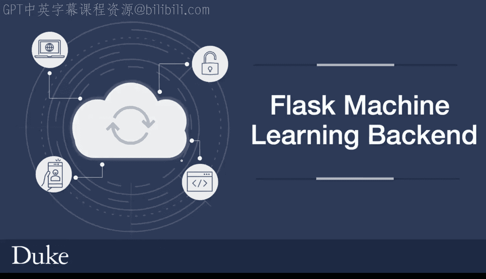
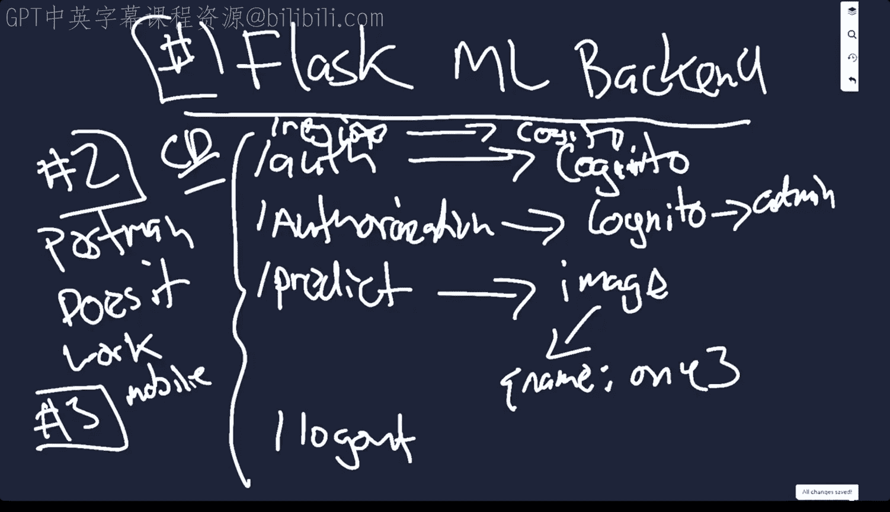
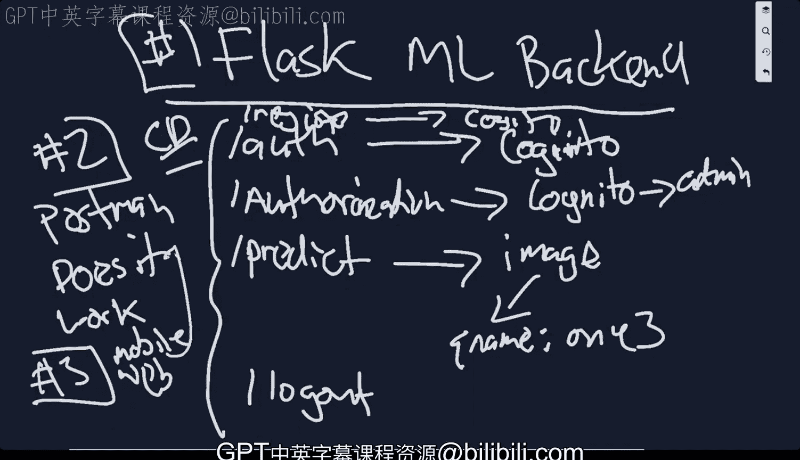

# 构建大规模云计算解决方案：3-4：使用Flask构建机器学习后端服务 🚀

在本节课中，我们将学习如何从零开始，为一个机器学习公司构建一个最小可行、可用于生产的后端服务。我们将以Flask框架为例，规划出核心的API端点，并讨论从后端到前端的完整开发流程。

## 概述

假设你需要从头构建一个机器学习公司。首要任务是确定需要构建的最小功能集合。一个基于Flask框架的后端服务是一个不错的起点。

## 第一步：规划核心后端端点 🏗️

上一节我们提出了构建后端服务的想法，本节中我们来看看具体需要哪些核心API端点。一个基础的机器学习后端服务至少需要以下几个端点。

以下是构建一个简单但功能完整的后端服务所需的端点列表：

*   **认证端点 (`/auth`)**: 此端点负责验证用户是否拥有有效账户。其实现可以与外部服务集成，例如 **AWS Cognito** 或 **Firebase**。用户通过此端点登录后，才能访问其他受保护的资源。
*   **授权端点 (`/authz`)**: 此端点与认证服务（如Cognito）协同工作，用于确定已登录用户可以访问哪些资源。例如，它可以区分普通用户和管理员（`admin`）的权限。
*   **预测端点 (`/predict`)**: 这是服务的核心功能端点。以手写数字识别为例，该端点接收图像作为输入，运行机器学习模型进行预测，并将结果（例如识别的数字名称，如 `"name": "1"`）返回给用户。
*   **注册端点 (`/register`)**: 允许新用户创建账户。同样，可以集成Cognito等服务来处理用户注册流程。
*   **登出端点 (`/logout`)**: 用于处理用户会话的终止。

通过构建这四到五个端点，你就拥有了一个可运行的后端服务。用户可以注册、登录、使用预测功能，然后登出。这是一个非常精简但可用于生产环境的后端架构。

## 第二步：使用Postman测试与持续交付 🔧

在第一步中我们规划了后端蓝图，本节中我们来看看如何确保其可靠运行。在着手开发任何前端界面（如单页Web应用或另一个Flask前端）之前，我的个人建议是：**不要先做那个**。

首先，你应该使用像 **Postman** 这样的工具来测试你的API。确保每个端点都能被正确调用，并且按预期返回结果。这是验证后端逻辑是否有效的关键步骤。

同时，第一步的实现过程隐含着另一个重要实践：**持续交付**。我们之前讨论过它的重要性。这意味着每次你提交代码时，都应该有自动化流程来检查代码风格、运行测试。我会将精力集中在这方面，虽然需要一些前期工作，但它能确保服务的稳定性和质量。

## 第三步：构建前端界面 📱

如果你已经完成了第二步，确保后端服务通过Postman测试并能稳定工作，那么就可以进入第三步：构建前端界面。

此时，前端可以是任何你想要的形态。事实上，有些公司甚至不优先考虑Web端。例如，微信（WeChat）就更侧重于移动端优先的策略。你可以选择开发移动应用，或者构建Web应用。关键在于，现在你拥有了一个坚实、可调用的后端服务，前端可以自由地通过API与之交互。

## 总结

本节课中我们一起学习了构建机器学习后端服务的三步法。首先，我们使用Flask规划了核心的认证、授权、预测等API端点。接着，我们强调了使用Postman进行API测试和建立持续交付流程的重要性，这是确保后端健壮性的关键。最后，在拥有可靠的后端服务之后，我们再根据需求选择开发Web或移动端前端界面。这个流程帮助我们从零开始，系统地搭建一个可扩展的机器学习应用。