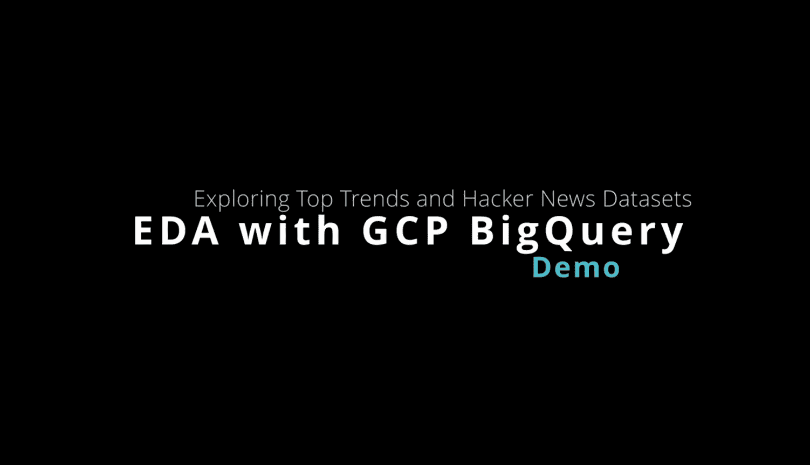
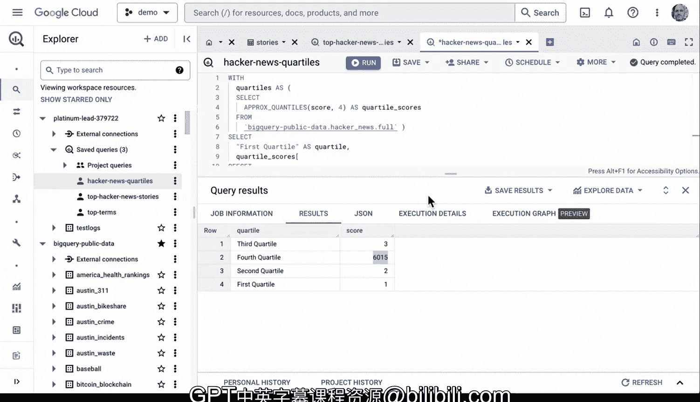

# 构建大规模云计算解决方案：3：探索Google BigQuery



## 概述
在本节课中，我们将学习如何使用Google Cloud平台上一个强大的数据探索工具——BigQuery。我们将从访问公共数据集开始，逐步学习如何编写查询、分析数据，并利用可视化工具进行更深入的探索性数据分析。

---

## 访问与探索公共数据集

BigQuery提供了多种便捷的入门方式，例如编写新查询、添加数据或上传本地文件。其中，利用公共数据集是功能最强大的方法之一。

我们以Google Trends数据集为例，这是一个理解如何使用特定数据的绝佳起点。

### 查看数据元信息
首先，通常需要查看该数据的元信息。可以看到，该数据集最后修改于2022年9月20日，是一个Google Trends数据集。

### 浏览数据结构
如果想查询数据，一个好方法是使用切换节点查看数据的不同部分。例如，我们可以查看“热门搜索词”相关的字段，如`term`（搜索词）、`weak_score`（周度分数）、`rank`（排名）等，以确定我们想要分析的内容。

实际上，如果直接选择`term`字段，BigQuery会自动尝试为我们生成一个查询。因此，我们无需做太多工作就能进行查询。例如，可以轻松查看该数据集中排名前10的热门搜索词。可以看到，由于湖人队正在参加季后赛，“Lakers”是目前非常热门的搜索词。

同样，我们也可以查看`score`（分数）、`rank`（排名）等其他字段。

---

## 编写自定义查询

接下来，我们可以开始编写一个能展示更多细节的查询。

我们将格式化一个查询，以更清晰地展示不同的热门搜索词。以下是查询步骤：

1.  使用`SELECT`语句选择`term`字段。
2.  将`refresh_date`作为主要日期字段。
3.  设置时间范围在`2023-04-01`到`2023-04-17`之间。
4.  将结果限制为100条。

此外，在“更多”选项中，我们可以格式化查询语句。如果你打算保存查询，这是一个好习惯。你可以将查询保存为“热门搜索词”或其他名称，并可以反复使用它。数据科学家可能希望定期运行此类查询，并只需稍作调整即可。

运行此查询后，可以看到在指定日期范围内的所有热门搜索词。我们可以查看历史上任何时期的数据，会发现人们关注着流行文化中的许多关键词。

---

## 深入探索数据

当你获得这样一个数据集后，一件有趣的事情是进一步探索数据。作为数据科学家，在构建机器学习模型之前，通常需要先查看数据，而不仅仅是执行SQL查询。这时，其他功能就派上用场了。

点击“探索数据”，会看到三个选项：

*   **电子表格**：在许多场景下，这是一个相当不错的选择。
*   **在Colab笔记本中打开并执行查询**：这也是一个非常好的选择。
*   **使用仪表板类工具查看**：例如Looker Studio。

让我们首先看看Looker Studio。进入Looker Studio后，它会提供一些默认查询，我们可以查看不同的字段和搜索词等，并从中进行查询。如果需要，我们还可以保存并分享这个分析报告。这为进行探索性数据分析提供了一个非常全面的解决方案。

---

## 探索其他数据集并组合数据源

除了我们已经展示的内容，接下来我们还可以查看其他数据集。

目前我们处于Google Trends的公共数据中，查看的是“热门搜索词”。那么，国际热门搜索词或热门上升搜索词呢？我们可以将已有的查询放入新窗口，保存并运行，例如运行一个“国际热门搜索词”查询，会得到与之前不同的结果。同样，我们也可以将其导入Looker Studio进行分析。

除了这个特定数据集，我们还可以查看其他数据集，发现新信息，甚至组合不同的数据源。

BigQuery中有许多可供使用的数据集，例如Google Ads、Google Cloud发布信息、政治趋势等。我们选择一个有趣的数据集来探索：Hacker News。

查看Hacker News数据集，可以看到它包含了自2006年以来Hacker News上的所有故事和评论。这是一个较小的聚合器，汇集了许多科技人士感兴趣的故事。该数据集最后修改于2022年9月20日，因此我们可以从中发现一些非常酷的信息。

### 分析故事数据
以故事数据为例。首先，查看数据模式（schema）总是很重要，以了解我们可能关心的不同字段名称。例如，`story_score`（故事得分）是一个好字段，可以了解历史上最受欢迎的故事及其得分情况。中位数得分、第25百分位数、第75百分位数等描述性统计信息在初次查看数据时非常有帮助。

因此，我们将查询这个字段。转到查询界面，在新标签页中，BigQuery会给出一个默认查询。但我们将从一个自定义查询开始：查看Hacker News上创建过的顶级故事。

查询语句如下：
```sql
SELECT *
FROM `bigquery-public-data.hacker_news.full`
WHERE type = 'story'
ORDER BY score DESC
LIMIT 100
```
我们可以格式化查询以确保语法正确，然后保存为“顶级Hacker新闻故事”之类的名称并运行。

这个查询结果更加丰富，如果我们想进行自然语言处理，这里有作者信息。得分情况也很有趣，可以看到有6000分、4000分，即使在前10名中，得分差异也很大，这看起来有点不寻常。

作为数据科学家，我们会注意到一个趋势：例如，“Stephen Hawking has died”（斯蒂芬·霍金去世）和“Steve Jobs has passed away”（史蒂夫·乔布斯去世）是有史以来最热门的故事之一。查看人们离开公司的故事，可能会发现某种特定的关注模式。如果我们查看更多故事，比如100条，可能会发现更多可以深入挖掘的信息，例如“Google searches dying”（谷歌搜索量下降）等非常有趣的故事。

---

## 使用可视化工具深入分析

让我们进一步探索这些数据。我们将再次运行查询，但这次只查看前10条结果，然后使用Looker Studio探索数据。

在这里，我们可以更深入地研究细节，查看特定字段或寻找操作数据的方法。例如，当前显示的是作者，但ID字段对我们没有意义。我们可能更关心“得分总和”。因此，我们可以更改查询，在可视化中获得不同的结果。

同样，如果我们想更改分组依据，可以将按ID分组改为按其他字段分组。通过这种方式，可以轻松查询不同字段并创建不同的可视化图表，并再次分享给其他人。

---

## 进行描述性统计分析

看到这些得分后，我们不禁思考：关于这个数据集，如果我们想创建一个预测模型，能知道些什么？得分之间是否存在线性关系？还是像幂律分布，即只有极少数故事非常受欢迎，而大多数故事并不受欢迎？

接下来，我们可以回到Hacker News查询，并创建一个查看四分位数的查询。这是一个有趣的探索。

我们将创建一个新查询窗口，计算第一四分位数（前25%）、第二四分位数（中位数）、第三四分位数和第四四分位数，以了解这个数据集的分布情况。

保存查询为“Hacker新闻四分位数”并运行后，得到的结果令人惊讶。

我们看到，就第一四分位数（前25%）而言，很多故事的得分都很低。中位数也非常低，即典型的故事得分。甚至75%的故事得分也只有3分。但在最高的25%（第四四分位数）中，只有极少数故事获得了非常高的得分。

因此，在创建模型时，尤其是在使用这些数据进行其他类型的预测模型（例如预测热门故事）时，可以考虑这些信息。

---

## 总结



本节课中，我们一起学习了如何在Google Cloud上使用BigQuery引擎入门。我们掌握了执行SQL查询、反复迭代修改查询，然后使用Looker Studio等工具进行可视化分析，最后保存结果并与团队其他成员分享的完整流程。这是开始进行数据探索和分析的强大方法。